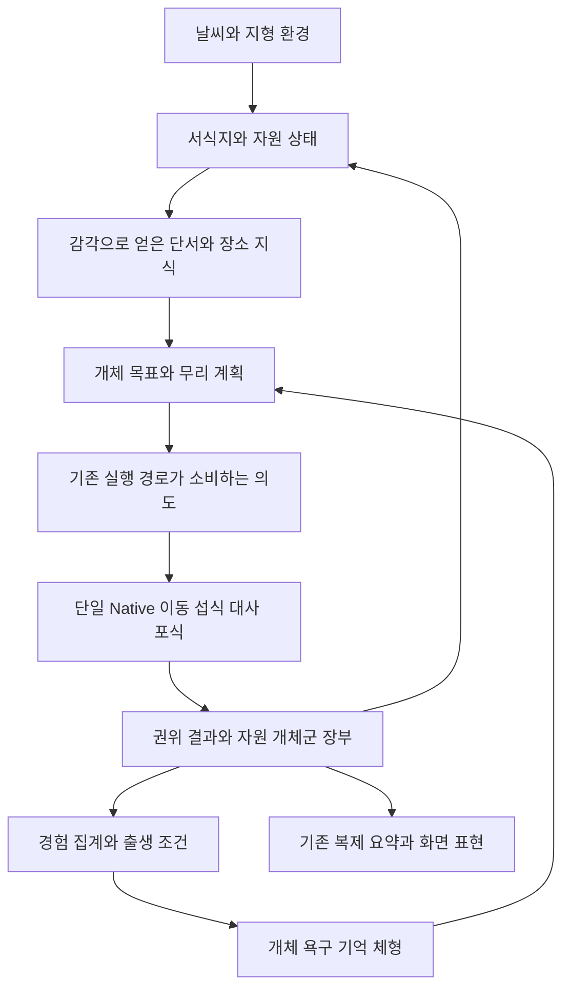

# MMORPG 동적 생태계 세부 기획과 확장 아키텍처

작성일 2026-10-23. 이 문서는 사용자와 구상한 환경·식생·몬스터·플레이어·개체 다양성·세대 변화를 하나의 구현 가능한 기획으로 세분화한 **제안 설계**다. 새 기능 구현·플러그인 활성화·정책 계약 변경의 완료 기록이 아니다. 현재 구현은 [최신 인수인계](../조연우/JYU_CHAT_HANDOFF_20261023.md)와 Source를 따른다. 제시한 자료형·주기·임계값은 별도 표시가 없으면 제안이며 확정 성능이나 생물학적 재현성을 뜻하지 않는다.

목표는 플레이어가 없어도 환경·자원·포식·이동으로 변화하고, 플레이어 활동도 그 안에 영향을 주는 MMORPG용 생태계다. 공간의 먹이·은신·수분·위험, 개체의 욕구·기억·체형, 무리의 공동 목표가 상호작용한다. 모든 가능한 현실 현상을 구현하는 대신 행동의 원인과 결과가 연결되고 게임에서 읽히는 수준을 목표로 한다.

## 1 설계 결론과 현재 구현 경계

| 영역 | 확인한 현재 기반 | 이번 문서가 제안하는 확장 |
|---|---|---|
| 권위와 이동 | Server/Standalone 권위, Native 단일 이동·대사, 기존 Mass/Bubble | 기존 경로에 typed 의도/결과를 연결. 두 번째 이동·자원 writer 금지 |
| 자원 | Native FFoodGrid와 M4 Register/Commit/AdjustSpatialFoodHabitat 장부 | 식물 패치·수분·외형을 같은 자원 소유자에 연결 |
| 감각과 Social | Sight/Hearing/Memory, ReadSignal v1, Herd·Alarm·Shelter | 상황별 경험, 증거 기반 추적, 장소 선호. 후각은 초기 범위에 넣지 않음 |
| 이주 | owned 맵 Barren↔Forest 공동 여정·실제 지역 인계 | 장소 평가·자원 예상 수요·출생/서식과 연결. 추가 경로는 별도 검증 |
| 늑대 사냥 | EcoThreatModel/EcoWorldV3에 PackPeek/PackGoals 등 협동 규칙 존재 | 기존 규칙 감사 후 탐색·흔적·역할/실패 계약으로 확장. 협동을 처음부터 미구현이라 하지 않음 |
| 체형 | Core/EcoDataContracts.h에 BodyScale/LegScale 등 과거 자료형 존재 | 검증된 유전·성장·표현 경로. Legacy LLM Evolution 자동 활성화 금지 |
| 출생·세대 | 기존 스폰 예약/완료 API 존재. v3 wave 비활성 유지 | 출생 스폰·혈통·출생 예산·집단 분석 시계. API 존재만으로 구현 완료 아님 |

근거 Source: [Native 세계](../../Source/AdaptiveEcosystem/AI/Policy/EcoWorldV3.h), [포식자 규칙](../../Source/AdaptiveEcosystem/AI/Policy/EcoThreatModel.h), [생태계 API](../../Source/AdaptiveEcosystem/Ecology/EcologySimulationSubsystem.h), [공간 먹이 장부](../../Source/AdaptiveEcosystem/Ecology/EcologySpatialFood.cpp), [감각](../../Source/AdaptiveEcosystem/AI/Social/Senses/EcoSensoryTypes.h), [기존 체형 자료형](../../Source/AdaptiveEcosystem/Core/EcoDataContracts.h). 현재 통합 기본 SocialControl=0, ShelterSafe=1/ProtectedRefuges=1과 기존 맵 이주 OFF·owned 이주 맵 ON을 유지한다. 이번 작업에서 새 UBT/PIE 검증은 하지 않았다.

## 2 공통 아키텍처

기능마다 새로운 전역 매니저·Actor Tick을 만들지 않는다. 아래 책임을 기존 World/Ecology/Mass/Native/Representation 계층 안에서 모듈과 데이터 계약으로 분리한다. 한 런타임 모듈을 유지하며 새 Subsystem이 필요하면 실제 수명·공유 서비스 요구로 판단한다.

공통 처리 단위는 관측 Snapshot, 의도 Request, 실제 Outcome, 장부 Receipt다. 이벤트는 발생 사실과 제한된 관측 증거를 구분한다. EventId/WorldEpoch/Step/Sequence로 중복을 막고, 원인 시각과 전달 시각을 따로 둔다. 로그는 전체 상태를 영구 복제하는 저장소가 아니라 제한된 진단 기록이다. 정식 저장은 snapshot+필요한 변경 기록으로 설계한다.

서식지 질의는 거대한 단일 점수장이 아니라 지형 셀/패치의 안정 ID, 인접 그래프, 자원·수분·차폐·위험 레이어를 조합한다. 개체는 그중 자기 감각·경험·무리 보고로 아는 후보만 선택한다. 서버가 알고 있는 전체 상태가 곧 모든 몬스터의 지식은 아니다. 현 이주의 알려진 route·목적지 자원 평가와 더 엄격한 지식 모델 도입은 별도 계약으로 구분한다.

판단은 생존 반사/강제 제약 → 욕구와 기억으로 목표 선택 → 공동 계획 → 기존 정책·실행의 순서로 조합한다. Utility 점수와 제한된 단계 계획을 먼저 사용하고, 복잡한 조합이 필요할 때 HTN/StateTree를 검토한다. 새 StateTree/PPO/BT가 각각 Transform을 쓰는 구조는 금지한다. PPO의 최종 역할과 의도 소비는 RL 담당과 명시적으로 계약한다.

## 3 시간과 갱신 주기

| 시간 층 | 대상 | 갱신 방침 |
|---|---|---|
| 즉시/고정 결정 스텝 | 공격·위협·이동·실제 섭식 | 기존 Native 결정 시계와 단일 writer |
| 짧은 계획 간격 | 목적지·역할·탐색·예약 | 사건이 생겼을 때 우선 갱신, 나머지는 분산 스케줄 |
| 환경 간격 | 수분·식생 회복·날씨 누적 | 고정 논리 간격, 변경된 셀 중심, 결정 단계와 입력 버전 정렬 |
| 생활/출생 간격 | 성숙·출생 예산·회복 | 누적 조건과 마감 시각, 프레임/사망 횟수와 분리 |
| 장기 분석 간격 | 출생 집단·특성 분포 | 충분한 시간과 표본을 모은 뒤 분석; 살아 있는 개체 일괄 변경 없음 |

구체 초 단위 수치는 profiling과 여러 seed 검증 후 정한다. 한 틱마다 전 세계 개체/식물 전수 탐색은 하지 않는다. 실제 날짜·wall clock과 생태계 논리 시간을 구분하고, 가속 시연은 시간 배율과 검증 조건을 기록한다.

## 4 물 지형 토양과 미세 서식지

물가 식생이 풍부할 수는 있지만 거리 하나로 성장을 늘리지 않는다. 수분·침수 기간·배수·토양·일조·식물 종류를 함께 본다. EPA는 포화 토양이 식생 군집과 물에 적응한 식물의 분포에 영향을 준다고 설명한다[S1]. 아래는 그 사실을 참고한 단순화된 게임 모델이다.

### 4.1 지면 셀 데이터

초기 입력은 지면 높이/법선·경사, 토양 유형과 보수/배수, 물 접근성/수면 높이, 그늘/일조, 통행 가능 여부다. 런타임은 토양 수분, 침수 정도/기간, 건조 스트레스, 필요할 때 온도/눈 피복을 가진다. 담수·해수 구분과 실제 음수 가능 shore point도 구분한다.

평면상 강에 가까워도 절벽 위·반대편 장벽·염수라면 같은 물 접근성을 부여하지 않는다. 전체 유체 역학 대신 authoring된 수원 영향+고도/지형 연결성+배수 근사로 시작한다. 물 높이 변화·홍수는 후속 확장으로 둔다.

### 4.2 단순 수분 수지

다음 수분 = 이전 수분 + 강수 침투 + 연결된 수원 공급 - 증발 - 배수 - 식생 소비. 모든 항은 같은 시간·단위 기준으로 정의하고 제한 범위를 검사한다. 비 시각 이펙트가 자원을 직접 늘리지 않고 World의 권위 환경 입력이 수분을 바꾼다.

식물마다 수분 최적 구간과 건조/침수 내성이 다르다. 수분이 많을수록 무조건 좋은 선형 배수 대신 최적 범위 곡선을 사용한다. 침수에 약한 초지는 장기 포화에서 쇠퇴하고, 수변형 식생은 그 조건을 견디도록 게임 규칙을 설정한다. 나무 그늘·경사·기온도 성장과 휴식 선택에 별도로 작용한다.

### 4.3 장소 선택으로 전달

물가는 먹이·음수·그늘·이동 통로를 제공할 수 있지만 노출·혼잡·포식자 대기·진입 위험도 있다. 따라서 특정 종이 항상 물가에 모이게 하지 않는다. 급한 욕구, 시간대, 몸 상태, 기억, 다른 개체 수요가 선호를 바꾼다. 포식자도 실제로 발견/기억한 음수 지점을 탐색 후보로 삼는다.

## 5 식생 자원과 땅에서 자라는 표현

### 5.1 논리 단위와 소유권

작은 풀 한 포기마다 BP Actor를 만들지 않는다. 셀 안의 먹이 패치가 논리 단위이며 PatchId/지면 anchor/식생 유형/현재 먹을 수 있는 양 B/현재 수용량 K/재생 조건/생장 단계/고갈 상태를 가진다. 장식용 잔디와 먹이 패치는 구분한다. 큰 특수 식물·사용자 상호작용 대상에만 Actor 표현을 선택적으로 붙인다.

현재 Native FFoodGrid가 원천이므로 1차 확장은 기존 grid 셀을 패치로 표현한다. 여러 시각적 군락이 한 셀을 나타내도 자원을 복제하지 않는다. 세분화가 필요하면 하위 패치 합이 셀 총량과 일치하도록 소유권을 이전하는 별도 마이그레이션을 설계한다. BP가 먹이를 늘리거나 외형 수치에서 권위 양을 역산하지 않는다.

### 5.2 성장과 재성장

싹/성장/성숙/뜯김/휴면/고사 상태를 구분하되 개별 줄기의 생물학은 시뮬레이션하지 않는다. 성장량은 수분·일조·온도·토양과 남은 생장 기반에 영향을 받는다. 먹이를 모두 먹었다고 뿌리가 항상 죽지는 않으며, 고갈 후 회복과 완전 고사 후 재정착은 다른 조건이다. B=0에서 단순 B 비례식만 사용하면 영원히 회복하지 않는 문제를 피하도록 생장 기반 또는 명시적 재정착 조건을 둔다.

현재 양과 용량은 구분한다. 비로 잠재 수용량이 늘어도 그 즉시 먹이가 가득 차지 않는다. 가뭄으로 줄어든 실제 먹이는 명시적 환경 손실로 기록한다. 먹이 품질·소화 효율은 양과 별도이며 초기에는 종별 소수 유형으로 제한한다.

### 5.3 섭식 거래

단계: 감지/기억한 후보 질의 → 식성/도달/안전 검사 → 접근 자리 임시 예약 → 기존 이동 → 실제 위치·행동 확인 → 권위 섭식 요청 → 같은 스텝의 경합 해소 → 승인량만 B와 에너지에 반영 → 장부 영수증 → 표현 갱신.

승인 섭식량은 요청량·접근 가능한 잔량·위장 여유·해당 스텝 소비 속도 이하로 제한한다. 같은 먹이를 여러 개체가 동시에 먹어 음수가 되지 않도록 중앙 batch에서 결정적인 순서 또는 공정 분배를 사용한다. 장기 독점을 막고 매 스텝 ID가 낮은 개체만 유리하지 않게 공정성을 검증한다. 예약은 먹이 소유권/잔량 차감이 아니며 TTL·사망·이탈 시 정리한다.

자원 수지는 B_after = B_before + 실제 성장 - 실제 승인 섭식 - 명시적 환경 손실이다. clamp로 오차를 숨기지 않는다. 현재 CommitSpatialFood는 Before-Consumed+Regenerated=After만 허용한다. 가뭄 고사/화재 같은 감소를 negative regeneration으로 보내거나 먹은 것으로 기록하면 안 된다. 기존 AdjustSpatialFoodHabitat의 적용 의미·양수 capacity 제약을 확인하고, 일반 환경 손실이 필요하면 거래 계약을 명시적으로 확장한다. Native와 M4 두 곳에서 재생/소비하지 않는다.

### 5.4 지면 표현

PCG/레벨 authoring은 식생이 생길 수 있는 지면 후보와 분포를 만든다. Landscape/terrain query로 지면 높이·법선·수면·경사·collision을 검사하고 stable PatchId와 anchor를 저장한다. 월드 원점/Actor 바닥 기준으로 공중에 띄우지 않는다. 지형 준비 전에는 등록/표현을 지연하고 준비 후 검증한다. 매 프레임 전체 식물에 ground trace를 하지 않는다.

표현은 patch별 묶음 ISM/HISM과 Per Instance Custom Data를 사용해 생장량·건조도·뜯긴 상태·계절색을 전달한다[S4]. 작은 변화는 material/제한된 scale, 큰 단계 전이는 준비된 mesh 단계로 표현한다. 바닥 pivot과 WPO bounds, 최소 잎 면적, 그림자·거리 전환을 검증한다. WPO/재질로 줄인 모습이 물리 충돌을 자동 갱신한다고 가정하지 않는다.

HISM이 항상 ISM보다 빠르지는 않다. 동적 변경 빈도·Nanite 여부·가시 인스턴스 수를 재서 고른다. 변경된 patch만 묶어 갱신하고 매 bite 전체 PCG graph를 재생성하지 않는다. PCG의 runtime/hierarchical generation은 공간 배치/streaming 수단이며 생태계 식량 장부가 아니다[S5]. ISM/HISM 변경이 자동으로 네트워크 복제되는 것으로 설계하지 않는다.

## 6 식생과 몬스터가 서로 바꾸는 것

| 상호작용 | 몬스터에 주는 영향 | 식생/지역에 돌아오는 결과 |
|---|---|---|
| 방목 | 먹이·에너지, 채집 위치 선택 | 가식량 감소·회복 시간·군락 외형 변화 |
| 차폐 | 감지 확률·관찰 거리·매복/회피 후보 | 이용 압력과 통행 흔적 |
| 그늘/바람막이 | 더위·추위·휴식 장소 선호 | 식생 구조가 서식지 적합성에 기여 |
| 짓밟힘 | 혼잡한 길/쉬운 통로 선호 | 반복 통행 구역 회복 저하·길 표현 |
| 경쟁 | 먹이·은신·음수 자리의 분산 | 지역 사용 강도와 유입/이탈 변화 |
| 사체/배설 등 | 사체는 포식자/청소 행동의 한정 자원 | 장기에는 제한된 영양 회수 가능 |

일반 수풀의 차폐와 기존 Protected Refuge의 포획 보호/진입 금지는 구분한다. 풀이 자랐다고 자동으로 무적 은신처를 생성하지 않는다. 식생 차폐를 논리에 넣을 때는 visual mesh·LOS proxy·Native 차폐 입력을 같은 버전으로 맞추고 기존 ShelterSafe 안전 규칙 하나를 보존한다.

짓밟힘·배설/영양 회수는 확장 후보다. 초기부터 모든 개체·똥을 Actor로 만들지 않고 셀 영향량/짧은 visual만 사용한다. 사체의 남은 가식량과 사용자 loot는 출처/용량을 명확히 해 중복 보상을 막는다. 정확한 물질 순환을 주장하려면 별도 단위·손실/외부 공급을 정의해야 하며 현재 Food 단위를 임의로 kg라 부르지 않는다.

## 7 개체와 무리의 장소 선택

### 7.1 종별 프로필과 개인 차이

종 프로필은 식성/먹이 접근 높이·활동 리듬·온습도 적합성·지형 통과·사회성·기본 경계·번식/성숙 규칙을 정의한다. 개체는 배고픔·갈증(후속 생리 계약)·피로·부상·나이·기억·유전 성향을 가진다. 같은 종이어도 지금 가장 필요한 것이 달라 장소가 달라진다.

### 7.2 공통 장소 평가

먼저 도달 불가·금지 수역·신체 통과 불가·위험한 절벽 같은 hard constraint로 후보를 제거한다. 남은 후보에 먹이/음수/차폐/온열 편익 - 이동/혼잡/포식/사람 위험/정보 불확실성을 평가한다. 먼 거리의 매력적인 장소라도 실제 이동 비용과 접근 가능한 마지막 지점을 계산하고, 길이 없으면 높은 편익으로 상쇄하지 않는다. 단위별 정규화와 가중치 의미를 정의해 임의 합산하지 않는다. 임계 진입/이탈을 다르게 하고 최소 머무름·목적지 전환 비용·예약 잔여 수요로 왕복 진동과 몰림을 줄인다.

평가 결과에는 점수뿐 아니라 상위 이유·거절 이유·근거 시각이 남는다. 예: 물은 많지만 급경사라 제외, 먹이는 많지만 최근 급습 기억이 강함, 목적지 수요 초과. 실제 상황이 바뀌면 계획을 재검증하고 생존 반사가 우선한다.

### 7.3 이동 지식

초기에는 authored adjacency/corridor와 제한된 방문 기억을 사용한다. 새로운 지역 탐색은 알려진 경계에서의 제한된 정찰로 확장한다. 전 세계 플레이어/먹이 실시간 좌표를 주지 않는다. 무리 이동에는 준비·뒤처진 개체 대기·휴식·위협 분산·복귀를 유지한다. 이주는 유입 수요·기존 개체·현재 자원과 회복 전망을 함께 본다.

## 8 플레이어 관계와 상황별 경험

### 8.1 활동을 다른 사건으로 기록

안전한 접촉, 소음/접근, 지속 추격, 근접 급습, 원거리 피격, 무리 구성원 손실, 은신처 주변 반복 위협을 나눈다. 공격 사건은 당시 감지 여부·거리·접근 속도·피해 방향·시야 가림·추격 지속·탈출 방향·공격자 분류의 확실성을 가진다. 서비스트랜잭션의 사실과 개체가 알 수 있는 정보는 분리한다.

서버는 누가 죽였는지 알아도 몬스터가 관측하지 못했으면 사람에 의한 급습이라고 확정하지 않는다. 죽은 개체가 그 사망을 경험해 즉시 자기 행동을 바꾸지는 않는다. 생존자·목격자·유효 경보가 기억을 만들고, 지역 위험 집계가 서서히 반영된다. 공식 telemetry의 정답 label은 검증용이며 감각 입력에 유출하지 않는다.

### 8.2 어떻게 당했는지에 따른 반응 제안

| 관측된 상황 | 단기 반응 | 경험이 충분히 반복될 때의 후보 변화 |
|---|---|---|
| 차폐 뒤 근접 급습 | 급도주·경보·시야 확보 | 해당 수풀 경계 회피, 관찰 빈도 증가, 열린 도주로 선호 |
| 긴 추격 | 방향 전환·무리/은신 방향 판단 | 더 이른 회피, 체력 보존, 긴 도주로·안전 거점 선호 |
| 원거리 피격 | 관측된 방향에서 벗어나 차폐 탐색 | 노출 구간 이용 감소. 모르는 공격자 위치를 추정 사실로 승격하지 않음 |
| 물가 반복 사냥 | 해당 접근로 회피·대기 | 음수 시간/shore point 분산, 최근 위험 후보 비용 증가 |
| 반복되지만 무해한 접촉 | 안전거리 관찰 | 경계 거리 감소·호기심 접근 가능. 모든 종의 친화 강제 없음 |
| 실패한 포식 시도 | 탈출 성공 기억과 휴식 | 실제 성공한 경로 선호. 무조건 속도 상승 없음 |

반응은 게임 규칙 제안이다. 확정적인 인과 추론/온라인 PPO 학습이라고 부르지 않는다. 사건 종류별 가중 기억과 신뢰도·시간 감쇠로 시작하고, 최소 표본·변경 상한·다른 환경에서의 감소를 둔다. 강도와 정보 신뢰도는 다른 값이다.

### 8.3 사람 전체에 대한 지역 반응

개인 접촉 → 무리 경보 → 지역의 인간 위험/익숙함을 서로 다른 시간 규모로 누적한다. 특정 유저가 반복 사냥하면 지역 몬스터가 인간 일반을 더 경계할 수 있으나 전 서버/다른 지역이 즉시 같은 기억을 갖지는 않는다. 지역·종·무리 성향별 반응 차이를 유지한다.

익숙함과 위험을 하나의 signed 수치로 상쇄하지 않는다. 빈번한 안전 접촉과 최근 심한 피해가 공존하면 익숙하지만 피하는 상태가 가능하다. 방문 횟수는 짧은 왕복이 아니라 실제로 지각된 접촉 episode로 묶고 누적 상한·회복 시간을 둔다. 호기심 접근은 안전거리·체류 상한·급접근 중단·공격/무리 이탈 시 취소 조건을 둔다.

## 9 육식 몬스터의 탐색과 무리 사냥

### 9.1 기존 협동 규칙을 활용하는 범위

현재 Native 늑대에는 무리 도움/방향/중단 규칙이 있다. 먼저 해당 Step·Python mirror·가중치와 설정을 감사하고 새 목표/증거 계약을 adapter로 붙인다. 기존의 개인 추격에 별도 BP AI MoveTo를 겹치지 않는다. 모든 포식자를 무리 사냥으로 강제하지 않고 종/허기/참여 수/대상·지형 조건으로 선택한다.

### 9.2 행동 단계

배회/서식 순찰 → 단서 조사 → 표적 확인 → 접근 → 제한된 역할 배분 → 추격/협공 → 포획/포기 → 식사/포만 휴식. 표적이 없으면 조사, 단서가 만료되면 제한 탐색 후 포기한다. 사냥 성공보다 실제 에너지 이득·부상 위험·시간 비용을 본다.

역할은 주 추격/측면 접근/검증된 탈출로 쪽 대기/예비 중 필요한 것만 부여한다. RoleId, PlanId, 목표 근거 버전, 만료 시각, 현재 가용성을 가진다. 고정 알파 개체가 죽으면 전부 멈추지 않도록 참여 개체에서 재배분한다. 역할은 성향이 아니라 현재 능력·위치·피로·가시성에 따른 작업이다.

### 9.3 역할 배분과 실패

작은 무리는 기존 후보를 대상으로 간단한 비용 매칭과 유지 보너스를 사용한다. 역할을 매 틱 뒤집지 않는다. 이동 불가·증거 상실·참여자 사망/기절·과도한 비용이면 해제한다. 여러 무리가 한 개체를 무한히 중복 포위하지 않게 참여 상한과 제한된 표적 claim을 검토한다. 공격 기회/접근 자리는 lease이며 최종 포획은 실제 거리·시야·기존 Native 판정만 인정한다.

포만/부상/에너지 부족/오래된 단서/위험 은신처/사냥 시간 한도는 철수 조건이다. 포획 성공 뒤 근처 다른 먹잇감으로 즉시 연쇄 살해하지 않고 실제 식사·소화·휴식 상태를 소비한다. 낮은 피식자 개체수에서는 게임 운영용 보존 제약을 별도 표시하고, 이를 몬스터가 전지적으로 개체 수를 안다는 지식으로 넣지 않는다.

### 9.4 역할과 개별 두뇌의 경계

공동 계획은 목적·관측 근거·이동 의도만 제공한다. 개인 두뇌는 실제 위험·지형·이동·공격을 실행한다. HTN 전체 도입은 필수가 아니며 단계 계획/Utility로 복잡도를 제한한다. Guerrilla의 공개 자료는 HTN·Utility와 집단 조정의 조합을 설명한다[S8]. 여기서는 책임 분리의 사례로 참고하며 그 게임이 우리식 생태/유전 시뮬레이션을 구현했다고 주장하지 않는다.

## 10 흔적과 불확실한 정보

흔적은 전 세계 Entity 위치 기록에 대한 검색창이 아니다. 지면 이동 거리/상태 사건에서 생성한 제한된 footprint cluster, 꺾인 식생, 피격 후 짧은 혈흔, 실제 소리, 사체를 증거로 사용한다. 발 AnimNotify는 로컬 표현이고 권위 흔적 생성은 기존 서버 논리 사건/이동 거리에서 한다. 모든 발자국을 Actor/replication item으로 만들지 않는다.

제안 TraceEvidence는 EvidenceId/원 시각/지면 셀/종류/보고 위치·가능한 진행 방향 범위/세기·신뢰도/불확실성/만료를 갖는다. 서버 내부 SourceId가 있어도 관찰 계약에서 알 수 없는 신원은 숨긴다. 흔적이 연결된 현재 대상 Transform을 읽어서 추적하지 않는다.

공간 grid의 근처 셀만 질의하고 셀별 개수·전체 메모리·개체별 top-K 검사·LOS budget·TTL을 제한한다. 같은 발자국을 재발견/무리 재전파해 원 시각을 갱신하지 않는다. 이동 단위 cluster와 순환 버퍼로 압축한다. 대규모 장기 이동에는 개별 발자국 대신 느린 통행량 레이어를 사용하되 실시간 표적 위치로 쓰지 않는다.

흔적 지속 시간은 지면과 날씨에 따라 다르게 설정한다. 젖은 땅이 발자국을 표현하는 효과와 강우가 흔적을 지우는 효과를 따로 둔다. 장식·게임 규칙이며 사실적 수문/후각 모델을 주장하지 않는다. 바람 기반 냄새 추적은 기존 후각 제외 범위를 변경하는 후속 후보로만 남긴다.

## 11 리스폰 출생과 세대 속도

### 11.1 복잡한 출산 연출 없이 출생

교미 AI·임신 물리·출산 애니메이션은 초기 범위에 넣지 않는다. 성숙·에너지/건강·번식 대기·지역 수용 여건이 충족되면 제한된 출생 credit을 쌓고, 예산이 허용할 때 새 개체를 정상 스폰한다. 자식은 새 ID와 초기 나이·부모/기원 정보를 가진다. 필요하면 준비된 어린 외형/성장 단계를 쓰되 억지로 성체 Mesh만 작게 만들어 완성으로 간주하지 않는다.

성숙한 적격 부모 둘을 간단히 선택해 trait를 조합하는 방식으로 시작할 수 있다. 특정 장소에 서로 찾아가는 과정은 생략한다. 부모당 기여 상한/간격·자원 비용·무리별 분산을 둔다. 부모를 실제 선택하지 않는 집단 분포 방식은 가상 부모 ID를 꾸미지 않고 PopulationReservoir 기원으로 기록한다.

### 11.2 스폰 원인을 분리

| 스폰 원인 | 의미 | 유전/세대 처리 |
|---|---|---|
| Initial | 시작 집단 구성 | 초기 분포와 seed, 기원 표시 |
| Birth | 번식 조건으로 새 개체 생성 | 실제 부모 또는 명시된 집단 분포, 새 출생/혈통 |
| Immigration | 다른 지역의 실제 개체 유입 | 기존 ID·유전·나이 유지. 새 출생 아님 |
| Recovery | 콘텐츠 붕괴 방지용 외부 보충 | 사전 정의한 외부 공급/분포와 별도 장부. 자동 고속 진화 금지 |
| Representation | Actor·LOD·streaming 복원 | 새 논리 개체/세대 생성 금지 |

죽으면 즉시 Birth ticket을 만들어 대체하지 않는다. 사망으로 빈 공간이 생길 수는 있지만 출생 credit은 성숙 집단·자원·시간에서 나온다. 다 죽어 부모가 없으면 자식인 척 만들지 않고, 설정에 따라 회복 유입 또는 멸종 상태를 명시한다. 기존 v3 wave를 켜서 출생 구현을 대체하지 않는다.

### 11.3 세 가지 시계를 분리

개체의 나이/성숙 시계, 출생을 허용하는 스케줄·예산, 집단 변화 분석 시계를 분리한다. 자식의 혈통 깊이는 부모로부터 정해지며 사람이 몬스터를 몇 번 죽였는지로 증가하지 않는다. 세대가 겹치는 집단에서는 전역 Generation 하나보다 BirthCohortId·부모 정보·출생 시각이 더 정확한 진단이다.

집단 분석은 최소 경과 시간 AND 최소 새 출생 표본 AND 충분한 부모 기여를 충족했을 때 실행한다. 예를 들어 20분의 논리 시간·기준 집단 25% 상당 출생·최소 표본 조건을 조합할 수 있으나 이 수치는 미확정 예시다. 조건 미충족이면 분석 보류다. 분석 시점에 모든 유전 값을 일괄 덮어쓰지 않는다.

자연선택식 구현에서는 부모의 번식 기여가 이미 변화를 만든다. 분석 창이 끝났다고 다시 속도 보너스를 더하면 이중 적용이다. 소규모 집단을 분포로 근사할 때만 별도 승인된 느린 모델을 쓰고, 명시적 부모 유전 방식과 같은 개체에서 동시에 적용하지 않는다.

### 11.4 유전과 변이

출생 시 허용 범위 내 부모 조합+작은 무작위 변이를 정한다. 변이를 사망 원인에 맞춰 항상 유리한 방향으로 만들지 않는다. 변이 예산·연관 특성 제약·비용으로 무한 최적화를 제한한다. 초기 특성은 체격·이동/에너지 관련 설계축·경계 기질 등 소수로 둔다. 성장·기억은 유전과 별도로 관리한다. 이주로 유입된 특성 변화와 현지 번식 결과를 통계에서 구분한다.

## 12 체형 표현과 애니메이션

### 12.1 공통 계산 경로

유전 설계값 + 종 프로필 + 성장·영양·건강 → 검증된 Phenotype → Native 능력/논리 신체 크기 + 시각적 MorphologyDTO. 외형은 유전 값과 별개로 무작위 속도를 붙이지 않는다. 체형이 이동·에너지에 주는 효과는 게임 모델과 곡선으로 정의하며 실제 생체역학 계산 완료라고 설명하지 않는다.

현재 BodyScale/LegScale의 과거 min/max를 새 종에 무조건 재사용하지 않는다. Mesh weight·Skeleton·PhysicsAsset·IK·충돌을 확인해 안전 범위를 정한다. 유전 값은 출생 후 고정하고 성장과 건강의 표현은 별도 느린 상태로 합성한다.

### 12.2 기능 선택

| 수단 | 적합한 역할 | 주의/선택 |
|---|---|---|
| 준비된 체형 preset + 제한된 전체 크기 | 빠른 초기 검증/먼 거리 표현 | 논리 신체·발 높이·충돌 동기화 필요 |
| Morph Target | 몸통·근육·지방 등 준비한 표면 형태 | 대응 morph authoring 필요. Skeleton/물리 자동 수정 아님 |
| Transform Modify Bone/Control Rig | 제한된 다리·몸통 비율 | inherited scale·관절 한계·LOD 확인. 임의 뼈 확대 금지 |
| Virtual Bone | IK 목표/보조 기준, layered pose의 안정화 | 자체 체형 생성/skin 변형 도구로 선택하지 않음[S2] |
| Stride/Orientation/Slope Warping | 보폭·방향·지면 보정 후보 | 현재 사족 리그·클립 입력과 호환 검증. 필수 일괄 도입 아님[S3] |
| Two Bone IK/FABRIK/Full Body IK | 발/머리·골반 등 접촉 보정 | 체형에 맞춘 체인 길이·cost·LOD. 비슷한 보정 중복 금지[S7] |
| Mutable | 조합 수가 많은 Mesh/재질/체형 생성 후보 | 현재 로컬 UE5.8 플러그인 Beta/기본 OFF. 선택적 실험, 필수 의존성 아님[S6] |

Virtual Bone은 Epic이 layered animation/IK 보정 목적으로 설명한다[S2]. Mutable은 skeletal mesh·재질·텍스처 생성 기능이고 동물도 대상으로 설명된다[S6]. 문서의 기능 존재만으로 현재 사슴·늑대 자산과 검증 완료라고 보지 않는다. 외부 유료 플러그인 구매/설치는 이 문서에서 승인/수행하지 않았다.

### 12.3 제안 ABP 단계

기본 locomotion → 체형 비율 보정 → 보폭/방향 보정(필요한 경우) → 경계 look/섭식/탐색/부상 layer → 최종 지면/접촉 IK → 출력 순서를 출발점으로 검증한다. Morph의 적용 경로는 mesh 설정/변형 시스템에 따라 따르므로 모든 것을 AnimGraph 노드 하나로 처리한다고 하지 않는다. 목표를 생성하는 공간과 실제 solver의 공간·순서를 맞추고, 기존 IK가 있으면 통합/교체를 판단한다.

Root motion은 시각 pose 입력으로 이용할 수 있어도 Native 이동과 함께 Actor 위치를 적분하게 두지 않는다. 실제 Native 속도를 locomotion이 소비한다. 먹이 높이·바닥 높이·체형에 맞춰 목/머리를 보정하되 카메라 앞 외형 때문에 서버 bite 위치를 조작하지 않는다.

### 12.4 생물/애니메이션 LOD

근거리에는 제한된 morph+필요한 IK, 중거리에는 간소화된 보정, 원거리에는 검증한 체형 preset/저빈도 표현을 사용한다. Mutable을 시험하면 출생/표현 준비 시 비동기 생성·캐시와 fallback을 두고 매 프레임 개체별 생성하지 않는다. 체형 캐시를 공유할 때도 gameplay 유전 값/ID는 개별로 유지한다. dedicated에는 시각 생성 비용을 두지 않는다.

필수 검증은 발 미끄러짐/지면 관통, 목·척추 과신전, 먹기·도주·수면·사망 전이, ragdoll/피격, 은신처 슬롯·corridor 통과, 네트워크 late join과 LOD 전환이다.

## 13 낮밤 날씨와 생활 리듬

주행/야행/박명 프로필을 24시간 활동 곡선으로 표현하고 개체·무리별 작은 위상 차이를 둔다. 정각에 모든 몬스터가 동시에 자고 일어나지 않는다. 배고픔·위협·출생/양육·날씨가 기본 리듬을 일시적으로 바꿀 수 있다.

낮밤은 눈에 보이는 해/달, 서버 논리 시계, 관측/대사/활동, 날씨 입력의 기준을 맞춘다. 비의 VFX와 권위 강수는 분리하되 같은 환경 상태에서 파생한다. 비가 멈춰도 토양 수분·식생·개체 분포는 시간차를 두고 회복한다. 변화가 즉시 전 세계에 적용되지 않도록 지역 입력과 전파 범위를 둔다.

초기 식생은 일조·수분 적합성이 다른 소수 기능 유형(예: 초지형/수변형/관목형)으로 시작하고, 같은 종을 끝없이 복제하기보다 먹이 높이·영양/차폐·회복 특성에 차이를 둔다. 새끼가 먹을 수 있는 높이와 성장한 개체가 이용하는 먹이를 구분하는 확장은 이 접근성 계약으로 처리한다.

갈증·열 스트레스·물길 변화는 기존 Vitals/관측/Native 에너지 계약을 확장하는 기능이다. BP 타이머로 별도 체력 writer를 추가하지 않는다. 초기에는 서식지 선호와 기존 이동 비용에서 검증하고, 명시적 생리 변수는 별도 parity 계약을 만든 뒤 추가한다.

## 14 추가하면 가치가 큰 기능과 뒤로 미룰 기능

| 우선순위 | 추가 요소 | 기대 효과와 범위 |
|---|---|---|
| 높음 | 원인 지도·기억/자원/수분/출생 집단 디버그 | 변화가 안 보이는 문제와 원인 오판을 줄임 |
| 높음 | 관측 불확실성·행동 유지/포기 조건 | 전지적 추적·행동 진동·무한 추격 방지 |
| 높음 | 부상/피로·포만·회복 연결 | 먹기/사냥/휴식에 비용 부여. 기존 Native 상태 재사용 우선 |
| 높음 | 공간 자리/접근 가능성 | 먹이·음수·휴식·사냥에서 겹침/쏠림 감소 |
| 중간 | 어린 개체 추종·임시 보호 | 출생 이후의 무리 행동. 복잡한 출산 연출 없이 가능 |
| 중간 | 제한된 사체 자원·청소 행동 | 사냥 후 생활과 다른 종 연결. 가식량/loot 중복 금지 |
| 중간 | 통행·짓밟힘·식생 회복의 연결 | 실제 이용에 따라 서식 공간 외형이 바뀜 |
| 중간 | 지역별 종/체형/행동 차이 | 플레이어가 장기적인 생태 변화를 식별 |
| 후속 | 질병·기생·화재·홍수·계절 번식 | 추가 피드백이 커 기본 균형/회복 검증 후 개별 도입 |
| 후속 | 식물 종 경쟁·종자 확산·진화 | 식생 변화의 장기성. 초기 패치 모델을 넘어서는 범위 |
| 후속 | 후각·복잡한 유전 우열/근친·종분화 | 현재 요구의 핵심 경로를 완성한 뒤 필요성 평가 |

개체 수를 늘리는 것과 상호작용 수를 늘리는 것을 동시에 무제한으로 하지 않는다. 새로운 종은 기존 감각/식성/생활 리듬/장소/표현 프로필로 추가할 수 있어야 하고, 완전히 다른 행동만 명시적 adapter로 확장한다.

## 15 대규모 서버와 저장 구조

서버 권위 데이터는 compact index/Fragment/분할된 셀 배열로 유지하고 species DA에서 검증된 불변 설정을 추출한다. 개체 Genome/Memory/Policy 출력은 Shared Fragment에 넣지 않는다. 매 프레임 UObject DA를 따라다니는 조회를 줄인다. 개체별 UObject·BT·Actor가 반드시 필요한 것으로 설계하지 않는다.

기존 Mass 처리와 분리된 완료 경계에서 생성/삭제/자원 결과를 닫는다. 센서·패치 갱신·역할 배분을 예산별 큐로 분산한다. 먼 곳은 논리 ID와 자원 상태를 유지하며 update 빈도를 낮춘다. 화면 밖에서 개체를 지웠다가 새 세대로 재생성하지 않는다.

집계 시뮬레이션을 도입하면 active Entity와 동시에 같은 개체를 계산하지 않게 ownership을 전환하고, 구체화/집계화 전후 개체 수·자원·혈통의 보존 검사를 둔다. 외삽은 포획/섭식 시점 순서를 깨지 않도록 검증한다. 현재 M3/Native 경로의 LOD 혼용 가드를 제거해 해결하지 않는다.

Client는 기존 relevance/summary transport를 확장해 필요한 체형·식생 patch 변경·활동만 수신한다. 논리 Subsystem을 복제 transport로 만들지 않는다. patch 기준 snapshot version+제한된 delta와 late join 복구를 설계한다. client PCG가 seed만 보고 실제 먹이량을 재결정하지 않는다.

저장에는 WorldEpoch/논리 시각, 설정·계산 schema version, StableAgentId/혈통/나이/유전/중요 기억, patch 상태, 출생 credit/미완료 요청, 지역 요약을 포함한다. 순환 로그·무한 혈통은 그대로 저장하지 않고 압축/상한을 정한다. RNG는 세계 seed+안정된 사건/출생 ID+명명된 stream으로 재현하되 thread/Entity 순회 순서에 우연히 의존하지 않게 한다.

서버 재시작의 오프라인 시간 적용에는 최대 catch-up·이벤트 순서·외부 공급 기록을 둔다. 원격 지역/샤드로 이동할 때는 단일 권위 소유권과 인계 ID/중복 거절이 필요하지만 이번 설계가 cross-shard MMORPG 구현을 완료한 것은 아니다.

## 16 게임 지속성과 운영 제약

회복/콘텐츠 공급은 생태 규칙을 덮는 비밀 보너스가 아니라 원인이 기록되는 운영 계층으로 둔다. 최소 사냥 콘텐츠, 초보 지역 위험 상한, 퀘스트 대상 공급, 멸종 허용 여부를 지역 프로필에서 명시한다. 보호된 보존 집단/외부 유입/별도 퀘스트 개체 등 어떤 수단을 쓸지는 제품 결정이다.

반복 학살로 출생·진화를 가속하거나, 왕복만으로 위험한 종을 길들이거나, 다른 지역으로 몬스터를 몰아 신규 유저를 공격시키는 악용을 검증한다. 사건 episode 묶기·감쇠·상한·회복 예산으로 제어하고 플레이어 수가 많다는 이유만으로 개체 능력치를 계속 상승시키지 않는다.

Valve의 Left 4 Dead 공개 자료는 개체 행동과 상위 pacing 제어를 분리해 참고할 수 있다[S9]. 우리 운영 계층은 이를 그대로 복제하는 것이 아니라 생태 상태를 훼손하지 않는 공급/위험 한계로 별도 설계한다. 플레이어 감정에 맞춰 모든 야생 개체를 순간 생성/삭제하는 생태계로 바꾸지 않는다.

## 17 DA와 데이터 계약

초기 에셋은 SpeciesEcologyProfile(생활/식성/성장/경험), HabitatVegetationProfile(지면 적합/성장/자원), MorphologyProfile(외형/리그/허용 조합) 중심으로 제한한다. 범용 룰을 재사용할 필요가 생기면 별도 DA로 분리한다. UPrimaryDataAsset은 식별/로딩 관리가 필요할 때 사용하고, DataTable은 많은 종의 단순 수치 비교, Curve는 비선형 반응에 사용한다. 거대한 종별 BP 자식 트리로 모든 동작을 복제하지 않는다.

제안 계약은 HabitatSnapshot/ResourcePatchSnapshot, PerceivedEvidence/EncounterOutcome, HabitatQuery/UseRequest/UseResult, PackPlan/RoleLease, BirthRequest/BirthOutcome, Genome/GrowthState, MorphologyDTO다. 기존 계약과 겹치는 타입은 새로 만들기 전에 병합/adapter 여부를 결정한다. 이는 새 타입 생성 지시가 아니라 의미 경계다.

문서에 단위(cm/Native unit/논리 초/기존 Food 단위), 권위, 유효기간, schema, 생성/갱신 단계, consumer, 불변 조건, 실패/재시도/정리 규칙을 적는다. Birth/Death/Migration/Feed와 같은 결과는 동일 사건으로 두 번 집계되지 않게 한다.

## 18 구현 순서와 검증 기준

| 단계 | 최소 완료 장면 | 핵심 검증 |
|---|---|---|
| A 기반/관측 | 같은 ID의 위치·원인·자원·기억을 추적 | 기존 Native/M4/Social/복제 불변식, 현재 동작 baseline |
| B 식생/서식 | 지면 먹이 군락을 먹으면 줄고, 수분 조건에 따라 회복 | 동일 자원 수지·동시 섭식·물/경사 적합·streaming/late join |
| C 경험/장소 | 무해 접촉과 급습/추격 경험이 다른 선택으로 이어짐 | 알 수 없는 공격자 비노출·TTL·표본·회복·악용 |
| D 탐색/협동 | 흔적 조사→표적 확인→역할 접근→포기/식사 | 실제 증거만 사용, bounded query, 역할 해제, 단일 이동/포획 |
| E 다양성/출생 | 서로 다른 체형, 조건부 출생 스폰, 저장 복원 | 동일 ID/부모/원인·출생/인구 장부·rig/충돌·복제 |
| F 장기 변화 | 여러 출생 집단의 분포 차이 | 세대 가속 방지·다중 seed·이주/생존 편향 구분·능력/비용 |
| G 규모/배포 | 다중 유저·장기 실행·패키징 | budget/CPU/메모리/대역폭·원격 상태 보존·cook·정상 종료 |

각 단계는 기존 owned 이주 맵 또는 사용자 승인된 팀 대형 레벨의 owned 복사에서 검증한다. 일반/대조군/가뭄/과습/야간/반복 사냥/무해 접촉/포식자 증가·소멸/서버 재시작을 나눈다. 현재 156 초기 개체 장면을 출발점으로 500/1000 등 증가 조건은 목표 시험이며 측정 완료 수치가 아니다. 목표 플랫폼·서버 tick/frame budget을 먼저 정하고 주장한다.

측정 항목: 생존·출생·사망 원인·지역 유입/유출, 실제 먹이 수지, 과밀/빈 사냥터 지속시간, 이주 도착/복귀/실패, 사냥 성공당 비용, 유효한 추적/오탐·포기, 인간 접촉 반응/회복, 체형 평균뿐 아니라 분산·부모 기여·출생 집단 크기, p95 센서/환경/AI 시간·메모리 상한·네트워크 예산.

성공 장면 한 번으로 균형을 판정하지 않는다. 같은 초기 상태와 여러 seed 대조군, 단기 반응과 장기 분포를 나누고, 꺼진 기능은 기존 Golden 결과를 유지하도록 한다. 새 Native 세계/신체/활동/관측·행동을 변경하면 Python mirror·engine-free evaluator·Golden·필요한 재학습을 공동 범위에 넣는다. 기존 가중치가 새 환경에서도 적합하다고 가정하지 않는다.

## 19 남은 제품 결정

첫 playable 범위의 종 수·사용자 동시 접속/서버 예산, 한 세션의 관찰 시간, 실제와 가속 생태 시간, 어린 개체 외형 제공 여부, 멸종/Recovery 정책, 물 마시기의 생리 변수 도입 시점, 계절·재해·질병 범위는 아직 확정하지 않았다. 이 결정은 세부 설계의 유효성을 제한할 뿐 현재 기반/대조군/시각화 정리를 막지는 않는다.

외부 사례는 책임 분리와 엔진 기능 선택의 근거다. 어떤 단일 플러그인도 생태계 전체를 해결한다고 제안하지 않는다. 초기 권장 조합은 기존 Native/Mass·권위 장부 + 지면 자원 패치 + ISM/HISM 표현 + 제한된 Morph/Bone/IK + 경험/계획 데이터다. 고급 플러그인은 실제 병목/외형 요구를 증명한 뒤 선택한다.

## 20 공식 자료와 사례

- [S1 EPA What is a Wetland](https://www.epa.gov/wetlands/what-wetland): 수분/포화와 식물 군집 조건. 이 게임의 성장 수식·계수는 별도 설계다.
- [S2 Epic Virtual Bones](https://dev.epicgames.com/documentation/en-us/unreal-engine/virtual-bones-in-unreal-engine): 보조 기준과 layered animation/IK 용도.
- [S3 Epic Pose Warping](https://dev.epicgames.com/documentation/en-us/unreal-engine/pose-warping-in-unreal-engine): Orientation/Stride/Slope Warping. 사족 적용은 별도 시험.
- [S4 Epic Instanced Static Mesh Component](https://dev.epicgames.com/documentation/en-us/unreal-engine/instanced-static-mesh-component-in-unreal-engine): ISM과 인스턴스 custom data. 무조건적인 HISM 성능 보증은 아님.
- [S5 Epic PCG Generation Modes](https://dev.epicgames.com/documentation/en-us/unreal-engine/using-pcg-generation-modes-in-unreal-engine): partition/hierarchical/runtime 배치.
- [S6 Epic Mutable](https://dev.epicgames.com/documentation/en-us/unreal-engine/mutable-skeletal-mesh-generation-in-unreal-engine), [Plugin Index](https://dev.epicgames.com/documentation/en-us/unreal-engine/API/PluginIndex/Mutable): 생성 기능과 배포 상태 확인. 로컬 UE5.8 Mutable.uplugin은 IsBetaVersion=true, EnabledByDefault=false(2026-10-23 읽기 확인). 프로젝트의 직접 활성 항목에는 없음. 실행/호환 검증 아님.
- [S7 Epic Control Rig Full Body IK](https://dev.epicgames.com/documentation/unreal-engine/control-rig-full-body-ik-in-unreal-engine): 절차적 접촉/전신 보정.
- [S8 Guerrilla The AI of Horizon Zero Dawn](https://www.guerrilla-games.com/read/the-ai-of-horizon-zero-dawn): HTN/Utility·크기가 다른 에이전트·집단 조정 사례.
- [S9 Valve The AI Systems of Left 4 Dead](https://cdn.akamai.steamstatic.com/apps/valve/2009/ai_systems_of_l4d_mike_booth.pdf): 개체 AI와 상위 pacing 논의. 생태계/유전 시뮬레이션 사례는 아님.
- [S10 Epic Data Assets](https://dev.epicgames.com/documentation/en-us/unreal-engine/data-assets-in-unreal-engine), [MassEntity Overview](https://dev.epicgames.com/documentation/en-us/unreal-engine/overview-of-mass-entity-in-unreal-engine): 에셋 설정과 데이터/처리 분리.
- [S11 UC Berkeley Natural Selection](https://evolution.berkeley.edu/evolution-101/mechanisms-the-processes-of-evolution/natural-selection/): 변이·유전·번식 결과의 구분. 게임의 압축된 시간과 특성 수식은 별도 모델이다.
