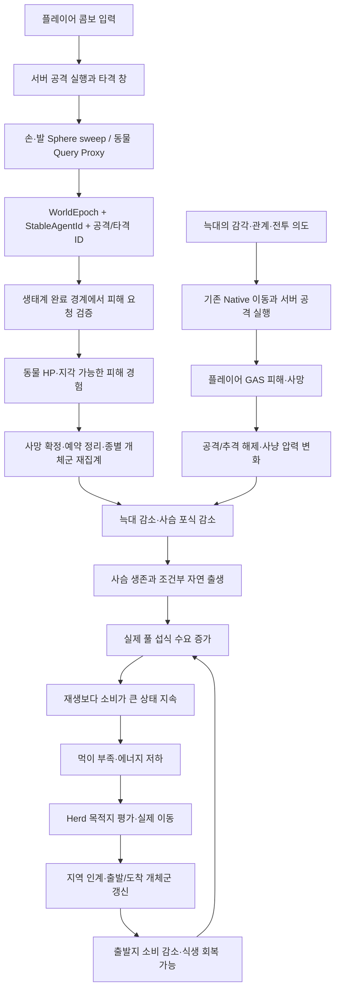

# 플레이어 사냥·상호 전투와 생태계 폐루프 계획

작성: 2026-11-05. **계획 및 현재 Source 감사이며 구현 완료 문서가 아니다.**

후속 구현과 실제 검증 범위는 [2026-11-06 구현·수동 테스트 기록](PLAYER_HUNTING_IMPLEMENTATION_AND_TEST_20261106.md)을 따른다. 사용자의 후속 지시에 따라 별도 맵 대신 기존 `/Game/JWJ/1102_Integration_JWJ`에 적용했다. 아래 최초 감사의 미구현·복사 맵 제안은 당시 상태다.

## 1. 기준과 결론

- 실제 작업 branch: `jwj-1024`, HEAD: `92e6df20a7ee10d9299551a60ba32d4ab1e8c4ae`.
- 작업 트리에 기존 C++/설정/맵 변경과 미추적 `Source/AdaptiveEcosystem/Player/` 콤보 구현이 있다. 아래 현황은 이 로컬 Source까지 포함한다. 동일 HEAD의 깨끗한 checkout과 같다고 가정하지 않는다.
- 이번 작업은 이 계획 문서만 추가한다. 기존 코드·설정·에셋을 변경하거나 빌드·PIE·Blueprint 실행 확인을 수행하지 않았다.
- 기준 계약: [공통 맥락](../PROJECT_CONTEXT.md), [life 실행 계약](ECOSYSTEM_LIFE_IMPLEMENTATION_20261023.md), [Mass 실행 순서](../Mass/MASS_PROCESSOR_ORDER.md), [무리 이주 계약](../조연우/HERD_MIGRATION_AND_SIGNAL_CONTRACT.md).

권장 구조는 **서버의 공격 판정 → 안정 ID가 지정된 피해 요청 → 기존 생태계 완료 경계에서 피해 확정 → 기존 사망/개체군 장부 → 실제 포식·번식·섭식 변화 → 조건부 무리 이주**다. 동물 시각 Actor에 HP와 개체군 관리를 추가하지 않는다. 플레이어 HP는 기존 GAS 기반 위에 별도 소유하며 동물 HP와 역할을 구분한다.

늑대를 죽였다고 사슴을 직접 생성하거나, 사슴이 늘었다고 먹이를 직접 감소시키지 않는다. 늑대 감소로 실제 포식이 줄고, 살아남은 사슴과 자연 출생으로 초식 개체가 증가하며, 실제 섭식 합계가 재생량을 넘을 때 부족이 발생해야 한다. 이 연쇄는 환경·번식·경로 조건에 따라 달라지는 **검증할 가설**이지 매번 보장할 결과가 아니다.

## 2. 현재 구현과 공백

경로는 `Source/AdaptiveEcosystem/` 기준이다. 링크는 현재 로컬 파일을 가리킨다.

| 구간 | Source에서 확인한 사실 | 이번 계획의 추가 작업 |
|---|---|---|
| 동물 표현 | [RepresentationActor](../../Source/AdaptiveEcosystem/Creature/Representation/EcoCreatureRepresentationActor.cpp)의 Mesh/Placeholder는 `NoCollision` | 권위 논리 위치에 연결된 서버 Query 피격체 확보 |
| 콤보 | [ComboAttack](../../Source/AdaptiveEcosystem/Player/EcoGameplayAbility_ComboAttack.cpp)에 입력 창·타격 창·분기·Montage 종료/취소와 서버 뼈 갱신 설정이 있음 | 이 구현을 재사용하고 실제 Dedicated 동작·취소·중복을 검증 |
| 손/발 판정 | [MeleeHitComponent](../../Source/AdaptiveEcosystem/Player/EcoMeleeHitComponent.cpp)는 이전/현재 소켓 위치 사이 Sphere sweep 후 `OnContact` 발생. 단계별 피해 데이터가 있음 | Actor 기반 중복 방지를 논리 ID/공격 ID로 확장하고 피해 소비자 연결 |
| 기존 단발 공격 | [PlayerCombatComponent](../../Source/AdaptiveEcosystem/Player/EcoPlayerCombatComponent.cpp) → `QueuePlayerStrike`. [MeleeStrike Ability](../../Source/AdaptiveEcosystem/Player/EcoGameplayAbility_MeleeStrike.cpp)는 요청 직후 종료 | 기존 단발 경로와 콤보 경로의 중복 실행 방지. 콤보를 이 경로로 우회하지 않음 |
| 실제 동물 피해 | [PlayerOutcomes](../../Source/AdaptiveEcosystem/Creature/Runtime/EcoCreaturePlayerOutcomes.cpp): 큐32, 플레이어당1초 제한, 서버 시뮬레이션 시간 기준3초 만료. 처리 시 전방300cm/높이/LOS로 대상을 다시 골라 HP−30, 기억/목격 처리 | 서버 sweep으로 확정한 대상 지정, 데이터 기반 피해, 실행/타격 ID, 개별 결과 반환 |
| 사망 | [Lifecycle](../../Source/AdaptiveEcosystem/Creature/Runtime/EcoCreatureLifecycle.cpp): 피해 → Survival → RecordDeaths → 종별 사망 합계 → 인구 재집계 | 새 피해를 같은 순서에 연결하고 동시 사망·장부 실패를 검증 |
| 개체수 | [Population](../../Source/AdaptiveEcosystem/Creature/Runtime/EcoCreaturePopulation.cpp): HP>0 개체만 집계, 전체 생성−사망 보존 검사, 종별 Summary 유지 | 플레이어 사냥 사망을 구분하는 원인·기여 진단 추가 |
| 먹이 | [Native world](../../Source/AdaptiveEcosystem/AI/Policy/EcoWorldV3.h)에서 셀별 요구량 합산·잔량 비례 배분, [IntegratedProcessors](../../Source/AdaptiveEcosystem/AI/Policy/EcoPolicyV3IntegratedProcessors.cpp)에서 `CommitSpatialFood` | 실제 요구/지급/부족/재생 수지 계측과 사냥 전후 비교 |
| 출생 | [NaturalBirth](../../Source/AdaptiveEcosystem/Creature/Runtime/EcoCreatureNaturalBirth.cpp): 부모·성숙·영양·거리·지면·인구 예약 조건 후 생성 | 자연 출생/초기 생성/wave/운영 복구를 구분하여 인과 검증 |
| 이주 | [HerdMigration](../../Source/AdaptiveEcosystem/Mass/EcoHerdMigration.cpp): 초식 body+Herd 기반, 지속 부족/목적지/경로 확인 후 실제 이동·인계 | 현재 맵의 opt-in/경로 검증, 사냥에서 시작한 자연 부족의 종단 검증 |
| 플레이어 피격 | [PlayerState](../../Source/AdaptiveEcosystem/Player/EcoPlayerState.h)에 ASC가 있으나 현재 `Player/`에는 HP AttributeSet/동물 피해 소비자가 확인되지 않음 | 서버 GAS HP·피해·사망·부활 계약과 동물→플레이어 공격 adapter |

검색한 C++ 범위에서는 StableAgentId에 연결된 동물용 서버 피격 Proxy를 발견하지 못했다. `FEcoClientProxyTag`는 클라이언트 표현이고, Native의 `bPlayerProxy`는 시뮬레이션 대역이므로 재사용할 피격 충돌체가 아니다. `Variant_Combat`의 별도 전투 캐릭터 HP/TakeDamage를 현재 공통 플레이어의 완성된 HP로 간주하지 않는다. Blueprint의 충돌/OnContact 바인딩과 실제 실행 맵 구성은 구현 시작 시 에디터에서 추가 확인한다.

## 3. 전체 흐름과 소유권



| 소유자 | 책임 |
|---|---|
| 플레이어 Ability/Combat | 입력, 콤보 실행, 공격 데이터, 타격 창, 서버 판정 증거 |
| 동물 피격 Proxy | Query 충돌과 논리 ID 연결. 이동 명령/HP/사망/개체군 소유 금지 |
| 기존 생태계 조정자 | 동물 피해 요청 소비, HP 감소, 기억, 생명주기 결과 연결 |
| Native backend | 동물의 단일 실제 이동·섭식·대사·포획 실행. 전투 의도도 이 경로를 통해 이동 |
| Ecology/M4 | 기존 자원/출생/사망/이주 장부와 지역·종별 요약 |
| 플레이어 ASC | 플레이어 Health/MaxHealth, 서버 피해 효과, 사망 상태 |
| Social | 지각 근거의 경보/공유, Herd 의도, 예약·무리 이동 계획 |
| Client | Montage·맞음·사망·HP/요약 수신 표현. 권위 피해/동물 생성 없음 |

## 4. 플레이어 → 사슴·늑대 전투 계약

### 4.1 서버용 경량 피격체

1. 실제 맵의 기존 서버 충돌체가 ID·생명주기·권위 조건을 만족하면 재사용한다. 없다면 가칭 `AEcoCreatureHitProxy`를 서버에만 생성한다.
2. 근처 플레이어의 최대 공격 범위에 이동 여유분을 더한 관심 영역만 활성화한다. 시각적 relevance와 별개이며 Dedicated에서 Mesh 없이 동작한다. 첫 타격 전에 영역을 준비한다.
3. 캡슐 또는 구 형태의 `QueryOnly` 충돌체를 사용하고 전용 공격 Query 채널로 찾는다. 지형/동물/플레이어의 이동을 밀지 않는다. 형상은 종별 피격 데이터와 실제 body scale로 정한다.
4. `WorldEpoch`, `StableAgentId`, binding generation을 보관한다. Entity handle, Native 배열 index, Proxy Actor 주소를 영속 신원으로 사용하지 않는다. 기존 `AgentLookup`을 재사용한다.
5. Mass 실행 밖의 GT에서 완료된 Native 논리 위치를 복사한다. Proxy snapshot의 simulation step/revision을 기록하고 sweep이 어느 snapshot을 읽었는지 추적한다. Native 이동 → 위치 동기화 → 공격 판정 순서를 명시한다.
6. 출생/삭제/죽음/지역 인계/로드 때 갱신한다. 풀 반환은 충돌 해제 → ID 해제 → generation 증가 순으로 처리한다. 늦게 도착한 contact는 새 개체에 적용되지 않아야 한다.
7. 여러 플레이어의 관심 영역은 합쳐 동일 개체에 Proxy 하나만 유지한다. pool/활성 개수/갱신 비용 상한을 설정하고, 포화 상태를 기록한다. 누락된 피격체 대신 임의의 가까운 다른 대상을 공격하지 않는다.

### 4.2 공격과 피해 요청

클라이언트는 입력 의도만 보낸다. 대상·피해량은 서버 타격 판정과 서버 공격 데이터에서 얻는다. 클라이언트 예측 contact가 필요해져도 참고 정보이며 권위 판정으로 그대로 수용하지 않는다.

| 요청 필드(제안 이름) | 의미 |
|---|---|
| `WorldEpoch` | 다른 실행 세계/로드 전 요청 거절 |
| `AttackExecutionId` | 서버가 발급한 공격 실행 번호. Ability 재사용과 분리 |
| `StepId`, `HitWindowId` | 콤보 단계와 의도된 다중 타격 구간 식별 |
| `AttackerSessionId`, `AvatarGeneration` | 플레이어 접속과 현재 몸 구분. 사망/부활/재접속 전 요청 차단 |
| `TargetStableAgentId`, `TargetBindingGeneration` | 확정된 논리 대상과 Proxy 재사용 검증 |
| `AttackDefinitionId/Revision` | 서버 데이터의 피해·사거리·대상 수·타격 횟수 참조 |
| `ContactPosition`, `PoseSnapshotRevision` | 서버가 확인한 공간 증거 |
| `ContactServerTime`, `EnqueueSimulationTime`, `Sequence` | 실시간 공격 검증, 생태계 소비 경계, 같은 시각 순서 구분 |

`FEcoCombatDamageRequest`, `FEcoCombatDamageOutcome`, `QueueCreatureDamage` 등은 **제안 API 이름**이다. 현재 존재하는 구현으로 읽지 않는다. 요청과 결과는 기존 조정자에 연결하고 별도의 전역 생태계 관리자를 만들지 않는다.

처리 순서:

1. 서버 Ability가 유효한 실행·단계·타격 창을 열고 `UEcoMeleeHitComponent`가 sweep한다.
2. `OnContact`의 대상 Proxy를 안정 ID로 해석한다. 일반 Actor 접촉은 동물 피해 성공으로 기록하지 않는다.
3. 서버 소유권/실행/피격 범위/벽/대상 수를 검사하고 지정 대상 요청을 큐에 넣는다. 벽 검사는 실제 피해 대상 접점까지 확인한다. 현재 소켓까지의 LOS만으로 충분하다고 가정하지 않는다.
4. 기존 생태계 안전 경계에서 epoch, 대상 생존·ID, 공격 실행, 기한, 데이터, 중복을 다시 확인한다. 가까운 다른 개체를 재탐색하지 않는다.
5. 기존 HP 경로에 적용하고 실제 감소량을 결과로 남긴다. HP보다 큰 공격이면 적용량은 남은 HP를 넘지 않는다. 유효한 피해에만 기존 피해 경험/목격 처리를 실행한다.
6. HP가 0이 되면 기존 사망 단계로 보낸다. 비치명 피해가 다음 Native tick에서 사라지거나, 이미 죽은 개체가 포획/공격/출생에 참여하지 않는지 검사한다.

중복 키는 `(WorldEpoch, AttackerSessionId, AvatarGeneration, AttackExecutionId, StepId, HitWindowId, TargetStableAgentId)`다. 한 구간의 매 프레임 sweep/여러 컴포넌트 접촉은 한 번만 적용한다. 다음 오른손·발차기는 다른 단계이므로 허용한다. 다중 타격은 데이터가 명시한 구간 번호로만 허용한다. 캐시는 TTL/개수 상한을 두되 재전송 유효기간보다 먼저 제거하지 않는다.

기존 1초 제한은 레거시 단발 공격용으로 격리한다. 콤보는 단계·타격 창·실행 속도·대상 수 제한을 적용하며 입력/RPC rate limit과 전체 큐 상한도 유지한다. 몽타주 종료·중단·사망·소유권 해제에서 창과 ability를 정리한다. 이미 서버가 승인한 contact는 정상적인 창 종료만으로 취소하지 않되, epoch 변경·stale avatar·기한 초과·유효하지 않은 대상은 거절한다.

현재 피해 소비는 자원 경계여서 입력부터 확정까지 지연될 수 있다. 먼저 큐 지연 p95/max와 단계별 결과 시간을 계측한다. 전투 목표 지연을 만족하지 못하면 **동일 조정자에 Mass 실행 밖의 전투 완료 지점**을 마련하고 기존 lifecycle/장부와 순서를 다시 계약한다. Notify나 Proxy에 별도 HP writer를 추가하지 않는다. 첫 버전은 서버 현재 위치 판정으로 한정하고 과거 위치 재현을 제공한 것처럼 설명하지 않는다.

### 4.3 결과·기억·피드백

- `ComboInputAccepted`: 다음 단계 입력 수락. 명중이나 피해 성공을 뜻하지 않는다.
- `ContactDetected`: 서버 충돌 감지. 살아 있는 동물인지/피해 적용 가능한지는 별도다.
- `DamageQueued`: 요청 수락. 실제 HP 감소 전이다.
- `DamageCommitted`: 실제 감소량, 전/후 HP, 대상 ID, 완료 시점.
- `DamageRejected`: Duplicate, Expired, InvalidTarget, AlreadyDead, InvalidWindow, Obstructed, QueueFull 등 이유.
- `DeathCommitted`: 생명주기와 M4 사망 기록 수락 후의 결과. HP 0 감지만으로 사망 보상 이벤트를 발행하지 않는다.

피해 경험의 `EpisodeId`는 중복되지 않는 확정 타격에 연결한다. 같은 공격의 목격/공유는 동일 원 증거를 유지하고, 실제 시야·LOS·식생 차폐·수면 조건을 재사용한다. 서버가 공격자를 알아도 개체가 못 봤다면 Unknown으로 유지한다. 공유 보고를 직접 관측으로 재발행하지 않는다.

## 5. 사슴·늑대 → 플레이어 전투

현재 늑대의 사슴 포획/영양 처리는 플레이어 전투가 아니다. 목표 구조는 기존 Native의 감각과 이동을 사용하면서 플레이어에 대한 별도 공격 실행·피해 결과를 연결하는 것이다.

1. 플레이어의 기존 ASC에 Health/MaxHealth AttributeSet과 서버 피해 GameplayEffect를 추가하는 방향을 채택한다. 실제 Blueprint에 HP가 이미 있으면 먼저 통합하고 중복 저장소를 없앤다. 세션 중 ASC 소유와 Pawn 부활 시 HP 초기화 책임을 명시한다.
2. 동물별 전투 설정을 둔다: 플레이어에 대한 관계, 공격 가능 여부, 도주/방어/추격 성향, 공격 거리·피해·준비/유효/회복 시간·중단 규칙. 초식/육식과 공격성을 동일시하지 않는다.
3. 1차 범위에서 사슴은 기존 회피를 유지하고, 늑대의 제한된 플레이어 근접 공격을 연결한다. 사슴의 반격은 동일 계약의 후속 종 설정/실행 확장이며 자동으로 활성화하지 않는다.
4. 기존 `ObservePlayers`/개별 기억에서 지각 가능한 상대만 후보로 삼는다. 공유 경보만으로 플레이어의 실시간 위치를 알아내지 않는다. 사슴 사냥과 플레이어 공격을 중재해 한 늑대가 두 행동을 동시에 실행하지 않게 한다.
5. `탐지 → 위협/추격 선택 → 준비 → 유효 타격 → 회복 → 재평가`를 서버 논리 시간으로 실행한다. 의도/속도 제약은 기존 control/threat hook에 전달하고 실제 위치는 Native만 갱신한다. SocialControl을 전역 ON하여 우회하지 않는다.
6. 유효 타격 시 늑대 논리 위치와 플레이어의 권위 Capsule을 바탕으로 거리·방향·높이·벽·생존·무적을 검사한다. 동물 Mesh/AnimNotify가 서버에 없어도 작동해야 한다. Notify는 연출 동기화에 사용한다.
7. `(epoch, animal StableAgentId, attack sequence, hit window, player session, avatar generation)`으로 중복을 막고 플레이어 ASC에 한 번 적용한다. 사망하면 공격/표적/예약과 플레이어 입력을 정리하고 기존 GameMode의 재생성 흐름과 연결한다.
8. 플레이어 사망은 사슴·늑대 Population에서 차감하지 않는다. 플레이어를 먹어 영양을 얻는 규칙은 첫 범위에서 추가하지 않는다. 반복 자살로 늑대 영양/번식을 공급하는 새 경로를 만들지 않는다.

늑대의 몸이 피해 확정 전에 죽은 경우 이후 공격 요청은 거절한다. 같은 경계의 상호 치명타는 서버 접촉 시각·sequence의 결정적 순서로 처리하고 먼저 확정된 사망 이후 공격을 거절하는 것을 기본 계약으로 한다. 양방향 큐의 처리 순서를 테스트로 고정한다.

## 6. 서버 사망·개체군·정리

현재 경로는 `ProcessPlayerStrikes → EcoMassSurvival::Advance → RecordDeaths → SpeciesTotals.Deaths → ReconcilePopulation`이다. `Advance`는 Alive를 제거하고 PendingDeath를 붙이며 예약/Travel/섭식 상태를 정리한다. 사체 보존 시간 후 Entity 삭제는 이미 감소한 인구를 다시 감소시키지 않는다.

`RecordDeaths`는 epoch/step/ID를 검사하고 같은 step의 receipt 중복을 억제한다. 플레이어 피해는 현재 `ExternalDamage`이며 `PredationHistory`를 올리지 않는다. 이를 늑대의 포식으로 둔갑시키지 않는다. 플레이어 사냥 통계가 필요하면 기존 원인을 보존하고 attacker/source 분류를 확장한다.

완료 경계에서 지역 r, 종 s에 대해 다음을 검사한다.

```text
Living[r,s] = Initial[r,s] + NaturalBirth[r,s] + WaveSpawn[r,s] + Recovery[r,s]
              + MigrationIn[r,s] - MigrationOut[r,s] - Deaths[r,s]
WorldLiving = AllSuccessfulSpawns - AllCommittedDeaths
RegionPopulation[r] = sum_s Living[r,s]
```

위 식의 세부 생성 원인은 목표 진단 분류다. 현재 `SpeciesTotals.Births`는 자연 번식 전용 수치가 아니므로 원인별 새 계측 없이 이를 NaturalBirth로 사용하지 않는다. 논리 소속 지역은 `CurrentRegionId`를 기준으로 하며 이주 경계에서 소속 이전이 확정되기 전후의 사망 귀속을 명시한다. 실제 위치의 환경 지역은 별도 진단으로 남길 수 있다. incoming/outgoing 예약은 생존 개체를 복제한 숫자가 아니다.

정리할 항목: 피격 Proxy, 공격 실행/대상, 은신처 lease, 무리 멤버/진행 중 계획, 이주 incoming 예약, 미완료 출생 부모, 섭식/사체 예약, 복제 표현. 화면 밖/서버 Mesh 없음/LOD 변경에도 같은 처리를 수행한다. 관련 캐시가 다음 reconciliation에서 정리되는 경우까지 검사한다.

주의: 현재 `Survival::Advance`는 `RecordDeaths` 호출 전에 death fragment/tag를 쓴다. 따라서 두 함수가 데이터베이스식 원자적 commit이라고 표현하지 않는다. 사망 장부 거절 시 기존 fail-stop을 유지하고, 사냥 보상·완료 이벤트를 발행하지 않는다. 실패 주입으로 부분 상태/중복 receipt가 발생하지 않는지 검증하고, 재시도가 필요하면 pending outcome 보존 및 idempotent 재조정 계약부터 구현한다.

현재 사체 영양은 [Carcass](../../Source/AdaptiveEcosystem/Creature/Runtime/EcoCreatureCarcass.cpp)의 **포식으로 확정된 사슴과 실제 참여 늑대** 경로다. 플레이어가 죽인 동물을 자동으로 늑대의 먹이로 바꾸지 않는다. 향후 사냥 전리품/스캐빈징은 사망 receipt에 연결된 별도 제한 자원으로 설계하며 풀 FoodAmount와 혼합하지 않는다.

## 7. 늑대 감소 → 사슴·먹이 변화

1. 플레이어가 늑대를 실제로 죽이면 해당 지역의 Wolf living과 이후 포식 가능 개체가 감소한다.
2. 사슴 포식 사망이 줄어들 수 있다. 동일 초기 상태의 무사냥 세계보다 사슴 생존이 높아지는 효과와, 실제 자연 출생으로 절대 개체수가 증가하는 효과를 구분한다.
3. 자연 출생은 기존 부모·성숙·영양·거리·자리·예산 조건을 통과해야 한다. 번식 가능한 부모가 없거나 먹이가 이미 부족하면 늑대가 없어도 사슴이 증가하지 않을 수 있다.
4. 실제 섭식 행동을 하는 사슴들이 각 FoodGrid 셀에 요구량을 낸다. 단순 사슴 수가 아니라 섭식 참여·개별 에너지/비축·접근 가능한 셀·성장 상태가 소비를 결정한다.
5. 같은 셀의 사슴 요구가 잔량을 넘으면 기존 비례 부분 배분이 적용된다. **소비 수요 증가가 지급량 증가를 무한 보장하지 않는다.** 잔량이 없으면 일부 또는 전부 미충족이다.
6. 총 실제 소비가 날씨/토양/식생 재생보다 오래 크면 FoodAmount가 감소한다. 부족은 에너지·비축 소모, 출생 감소, 이주 또는 기아로 이어질 수 있다.
7. 이주/사망으로 출발지 초식 소비가 줄면 환경이 허용하는 범위에서 먹이가 회복된다. 새 지역은 유입에 따른 소비와 혼잡이 늘어난다. 모든 지역이 동시에 풍요해지는 구조가 아니다.

```text
FoodAfter = FoodBefore + NativeGrowth - ActualConsumption - EnvironmentalLoss
            + ExplicitHabitatAdjustment
0 <= CellGrant <= CellRequest
sum(CellGrant) <= CellAvailableAtAllocation
```

기존 `CommitSpatialFood`/서식 변경 거래로 검증한다. Native 소비와 M4 소비를 중복 차감하지 않으며 사슴 수에 비례한 별도 Food 감소 코드를 추가하지 않는다. 늑대 영양/사체는 식생 Food와 별도다. 총량이 충분해도 특정 셀이 고갈될 수 있으므로 지역 합계와 접근 가능한 셀 부족을 함께 본다.

## 8. 먹이 부족 → 다른 서식지 이주

현재 `UEcoHerdMigrationSubsystem`의 기본 수치와 조건은 다음과 같다. 코드에서 확인한 현재 값이며 이번 계획으로 변경하지 않는다.

- 초식 body를 가진 Persistent Herd 구성원 최소2개, 같은 출발 지역, 유효한 Native context.
- `FoodFraction < 0.25`가 기본8초 지속.
- 적어도 한 구성원의 Native Energy<0.4, 또는 FoodFraction<0.05. 에너지/시간 단위를 HP나 wall time과 혼동하지 않는다.
- 현재 여행/좌초 상태와 기본45초 정착 cooldown 검사.
- 활성 경로, 지형/인접 관계, 실제 목적지, 목적지 수용 및 보고 확인.
- life 경로의 목적지 정보는 공유가 설정된 경로의30초 보고·90초 TTL을 사용한다.
- 목적지 예상 개체당 먹이가 출발지보다1.2배 초과이고 최소0.5 이상이어야 하며, 위험·물·은신·거리·정보 신뢰도를 평가한다.

이후 `Preparing → 실제 경로 이동 → 지역/context 인계 → 정착`과 기존 `RecordMigrations`를 사용한다. 단일 Native writer를 유지한다. 계획 선택/출발은 도착 성공이 아니다. 몸이 실제로 이동하고 ID가 유지되며 출발/도착 종별 집계가 한 번씩 변해야 한다.

단독 생존 사슴, 경로 없음, 목적지까지 부족, 오래된 보고, 도중 사망, 길 막힘은 별도 실패/대기 사유로 표시한다. 무리 이주가 발동하지 않는 경우를 숨기지 않는다. 필요하면 후속으로 단독 개체 정책을 설계하되 기존 최소2 조건을 이번 계획에서 임의 해제하지 않는다. 실패한 여행을 teleport로 성공 처리하지 않는다.

현재 이 경로는 늑대 무리 이주 완료를 뜻하지 않는다. 늑대의 먹잇감 부족에 따른 지역 이동은 종별 목적지 평가와 predator context 인계가 필요한 별도 확장이다. 이번 핵심 acceptance는 **늑대 사냥 → 사슴의 상대적 생존 증가/자연 출생 → 풀 부족 → 사슴 무리 이주**다.

## 9. 순서별 구현 산출물과 완료 기준

| 순서 | 산출물 | 완료 기준 |
|---|---|---|
| P0 실행 기준 확정 | 현재 공통 플레이어/ASC/콤보 데이터, 실제 spawner backend, life/soil/이주/wave 설정, 지형/경로/충돌 목록 | 기존 로컬 WIP와 파일 책임을 기록. 소유한 시험 맵에서 재현 가능 |
| P1 동물 피격 | 서버 Query Proxy, ID binding, OnContact→지정 대상 요청, 공격 데이터/중복/결과 | Dedicated에 시각 Actor 없이 사슴·늑대 HP 감소. 오른손/발차기 각각 허용, 같은 타격 중복0 |
| P2 죽음 연결 | 기존 lifecycle/사망 receipt/종별 인구, 정리, client 결과 | 두 플레이어 동시 치명타에도 죽음/인구 감소 각각1. 사체 제거/재접속에 추가 감소0 |
| P3 플레이어 피격 | GAS HP·피해·죽음/부활, 늑대 전투 실행 adapter | 늑대의 서버 유효 타격만 플레이어 HP 감소. 죽은 늑대/옛 Pawn/벽 너머 타격0 |
| P4 생태 인과 계측 | 원인별 출생/죽음/이주, 식생 요구/지급/재생, 지연/중복 진단 | 보존식 오차 허용치 내, 요청→피해→죽음→집계의 ID 추적 가능 |
| P5 종단 장면 | 소유한 두 지역·유효 경로, 자연 번식/식생/이주 opt-in | 늑대 사냥부터 자연 소비 부족과 실제 사슴 지역 인계까지 관찰. 미발생 시 원인도 보고 |
| P6 운영 경계 검증 | 저장/재시작/late join/관심 영역/패키지 회귀 | 확정 사망 재실행0, transient 공격 취소, Client 권위 로직0, 저장 규칙/버전 명시 |

P1→P2로 플레이어 사냥의 최소 세로 흐름을 먼저 닫고 P3에서 상호 전투를 완성한다. 기존 생태계 로직을 다시 작성하는 작업보다 실제 연동과 원인 검증이 우선이다. shared Native/Player/장부 파일의 담당 변경을 함수 단위로 조율한다.

## 10. 검증 계획

### 전투·생명주기

- 사슴/늑대 비치명·치명, 단계별 피해, 다중 대상 상한, 같은 타격 재접촉, 한 개체의 복수 충돌체, Proxy 재사용.
- 위조/만료 실행·중복 RPC·queue overflow·다른 world·ID 삭제·비정상 피해 수치·벽·높이·공격 중 이동/취소.
- 두 플레이어 동시 공격, 플레이어 공격과 늑대 포획/기아의 경합, 이주 인계와 치명타의 경합. 실제 적용량/원인/최종 receipt 각1.
- 서버 Montage와 뼈 갱신, 타격 창 Notify 누락/중복, Dedicated 무시각 상태, 저프레임/프레임 건너뜀.
- 동물 사망 후 무리/은신처/이주/출생/사체/Proxy 정리, 플레이어 사망·부활 후 이전 공격 무효.
- 피해 후 save/restart와 사망 직후 미완료 경계의 저장 거절. 복원 시 새 epoch, transient 공격/Proxy 재생성, 이미 확정된 죽음 재집계 금지.
- Standalone, Listen, Dedicated+Client2, late join, 관련 없는 Client의 local contact, 지연/손실 조건별 판정과 결과 지연. 실제 검증한 조건만 보고한다.

### 생태계 실험

동일 맵·초기 개체·seed·날씨·정책·자원·cap·관찰 시간의 짝지은 실행을 사용한다. 여러 seed에서 기존1800 simulation seconds를 시작 관찰 구간으로 삼되 자연 출생/부족이 드러나지 않으면 원인과 연장 필요성을 보고한다. combat 시간과 simulation 시간을 별도로 남긴다.

| 실험 | 목적 |
|---|---|
| A 무개입 | 자율 생태계 기준 |
| B 동일 플레이어 동선·무공격 | 접근/발소리/회피가 섭식에 주는 영향 분리 |
| C 늑대만 제한 사냥 | 실제 늑대 사망→포식 감소→사슴 변화 측정 |
| D 사슴만 제한 사냥 | 초식 소비 감소·먹이 회복 방향 비교 |
| E 사슴/늑대 강한 사냥 | 멸종·빈 사냥터·생태 회복 한계 관찰 |
| F 별도 부족 fixture | 이주 배선/실패 처리의 결정적 회귀. 자연 부족 증거와 분리 |

사냥은 서버 공격 실행 경로로 발생시키고 평가 중 Population/HP/Food 직접 수정으로 결과를 만들지 않는다. 운영 Recover/자동 wave는 인과 실험에서 OFF로 고정하거나 별도 변수로 분리한다. fixture의 먹이 제거와 재생 중단을 사냥의 생태 효과로 보고하지 않는다.

필수 지표: 지역·종별 living, 자연 출생/초기/wave/recovery, 플레이어 사냥/포식/기아 사망, 실제 포획 횟수, Food 잔량/용량/성장/소비/환경손실, 셀별 요구·지급률, 평균 에너지/비축·부족 지속 시간, 이주 계획/출발/실제 인계/정착/실패, 요청/접촉/피해/죽음 ID, 처리 지연 및 장부 잔차.

강제 사망/가뭄 fixture는 연결의 정확성을 증명하고, 자연 사냥 실험은 원하는 연쇄가 실제 발생하는지를 평가한다. C에서 사슴이 증가하지 않았다면 출생 부모/성숙/영양/cap·기아·이주 유출을 확인한다. 먹이가 부족해지지 않았다면 실제 소비와 재생을 비교한다. 실패한 가설을 수치 조작으로 성공 처리하지 않는다.

## 11. 보존할 경계와 후속 인계

- 기존 맵 옵션을 전역으로 켜지 않는다. 실제 팀 맵 사용 여부를 확인하고 소유한 복사 시험 맵에만 필요한 설정·경로를 authoring한다.
- V1 7/4, v3 18/5 mask2, 기존 모델/관측/가중치를 보존한다. 새 늑대 전투는 명시적인 실행 규칙 확장이며 PPO가 이미 배웠다고 설명하지 않는다.
- SocialControl=0 기본과 기존 opt-in, Native 단일 movement/metabolism writer, M4 보존 검사를 유지한다.
- player/animal ID, 결과 DTO, checkpoint 필드/버전 변경은 저장·복제 담당과 함께 정의한다. Subsystem 자체를 RPC transport로 만들지 않는다.
- Python 전체 세계 mirror/재학습/전체 궤적 parity는 별도 RL 인계다. 새 전투의 시간·비용·관계·피격 규칙을 명시하되 이번 계획으로 완료 처리하지 않는다.
- 확정 사망 이후 전리품/경험치/퀘스트, 플레이어 사체 영양, 늑대의 지역 이주, 임의 종 combat backend, WAN rewind/분산 서버는 별도 확장이다.
- C++/빌드 입력을 실제 변경하는 단계에는 루트 AGENTS의 직접 UBT 및 실행 중 프로세스 보호 규칙을 적용한다. 이 문서는 Source/링크/diff만 검증하며 새 빌드/PIE 성공을 기록하지 않는다.
