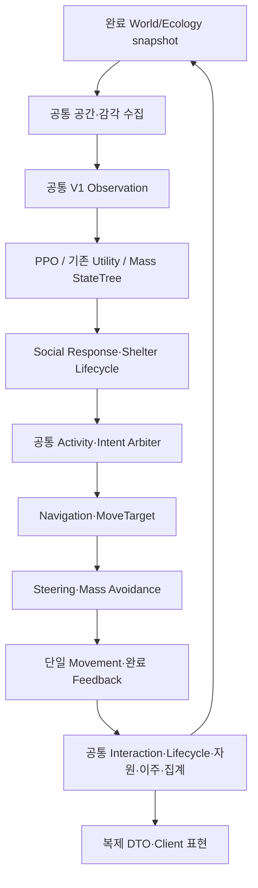

# Mass StateTree 기반 사슴·늑대 개발 및 PPO 비교 계획

작성일: 2026-10-14 / 기준 엔진: Unreal Engine 5.8 / 런타임 모듈: `AdaptiveEcosystem`

Source 기준: 로컬 `M4`, HEAD `3062180f895c7dc7e738f8f9efdc720788f40ef1` + 미커밋 작업 폴더. 아래 현재 상태는 Source를 읽어 확인한 사실이며 컴파일·PIE·cook·성능 통과 선언이 아니다. 이번 산출물은 개발 계획서다.

2026-10-14 후속 상세화: 실제 개발은 [사슴·늑대 독립 개발 마스터 계획](SpeciesAI/README.md)과 공통/종별 상세 문서를 따른다. 이 문서의 A/B 비교 조건은 유지한다. L1 production은 엔진 Force/Steering/Avoidance를 소비하는 grounded custom final writer로 구체화했으며, Shelter 예약은 기존 Social, 일반 Graze/Rest/Carcass 예약은 Activity owner로 분리한다. 이는 새 구현 계획이며 기존 production 경로를 교체한 상태가 아니다.

## 1. 목표와 개발 결정

사슴·늑대의 행동을 Unreal의 Mass StateTree와 Utility 선택으로 구현하고, 기존 Collaborator의 PPO와 동일 조건에서 비교할 수 있는 실험 경로를 만든다. 행동 선택, Social, 경로 탐색, 조향·이동, 생존·자원·생명주기, 복제·표현의 책임을 분리한다. MassEntity의 Chunk 처리와 계산 예산을 사용해 서버 비용을 제어한다.

핵심 결정:

1. **기존 PPO production 기본 경로와 V1 계약은 유지한다.** 새 StateTree 경로는 명시적으로 선택하는 비교 구현이다. 이 계획은 기존 PPO 가중치·관측 수치·Python 학습 환경을 변경하는 지시가 아니다.
2. **정책만 비교하는 실험과 전체 시스템을 비교하는 실험을 분리한다.** 새 이동·감각·LOD의 효과를 StateTree 정책 효과로 보고하지 않는다.
3. **공통 소유자를 재사용한다.** Food·HP·Death·Region·Herd·Shelter의 두 번째 권위 상태나 별도 생태계를 만들지 않는다.
4. **각 Entity의 최종 위치·속도 writer는 하나다.** 기존 직접 적분과 엔진 이동을 같은 Entity에 함께 활성화하지 않는다.
5. **효율은 계측으로 판단한다.** StateTree 또는 Mass라는 이름만으로 PPO보다 빠르거나 모든 코드가 병렬이라고 가정하지 않는다.
6. **개발 완료에는 폐루프와 네트워크 검증을 포함한다.** 동물이 움직이는 데서 끝내지 않고 행동 결과가 자원·생존·개체군·다음 관측에 반영되어야 한다.

## 2. 현재 구현과 계획의 관계

| 항목 | 현재 작업 폴더에서 확인한 사실 | 개발 시 처리 |
| --- | --- | --- |
| 사슴 정책 | `EcoPolicyProcessor`와 `EcoPolicyBatch`가 C++ Native PPO 또는 `RunUtilityPolicy` 선택 | 세 번째 backend인 Mass StateTree Utility를 opt-in 추가 |
| 기존 Utility | `eco.UseLearnedPolicy 0` 경로 존재 | 수정 없이 기준 비교군으로 보존 |
| V1 계약 | 7개 관측과 4개 연속 행동값 | 엄격 비교의 공통 입력·출력으로 유지 |
| 늑대 | `EcoCreaturePredatorProcessor`가 감각 기억 기반 추격·배회와 직접 이동 수행 | 엄격 사슴 비교에서는 고정. 별도 단계에서 늑대 StateTree 구현 |
| Social 인계 | Steering이 Social Request의 EffectiveAction을 읽고 `SelectVelocity`가 Shelter/Travel 의도 소비 | 현재 연결을 재사용. 역사 문서의 consumer pending을 현재 사실로 적용하지 않음 |
| 위치 적분 | 사슴 Steering, 늑대 Predator Processor가 각 Entity의 위치·속도 작성 | 엔진 이동 비교 구성에서는 기존 writer를 query/검증으로 제외 |
| 실제 공간 제약 | `ConstrainStep`의 sweep·지면 trace·지역 검사, `CrossesExcludedArea`의 volume 순회 | 기준선 비용을 측정하고 공통 공간 서비스로 개선 |
| 정책 스케줄 | 기본 `PolicyInterval / 60`초, 경과시간·원거리 배수·선택적 순수 계산 병렬 배치 | 엄격 비교에서 동일 스케줄. 최적화 효과는 별도 실험 |
| 기존 LOD | `UpdateSimulationLOD`가 개체 순회 후 정책 interval 배수 조절 | 엔진 Mass Simulation LOD 도입 완료로 표현하지 않음 |
| 생태 조정 | Creature가 `OnWorldPostActorTick`에서 공통 생존·자원·식사·이주·집계 처리 | 이 coordinator 재사용. 추가 clock/생명주기 loop 금지 |
| 플러그인·모듈 | StateTree/MassAI 활성화, StateTreeModule/MassNavigation/MassMovement 등 의존성 존재 | MassAIBehavior/MassNavMeshNavigation/SmartObjects 등 실제 추가 필요성은 로컬 엔진 기준 검증 |

Source 근거:

- [정책 실행](../../Source/AdaptiveEcosystem/AI/Policy/EcoPolicyProcessor.cpp), [수치 배치](../../Source/AdaptiveEcosystem/AI/Policy/EcoPolicyBatch.cpp), [Native 추론·기존 Utility](../../Source/AdaptiveEcosystem/AI/Policy/EcoPolicyInference.cpp)
- [사슴 Steering](../../Source/AdaptiveEcosystem/AI/Policy/EcoSteeringProcessor.cpp), [늑대 이동](../../Source/AdaptiveEcosystem/Creature/Runtime/EcoCreaturePredatorProcessor.cpp), [이동 의도 선택](../../Source/AdaptiveEcosystem/Creature/Runtime/EcoCreatureMovement.h), [공간 제약](../../Source/AdaptiveEcosystem/Creature/Runtime/EcoCreatureMovement.cpp)
- [Social Fragment](../../Source/AdaptiveEcosystem/AI/Social/EcoSocialFragments.h), [현재 LOD](../../Source/AdaptiveEcosystem/Creature/Runtime/EcoCreatureScheduling.cpp), [생태 조정](../../Source/AdaptiveEcosystem/Creature/Runtime/EcoCreatureLifecycle.cpp)
- [빌드 의존성](../../Source/AdaptiveEcosystem/AdaptiveEcosystem.Build.cs), [프로젝트 설정](../../AdaptiveEcosystem.uproject)

[기존 사슴·늑대 생태계 계획](DEER_WOLF_DYNAMIC_ECOSYSTEM_PLAN_2026-10-14.md)은 생활·사냥·공간·자원 구성을 다루는 별도 계획이다. 여기서는 새 backend를 공통 실행 계층에 연결한다. 두 계획에서 State/Intent/섭식 회계를 중복 구현하지 않는다. 생활 계층이 나중에 구현되면 모든 비교군에 동일하게 적용하거나 실험에서 모두 비활성화한다.

## 3. 비교 설계: 정책과 전체 시스템을 구분

### 3.1 실험 A — 엄격한 사슴 정책 비교

| 조건 | A0 | A1 | A2 |
| --- | --- | --- | --- |
| 사슴 행동 backend | 기존 Native PPO | 기존 C++ Utility | Mass StateTree Utility V1 adapter |
| 정책 입력 | 동일한 V1 7개 관측 snapshot | 동일 | 동일 |
| 정책 출력 | 동일한 개체별 V1 4개 값 | 동일 | 동일 |
| Social·공간 후보·이동·섭식·생존 | 같은 구현과 설정 | 동일 | 동일 |
| 늑대 | 현재 감각 기반 행동 W0 | 동일 | 동일 |
| 정책 주기·LOD·속력·포획 조건 | 같은 실험 설정 | 동일 | 동일 |

- A2는 V1 입력, 이전의 허용된 V1 관측 이력, backend 내부 상태, 공통 결정 시각만 사용한다. 실제 늑대의 숨겨진 위치·Herd Alarm·새 stamina·추가 감각 기억을 정책 입력으로 몰래 사용하지 않는다. StateTree 상태를 유지하는 차이는 알고리즘의 일부로 보고하며 무기억 점수 평가 결과도 보조 비교로 남긴다.
- StateTree의 Forage/Rest/Flee 같은 상태는 A에서 **선호도 출력 상태**다. A2에만 정지·가속·섭식 허용을 추가하지 않는다. 출력 이후의 실행 규칙은 A0/A1/A2에 동일하다.
- V1 순서·정규화·clamp·결측값 처리·Provider는 하나의 adapter로 공통화한다. 문서의 predator cap 5와 현재 생성 상수 8, 계약 헤더와 실제 Utility 수식 차이는 manifest에 명시한다. 기준 Source 동작을 조용히 V1 의도값으로 수정하지 않는다.
- 명목 결정 시각은 공통 scheduler가 지정한다. A2만 위협 Signal로 추가 결정을 하지 않는다. 긴급 재결정을 비교할 때는 모든 backend에 같은 snapshot과 실행 기회를 제공한 별도 조건으로 기록한다.
- 공통 low-cost 안전 제약이 정책을 덮어쓰면 Raw Action과 최종 EffectiveAction, 개입 횟수를 함께 기록한다. 안전 제약이 대부분 행동을 결정하면 정책 차이에 대한 결론을 제한한다.
- 동일 seed의 같은 초기 상태에서 별도 실행한다. 한 월드에 두 정책을 섞어 같은 먹이를 경쟁시키는 실행은 공정한 A/B 기준으로 사용하지 않는다.

### 3.2 실험 B — 전체 Unreal 행동·이동 스택 비교

| 조건 | 정책 | 이동·경로 | 해석 |
| --- | --- | --- | --- |
| B0 | PPO | 기존 공통 이동 | 기준 |
| B1 | StateTree Utility | 기존 공통 이동 | 정책 교체 효과 |
| B2 | PPO | 공통 Unreal NavMesh·Steering·Avoidance·Movement | 이동 스택 효과 |
| B3 | StateTree Utility | B2와 같은 Unreal 이동 | 정책과 이동 조합 |

이 비교는 A 완료 후 수행한다. B2/B3에는 같은 목적지 후보·속력/가감속·공간 제약·Social 우선순위·섭식 규칙을 제공한다. PPO의 네 값으로 공통 목적지/조향 의도를 만드는 adapter를 먼저 구현하고, StateTree도 같은 adapter를 통과한다. StateTree 전용 직접 목표 Task는 별도 확장 조건으로 기록한다.

늑대는 B0~B3 모두 W0로 고정한 결과를 먼저 얻고, 공통 W1 StateTree 늑대로 교체한 결과를 별도 표에 남긴다. W1과 특정 사슴 정책을 동시에 바꾸고 사슴 정책 우열로 해석하지 않는다. 미래 Collaborator의 늑대 PPO가 추가되면 새 종별 관측·행동 계약을 만든 뒤 비교하며 사슴 V1을 그대로 늑대 정책이라고 부르지 않는다.

추가 감각·새 생활 행동·Smart Objects·LOD·EQS는 각 기능 on/off를 같은 backend 쌍에 적용해 효과를 분리한다. 별도의 전체 기능 조합 결과는 production 시나리오 결과로 보고한다.

## 4. 책임 분리와 데이터 소유권

| 계층 | 읽기 | 유일한 쓰기 책임 | 금지 사항 |
| --- | --- | --- | --- |
| World | 레벨·환경 adapter | 지형/경계/날씨/낮밤 snapshot | Food/HP/정책 결과 확정 |
| 감각·공간 검색 | 이전 완료 Transform, 논리 소음, 위협 Source | 개체별 감각/기하 snapshot·후보 | 이동·포획 확정, 감각 밖 실제 표적 위치 노출 |
| Observation Adapter | 감각·자원·Vitals | 기존 관측 Fragment | 정책별로 다른 정규화/Provider |
| Behavior Backend | 공통 관측 snapshot | 개체별 Raw Action·backend 내부 실행 상태 | Social/HP/Food/Region/Transform 직접 변경 |
| Social Runtime | Raw Action, 개인·Herd 정보 | Herd/Alarm, ModulatedAction, Shelter Request·예약 | 실제 이동·자원 차감·생활 상태의 중복 소유 |
| 공통 Activity/Intent | EffectiveAction, 감각·생활 입력, 이전 feedback | 생활 상태·행동 목적지·속도 의도·섭식 요청 자격 | Raw Action 덮어쓰기, Travel/예약 확정 |
| Intent Arbiter | Travel, Social Request, 생활 의도 | 최종 이동 요청·선택 사유 | Region/Lease/HP 변경 |
| Navigation | 최종 이동 요청, NavMesh/공간 snapshot | 경로·짧은 경로·MoveTarget·경로 실패 | 최종 위치 적분·도착에 따른 지역/예약 확정 |
| Steering/Avoidance | MoveTarget·동료·경계·Force | 이번 step의 이동 입력/힘 | 별도 Food/무리 상태 관리 |
| 최종 Movement | 이동 입력·공통 물리 제약 | 최종 Transform/Velocity·이동 결과 | 동일 Entity 추가 적분 |
| Ecology/Lifecycle Coordinator | 완료 이동 결과·섭식/포획 요청 | 자원 거래, Vitals·Death 적용, Travel/Region commit·집계 | backend별 독립 생명주기/clock |
| Replication/Representation | 권위 완료 상태 | 복제 DTO·Client 보간·Actor/애니메이션 | Client 행동 재결정·권위 Death 발생 |
| Evaluation | 위 계층의 읽기 이벤트 | 실험 manifest·측정·보고 | 평가용 정보를 정책에 역주입 |

Ecology 자원 원장과 Mass Vitals는 각자의 기존 권위 소유자를 유지한다. Coordinator는 그 계약에 따라 거래 결과를 연결한다. StateTree의 Eat/Graze Task는 실제 Food 또는 Energy를 변경하지 않고 섭식 의도를 제출한다. Hunt/Attack Task도 직접 prey를 destroy하지 않는다.

### 4.1 공통 데이터 계약

아래 신규 이름은 설계 제안이다. 기존 타입과 충돌하면 통합·재사용하고 실제 이름은 계약 PR에서 확정한다.

| 데이터 | 저장 단위·소유자 | 필수 내용 |
| --- | --- | --- |
| 기존 `FEcoObservationFragment` | Entity / Observation | V1 7개 값. 입력 snapshot의 시각·revision은 공통 scheduling metadata로 연결 |
| 기존 `FEcoPolicyOutputFragment` | Entity / 선택된 backend | V1 Raw Action. 다른 backend가 동시에 쓰지 않음 |
| `FEcoBehaviorExecutionFragment` | Entity / Behavior | backend 식별, 상태, state entered/deadline, 결정 sequence, profile version, 재평가 사유 |
| 기존/통합 Activity·Intent Fragment | Entity / 공통 실행 계층 | 목적지, 목적지 종류, 속도 제한, 유효시간, 요청 sequence, 섭식 의도 |
| `FEcoMovementRequestFragment` | Entity / Arbiter | RequestId/revision, WorldEpoch, source/mode, 목적지/허용 반경, deadline, 참조 예약 ID |
| `FEcoNavigationRuntimeFragment` | Entity / Navigation | 활성 request revision, path 상태, navigation revision, 재시도 시각, 이동 정체 시간 |
| `FEcoMovementResultFragment` | Entity / Movement | 완료 request revision, 완료 시각, 실제 위치/속도, Arrived/Blocked/Failed/Yielded 사유 |
| 설정 Data Asset·ConstShared | 종·동일 프로필 공유 | StateTree asset, 곡선·임계치·기간, 검색/경로 예산, 속도·LOD 설정 |
| immutable 공간 snapshot | 프레임/step 공유 | 공간 index, 읽기 전용 값 후보, 생성 시각·revision |
| interaction request/result | 공통 거래 버퍼 | StableAgentId, RegionId, Epoch/Step, 요청 ID, 실제 배분·사망 결과 |

공유 설정에 개체별 상태·관측·출력·경로·예약을 넣지 않는다. StateTree instance memory는 엔진 Mass 통합 방식으로 관리하며 별도 UObject/AIController를 개체마다 생성하지 않는다. 상태 변경은 enum/Fragment 값으로 처리하고 행동마다 Tag를 붙였다 떼지 않는다. 고정 backend/종/이동 경로 구분용 Trait·Tag는 생성 시 정한다.

StateTree 내부 활성 상태의 진실값은 엔진 instance runtime에 둔다. 실행 Fragment의 상태 코드는 출력/진단용 파생값이며 두 곳에서 독립적으로 전이하지 않는다. 공통 Activity 상태는 정책의 내부 선택 상태와 구분한다.

Mass EntityHandle은 현재 World의 임시 접근에만 사용한다. 저장·로그·복제 식별은 StableAgentId/RegionId/SpeciesId이며 hot path는 runtime index를 쓴다. 요청 ID는 WorldEpoch와 함께 검증해 재시작·삭제·정책 전환 후 과거 결과를 적용하지 않는다.

기존 Shelter Request에는 ReservationId와 유효시간이 있고 Feedback에는 sequence가 있다. 범용 이동 revision을 연결할 때 기존 필드와 혼동하지 않는다. Social 소유 Request를 Navigation이 수정하지 않고 결과 adapter가 검증 후 기존 Feedback으로 변환한다.

### 4.2 상태·시간 계약

- 실행 상태는 행동의 단계이며 Alive/Travel/Alarm/Occupied의 두 번째 진실값이 아니다. 사망·이주·점유는 기존 소유자의 상태를 읽어 파생한다.
- Raw Action은 Policy에서 한 번, ModulatedAction은 Social에서 한 번 작성한다. 실제 실행 상태의 변경이 필요하면 공통 Activity 계층에서 수행한다.
- Social lease/감각 기억/이동 deadline은 현재 `UWorld` 시간 계약을 유지한다. 생존·자원은 Ecology completed clock/step을 사용하고 복제는 기존 movement sample real-time을 유지한다. 서로 다른 시계를 단순 대입하지 않는다.
- backend 결정은 동일한 simulation elapsed-time 일정으로 제공하고 사용한 관측 시각을 기록한다. 긴 frame에서 역사 관측을 만들어 여러 번 판단하거나 과거 지형 이동을 재적분하지 않는다.
- deadline signal은 재평가 요청이며 매 frame 물리 이동을 대신하지 않는다. lease·예약 정리는 StateTree가 잠들거나 마지막 owner가 사라져도 수행된다.
- backend 변경은 초기에는 재스폰/실행 재시작으로 한다. live switch를 추가할 경우 안전 경계에서 내부 상태·경로·예약·output revision을 정리하고 해당 구간은 평가에서 표시한다.

## 5. 목표 실행 순서와 Movement 단일화

이 그림은 목표 흐름이다. 현재 Predation-before-Steering와 PostActorTick 생태 조정 순서를 즉시 바꾸는 지시가 아니다. A는 현재 ordering을 고정한다. post-movement 공격 판정으로 전환한다면 모든 backend를 같은 공통 계약으로 전환한 뒤 별도 기준선으로 재측정한다.

1. 이전 완료 World/Ecology와 이전 완료 위치로 공간·감각 snapshot을 수집한다.
2. 이번 결정 대상의 공통 관측을 생성하고 선택된 backend만 Raw Action을 갱신한다.
3. Social은 기존 Herd/Alarm/Response/Query/Reservation/Lifecycle 책임을 수행한다. A의 StateTree 정책에는 추가 Social 정보를 넣지 않는다. Alarm 이후 정책 판단이 필요한 확장 실험은 별도 DAG로 정한다.
4. Activity/Arbiter가 유효 의도를 선택하고 Navigation은 경로/MoveTarget만 작성한다.
5. 공통 steering이 기본 힘을 생성하고 Avoidance가 보정한 뒤 단일 movement 경로가 적분한다. 실제 엔진 그룹·Force reset·DesiredMovement 소비 순서는 UE 5.8 Source로 검증해 dependency graph를 문서화한다.
6. Movement가 완료 결과를 기록한다. Social은 다음 Lifecycle 패스에서 feedback을 소비한다. 동일 프레임 양방향 prerequisite를 만들어 순환시키지 않는다.
7. 모든 Mass 작업이 끝난 기존 coordinator 경계에서 권위 거래·사망·도착·인구·요약을 반영한다. Processor loop 구조 변경은 command buffer, 현재 Creature 프레임 경계 파괴는 기존 observer 안전 계약을 따른다.

### 5.1 의도 우선순위

기본 production 우선순위는 `사망/무효/통행 불가 정지 → 권위 Travel/Waiting → 유효 Social Shelter → 공통 생활 목적지 → 정책 기반 일반 조향`이다. 이는 현재 Travel 우선 동작을 유지하는 출발점이다.

긴급 도주가 Travel 또는 Shelter보다 우선해야 하는 경우에는 해당 coordinator와 명시적인 Yield/Abort 계약을 추가한다. Arbiter가 Travel.State 또는 Reservation을 직접 지우지 않는다. A 비교 중에는 우선순위를 변경하지 않는다.

### 5.2 이동 경로의 배타성

- L0: 현재 사슴/늑대 직접 적분. 기존 `FMassCustomMovementTag`와 query 분리를 유지한다.
- L1: NavMesh + Mass Steering/Avoidance + 엔진 Movement. 엔진에 필요한 Fragment/Tag를 갖추고 기존 직접 writer query에서 제외한다.
- EntityConfig 검사에서 backend output writer와 final movement writer가 각각 하나인지 확인한다. 누락/중복/Client 논리 Trait/Box 혼용은 시작 단계에서 거부한다.
- L1의 가감속·힘 모델은 기존 일정 속력 Python 조향과 다르므로 Golden Vector 파리티 범위를 L1 이동까지 확대 주장하지 않는다.
- L1 도입을 위해 기존 Bootstrap 혼용 가드를 일괄 삭제하지 않는다. 별도 opt-in 구성의 검사 조건을 작성하고 완성된 구성만 허용한다.
- NavMesh 경로는 실제 collision/ground/region 제약을 대체 완료했다고 가정하지 않는다. 단일 적분 단계의 충돌·지면 처리와 엔진 적용 순서를 함께 설계한다. 별도 Processor에서 위치를 다시 적분해 보정하지 않는다.

## 6. 사슴·늑대 StateTree 구현 범위

### 6.1 사슴

| 상태/단계 | 선택 근거 | 출력/완료 | 책임 경계 |
| --- | --- | --- | --- |
| Wander | 낮은 배고픔·위험 | 공통 후보 기반 배회 의도 | 감각 밖 정보를 검색하지 않음 |
| Forage → Approach → Graze | 배고픔·먹이 후보·도달 가능성 | 먹이 목적지, 도착 후 섭식 자격 | 실제 Food/Energy는 거래 결과로만 갱신 |
| Regroup | 무리/동족과 거리, 위험 | 공통 동족 중심/허용 후보로 이동 | Herd 가입·탈퇴를 Task에서 수행하지 않음 |
| Alert → Flee → Recover | 현재 위협·공통 안전 입력 | 회피 의도, calm dwell 후 정상 복귀 | 개인/공유 감각 출처·유효시간 구분 |
| ShelterTravel → ShelterHold | Social의 유효 예약 Request | 기존 Request 참조, 완료 feedback | 예약 생성·Occupied 확정은 Social |
| Rest | 안전·충분한 Energy | 공통 정지/속도 의도와 재평가 deadline | A에서는 V1 선호도만 출력 |
| Migrating/Waiting/Dead 표시 | 기존 Travel/Vitals | 실행 중단 또는 기존 의도 추종 | 해당 상태를 StateTree가 확정하지 않음 |

Utility는 공통 관측의 Float/Enum/Constant Consideration과 response curve로 구성한다. 최댓값 선택을 기본으로 하며, 점수 기반 확률 선택은 seed가 분리된 다양성 실험으로 추가한다. 전이 threshold의 hysteresis·최소 체류·cooldown을 설정으로 제공하고 위험·사망 같은 공통 중단 조건은 명시한다. A2의 출력 범위는 V1 그대로다.

V1 adapter는 각 상태에서 네 값 모두를 결정적으로 출력한다. Forage 점수는 Energy/FoodDensity, Regroup 선호는 ConspecificCount/RecentPredation, Flee 선호는 PredatorCount/PredatorDistance/RecentPredation, Shelter 선호는 PredatorCount/CoverDistance를 사용하는 출발안이다. profile별 곡선·state별 action mapping과 입력 경계값의 출력 표를 E2에서 고정한다. 상태 점수 자체를 네 행동값으로 복사하지 않으며, FleeDist는 도주 거리 민감도라는 현재 실행 의미를 유지한다. A2에 동족 중심 거리 같은 추가 관측을 도입하지 않는다.

### 6.2 늑대 W1

`Rest/Patrol → Search → Approach/Pursue → AttackRequest → EatCooldown → Recover`를 구현한다. 표적을 잃으면 마지막 신뢰 가능한 감지 위치를 조사하고 일정 시간이 지나면 수색으로 돌아간다.

- 기존 감각 기억 API를 사용한다. 시야 밖 표적의 현재 Transform을 직접 조회해 추격 목표를 보정하지 않는다.
- 표적 ID/정보 시각/uncertainty·공통 포획 조건을 검증한다. 중복 포획은 공통 death receipt/거래 ID로 거부한다.
- 식사 cooldown·포획 보상·HP/Energy 소유권은 기존 계층에 둔다. W1 Task는 현재 상태를 읽는다.
- 포만감·추격 피로·사냥 포기·협동 사냥은 W1 기본과 구분한다. 대사 또는 stamina 규칙을 추가할 때 공통 종 계약/평가 조건을 먼저 버전 관리한다.
- persistent pack, 역할 배정, 포위 사냥은 Social 확장으로 후속 처리한다. StateTree에 별도 Pack 소유자를 만들지 않는다.

### 6.3 경로 Task 연결

일반 UE AIController용 MoveTo Task를 Mass 개체에 그대로 붙이지 않는다. Mass schema와 Mass Task 기반을 사용한다. 공통 Navigation 서비스가 request revision·예산·실패를 관리하고 엔진 `FMassNavMeshPathFollowTask`의 경로 기능을 연결한다. 공통 scheduler와 중복 path 요청을 만들지 않는 구현 방식을 spike에서 정한다.

## 7. Mass 처리 효율과 서버 예산

### 7.1 데이터와 순회

- chunk query의 Fragment access는 최소한의 ReadOnly/ReadWrite로 선언한다. optional Fragment 남용과 공유 설정 조합 증가가 chunk 수에 미치는 영향을 측정한다.
- 주변 생명체는 기존 공통 공간 index/snapshot으로 검색한다. O(N²) 전 개체 쌍 검색과 개체마다 Actor 전체 순회를 피한다.
- 현재 `CrossesExcludedArea`의 반복 volume 순회는 공간 index/변경 revision 기반 캐시로 바꿀 후보이며, 기존 금지영역 의미와 경계 통과 회귀를 검증한다.
- 감각·후보·관측·집계 간 같은 검색을 재사용한다. hash grid 갱신과 후보 buffer 생성 비용까지 측정한다. Avoidance 엔진 grid와 생태 감각 grid는 용도가 다르므로 무리하게 합치지 않는다.
- TArray scratch buffer는 frame/chunk 단위로 reserve·재사용한다. 경로는 pooled handle 또는 제한된 개체별 storage로 관리하고 profiler로 allocation·bytes/entity를 확인한다.
- StableAgentId → 현재 Entity 조회 테이블은 생성/삭제 경계에서 갱신한다. hot path에서 반복 전체 검색이나 FName 문자열 처리를 하지 않는다.
- 상세 로그는 선택 개체 또는 sampling만 사용한다. 상태 전이 로그와 집계 카운터를 분리하고 측정 중 로그 조건을 고정한다.

### 7.2 스레드 경계

| 처리 | 초기 실행 | 병렬화 조건 |
| --- | --- | --- |
| World/UObject·NavMesh·충돌·감각 서비스 조회 | Game Thread 또는 엔진이 보장한 API 실행 문맥 | API thread-safe 계약이 확인된 부분만 이동 |
| immutable snapshot 기반 수치/점수/조향 후보 계산 | 값 계산 분리 | chunk/task의 독립 output과 접근 선언 확보 |
| StateTree instance 실행 | 로컬 엔진 Mass 통합 실행 방식 | worker 허용을 가정하지 않고 Task·Evaluator·외부 데이터 접근 확인 |
| 예약·Food·Death·Region commit | 기존 직렬 권위 경계 | worker는 요청만 제출 |
| 결과 검증·fragment commit·signals | 수명·revision 검증 후 안전 경계 | 처리 중 view/EntityHandle을 다음 frame에 보관하지 않음 |

`bRequiresGameThreadExecution=false` 변경만으로 병렬화를 완료하지 않는다. nested ParallelFor와 Mass task 병렬화가 겹쳐 oversubscription을 만드는지도 측정한다. 비동기 path 결과는 WorldEpoch/StableAgentId/request/navigation revision·생존을 검증하고 stale 결과를 폐기한다.

### 7.3 주기·Signal·LOD

| 작업 | 시작 설정/정책 | 보호 조건 |
| --- | --- | --- |
| A 정책 결정 | 현재 `PolicyInterval / 60`초와 동일 phase | 모든 backend에 동일 결정 기회 |
| production 생활 선택 | 예시 0.25초 + 중요 변경 Signal | 확정 성능·밸런스 수치가 아닌 초기 후보 |
| 감각 | 현재 구현 주기 보존 후 거리/활동별 조정 | 실제 표적 이동·공격 위험 누락 지연 측정 |
| path 요청 | 목표 변경/경로 invalid/정체 시만 | 매 frame 재탐색 금지, agent cooldown·frame 예산 |
| steering/movement | 상세 simulation step | 긴 frame 처리와 tunneling 정책을 공통화 |
| Ecology/Vitals/예약 정리 | 기존 시간·거래 계약 | 원거리·표현 Off에서도 중단 금지 |
| 복제/표현 | 기존 연결별 interval·Actor 예산 | 권위 사망·population과 관련성 제거 분리 |

Phase는 StableAgentId와 experiment seed에서 결정해 동시 재평가 spike를 줄인다. StateTree wake Signal은 named notification이므로 payload를 담는 대신 Fragment에 값/revision을 먼저 기록하고 Signal을 보낸다. 같은 개체·원인의 중복 Signal을 합치고 starvation을 막는 최대 대기시간을 둔다.

Nav/EQS 요청은 priority queue + frame별 처리 개수/시간 예산 + aging으로 관리한다. 긴급 요청, 이주·예약 deadline, 일반 배회의 우선순위를 명시한다. 예산 부족 시 상태는 Pending이고 무효 경로로 직진하지 않는다. timeout·실패·fallback 비율을 측정하고 유리한 실행만 골라 통계 내지 않는다.

엔진 MassSimulationLOD는 opt-in Creature 구성부터 검증한다. 서버의 모든 연결 플레이어/권위 interest source와 위협·추격·예약·이주를 significance에 반영한다. Dedicated Server에서 로컬 카메라가 없다는 이유로 전체를 Off로 만들지 않는다. 거리 hysteresis와 갱신 간격을 둔다. 급박한 개체는 고빈도로 승격하고 no-player 월드에는 명시적인 기본 simulation 수준을 제공한다.

초기 범위에서는 **상세 이동 자체를 Off로 끄지 않고** 평온한 원거리 결정·검색·경로 재평가 빈도부터 낮춘다. 먼 지역을 집계 모델로 대체하는 coarse simulation은 별도 계약 전에는 구현하지 않는다. lease 갱신·만료 정리는 원거리에서도 deadline에 맞게 실행한다.

### 7.4 공간·렌더·네트워크

NavMesh는 자유 지형 이동의 기본 후보다. 고정 통로/장거리 이주용 ZoneGraph는 선택적 별도 adapter로 둔다. runtime NavMesh 재생성은 비용·스트리밍·실패 구간을 측정하며 개체마다 Navigation Invoker를 붙이는 방식은 기본으로 선택하지 않는다.

NavMesh/Avoidance만으로 지면 부착·모든 충돌이 해결된다고 가정하지 않는다. 근거리 충돌/ground probe 예산과 경로 기반 제약의 적용 범위를 정하고, 물·절벽·금지영역 통과 0건을 검증한다. 보정으로 인해 진전하지 못하면 PathBlocked/Failed 결과를 반환한다.

Representation Actor는 논리 개체의 필요조건이 아니다. Dedicated Server의 표현 on/off와 서버 논리 비용을 분리 측정한다. 기존 Mass Bubble의 관련성·연결별 전송 예산, Client Actor pooling·보간을 재사용한다. 새 행동 표시는 기존 payload/revision을 검토해 최소 추가하고 StateTree 내부 전체 상태·경로를 복제하지 않는다.

## 8. Smart Objects와 선택 기술의 범위

### 8.1 Smart Objects

먹이 이용 자리·휴식 자리·Shelter slot을 위한 adapter를 개발한다. 초기에는 현재 Shelter와 지역 Food 거래가 기준선이며 Smart Objects는 opt-in 확장이다.

- 예약의 논리 권위는 기존 Social에 둔다. Social 예약 commit을 수행하는 직렬 adapter가 대응 Smart Object Claim을 관리한다. Task가 Social을 우회해 Claim하지 않는다.
- 논리 ReservationId ↔ runtime ClaimHandle의 mapping은 해당 adapter 내부에 둔다. 엔진 Claim 상태와 Social 상태를 읽어 정합성을 검증하며 실패하면 둘 중 하나를 방치하지 않고 rollback/release한다.
- ClaimHandle은 엔진 slot 점유용 참조이며 저장/복제/영속 ID로 사용하지 않는다. 도착·사용·Release·invalid callback을 기존 Moving/Occupied/Lease 계약에 변환한다.
- 사망/Entity 삭제/이주/행동 취소/slot 소멸/streaming 재등록에서 해제하고 이중 해제를 안전하게 처리한다. navigation 실패에도 동일한 정리 경로를 탄다.
- 슬롯 접근·실제 이용 시간은 공통 Activity가 제출한다. FoodAmount는 Ecology 원장만 차감한다. 슬롯 사용 횟수를 자원 소비의 두 번째 회계로 만들지 않는다.
- 엔진 기본 Smart Object Task가 독자적으로 Claim/Release하는 경우에는 해당 Task를 그대로 사용하지 않고 권위 adapter를 통하도록 감싼다. 엔진 예약 경로와 Social 직렬 commit의 실행 문맥을 E6에서 확인한다.
- 지속 collection의 streaming 수명과 authored slot 범위를 별도 확인한다. 자동 Cover 생성은 후속 범위다.

### 8.2 EQS·AI Perception·Behavior Tree·ZoneGraph

EQS는 이동 가능한 후보 위치를 평가하는 선택 adapter로 추가한다. common 후보 contract와 검색 budget을 거쳐 모든 해당 비교군에 같은 조건으로 제공한다. 기본은 기존 값 snapshot/grid 후보 검색이다. EQS trace/path 검사 비용도 포함해 비교한다.

AI Perception은 플레이어 등 Actor 위협 Source를 기존 감각 서비스에 연결할 때 사용한다. 순수 Mass 개체마다 AIController/AIPerceptionComponent를 생성하지 않는다. 감각 데이터의 Entity 변환·수명·출처 계약을 별도 검증한다.

Behavior Tree는 선택적인 소수 특수 Actor AI의 후보로 남긴다. 기본 Mass StateTree와 두 개의 Brain을 동시에 돌리지 않는다. ZoneGraph는 고정 이동 통로 실험에 한정한다. 이번 전체 구현 완료의 필수 gate는 StateTree·NavMesh·Avoidance·LOD·공통 생태/네트워크·Smart Object adapter이며 이 선택 기술들의 무조건 도입은 아니다.

## 9. 개발 단계와 완료 조건

상태는 모두 **Planned**다. 실제 작업 시작 시 담당·완료일·검증 기록을 붙인다. 달력 일정은 E0의 규모·엔진 spike 결과 이후 산정한다.

| 단계 | 의존 | 구체 작업·산출물 | 완료 gate |
| --- | --- | --- | --- |
| E0 기준선·엔진 확인 | 없음 | dirty Source/asset manifest, seed/설정 동결, 기존 PPO/Utility 비용 캡처, Mass schema·NavMesh Task·Avoidance 이동 spike, 기본 budget | 실제 engine 모듈/Task/순서 확인, 현재 경로 재현, 목표 hardware·tick·budget 수치 기록 |
| E1 공통 계약·배타 구성 | E0 | backend 선택 adapter, 공통 Observation/scheduler, 설정 version, config validation, manifest 출력 | backend output writer/이동 writer 각각 하나, 기본 PPO 동작 보존, Client 논리 제외 |
| E2 사슴 StateTree V1 | E1 | Consideration/curve·state asset·V1 output adapter·state transition trace | A0/A1/A2 같은 입력/주기/출력 contract, finite [0,1], 원인별 상태 전이 확인 |
| E3 엄격 정책 비교 A | E2 | 같은 seed의 독립 반복 실행, V1 snapshot 비교, 행동/생태/성능 CSV·capture·보고 | 정책 외 조건의 동등성 증거, 오류 run 식별, 정책 효과와 안전 개입 비율 제시 |
| E4 공통 목적지·NavMesh·Movement | E3 | Activity 통합, Arbiter/Navigation request/result, engine path·steering·avoidance·단일 적분, 공통 PPO adapter | B2/B3 같은 실행 계층, 막힘/도착/취소/금지영역 검증, stale 경로 적용 0건 |
| E5 늑대 W1·상호작용 | E4 | 늑대 StateTree, 표적 상실/조사/공격 요청/cooldown, 완료 movement 기반 결과 adapter | W0/W1 별도 비교, 감각 밖 위치 누출·이중 포획/보상 0건, death 회계 일치 |
| E6 Smart Object 연결 | E4, Social 계약 | authored slot/adapter, Claim mapping·rollback·lease·invalid 정리, 공통 이용/섭식 | 중복 점유·예약 누수 0건, Food 원장 일치, streaming/사망/이주/실패 정리 증거 |
| E7 Mass 예산·LOD·네트워크 | E4~E6 기능 기준선 | 검색 재사용·할당 감소·안전 수치 병렬화·path/signal budget·engine Simulation LOD·복제/표현 제한 | E0 budget 충족, 원거리 폐루프 유지, no-player Dedicated Server와 다중 Client 검증 |
| E8 전체 비교·인계 | E7 | B0~B3, W0/W1·기능별 ablation, 규모/soak·cook 기록, 운영 가이드·최종 보고 | 재현 가능한 결과와 제한 공개, 기본/opt-in 설정 명확, Collaborator 실행 인계 |

E4 spike는 E0에서 기술 가능성만 확인하고 실제 공통 movement 변경은 E3 뒤 진행한다. E7 계측 준비는 E0부터 하되 최적화별 효과는 기능 구현 후 독립 캡처한다. 다른 책임의 병행 개발은 계약 merge 이후 가능하며 공유 파일 변경은 아래 경계를 지킨다.

### 9.1 PR 분할과 변경 경계

권장 PR 단위는 `baseline/contract → deer backend → A report → navigation/movement → wolf → SmartObject → LOD/performance/network → final report`다. 새 branch는 기본 `codex/` 접두사를 사용한다. 이 문서 작성 자체는 branch/PR 생성이나 Collaborator 메시지 전송을 수행하지 않는다.

공통 계약·Build.cs·uproject·EntityConfig 검증·실행 순서는 통합 책임자의 조정 변경으로 묶는다. StateTree 곡선/asset과 PPO 생성 헤더를 한 PR에서 함께 수정하지 않는다. 새 실험 맵/Config는 기존 팀 맵/Config와 별도 이름으로 만들고 content 에셋 변경 목록을 명시한다.

## 10. 협업 책임과 파일 배치

아래는 역할 제안이며 Collaborator에게 작업을 이미 배정하거나 동의를 받은 사실이 아니다.

| 역할 | 책임·인계 결과 |
| --- | --- |
| 통합/평가 담당 — wonkii 제안 | 공통 contract/config/clock·생태 거래/검증, benchmark manifest·budget·보고, 네트워크·표현 |
| 대체 행동 담당 | Mass schema·사슴/늑대 StateTree·Utility 곡선·V1 adapter, 내부 상태·출력 진단 |
| RL 담당 — sinhyeok04 제안 | PPO 모델/관측/정규화 manifest, Golden Vector 근거, baseline 조건 검토. 대체 행동 코드가 PPO 수치를 변경하지 않도록 경계 제공 |
| Social 담당 — 조연우 제안 | 감각·Herd·Alarm·Shelter Request/Feedback·lease, Smart Object 예약 adapter 계약 |
| Movement 담당 | 공통 Arbiter·NavMesh·Steering/Avoidance·단일 적분·완료 결과·요청 예산 |
| World/레벨 담당 — avaroki 제안 | 지형/NavMesh·물/절벽/금지영역·streaming·authored slots·재현 시나리오 |

한 사람이 여러 역할을 구현해도 소유권과 인터페이스를 합치지 않는다. PR 인계에는 읽기/쓰기 Fragment, 실행 phase/prerequisite, thread 문맥, input/output version, timeout·정리, 재현 설정·검증 기록을 포함한다.

권장 신규 위치(단일 런타임 모듈 내부):

- `AI/Behavior/`: backend 연결·Mass StateTree schema/task/consideration·V1 adapter. 기존 `AI/Policy`의 모델/생성 코드는 재사용.
- `Creature/Runtime/Behavior/`: 공통 생활 상태·실행 의도. 기존 사슴 생활 계획과 하나의 구현으로 통합.
- `Mass/Navigation/`: Arbiter·request/result·NavMesh adapter·경로 runtime·budget.
- `AI/Social/`: 기존 Social 및 Smart Object 예약 연결. Herd/Shelter 소유자를 복제하지 않음.
- `Debug/`: backend·path·writer·행동 원인 진단과 측정.
- `Content/AI/Behavior/`: 사슴/늑대 StateTree와 프로필. `Content/Experiments/`: 비교 Config/맵.
- `Docs/Integration/`: 실행 계약, 단계 검증 기록, 결과 보고서. `Tools/Integration/`: CSV/manifest 집계 도구.

위 경로는 새 파일 계획이다. 현재 파일의 존재나 엔진 API 명칭으로 읽지 않는다. 명칭 확정 시 기존 타입/파일 중복 검색을 먼저 수행한다.

## 11. 평가 프로토콜과 완료 증거

### 11.1 재현 manifest

모든 run에 RunId, Source commit + dirty diff/변경 파일 hash, 엔진 build, cooked build/config, 맵·NavMesh·profile/StateTree asset hash, PPO weight hash·schema·생성 상수, backend/늑대/이동/LOD/SmartObject/EQS 설정, seed, hardware, tick/frame cap, client 수, 초기 Population/Food/Energy/위치, warmup·측정 기간·event schedule을 저장한다.

전역 랜덤 seed만으로 재현성을 보장하지 않는다. 초기 spawn/phase/StateTree 확률 선택/배회/수동 사건의 난수 stream을 분리하고 StableAgentId 기반 stream을 사용한다. Entity query 순서나 worker 완료 순서에 따라 난수 소비 순서가 달라지지 않게 한다. UE 물리/NavMesh와 thread scheduling의 bit-exact replay는 별도 증거 없이는 주장하지 않는다.

튜닝 seed와 최종 평가 seed를 분리한다. 시작안은 시나리오별 공통 평가 seed 10개와 성능 반복 3회이며 E0에서 실행 비용에 따라 확정하고 manifest에 남긴다. PPO 결과를 본 뒤 StateTree 곡선을 평가 seed에만 맞춰 수정하지 않는다.

### 11.2 시나리오

| 시나리오 | 확인할 결과 |
| --- | --- |
| 평온·먹이 충분 | 배회/섭식/휴식, 상태 진동, 기본 CPU·메모리 |
| 먹이 고갈·과밀 | Food 감소→관측→행동/섭식→Energy·기아·이주→Population 회계 |
| 늑대 접근·추격·표적 상실 | 도주 지연·추격·감각 기억·포획·회복, 위험 상황 고빈도 승격 |
| Shelter 부족·소멸 | 예약 경쟁·도착·점유·실패·lease 정리 |
| 절벽·물·금지영역·좁은 통로 | Nav 실패/막힘/우회·충돌·avoidance·정체, 무효 직진 거부 |
| 지역 이주 중 위협/사망 | Travel 우선·Yield, 도착 commit·예약 해제·인구 보존 |
| 다중 Client/원거리/no-player | 서버 권위·각 Client 관련성·보간·화면 밖 생태 유지 |
| 긴 frame·낮은 FPS·장시간 | debt·deadline·lease, 거래 중복·누수·인구/자원 drift |

규모 시작안은 총 논리 Entity 128/512/2,048/8,192이며 사슴:늑대 비율은 run 간 고정하고 manifest에 기록한다. 각 규모에서 서버 논리·클라이언트 수·표현 개체 수를 분리한다. 가장 큰 규모는 stress 조건이고 처리 가능 수의 보장이 아니다. 0/1/4 Client와 30/60Hz, 30분 soak를 시작안으로 두고 E0에서 필수 조합을 확정한다.

### 11.3 측정값

- 행동·생태: 생존 비율/시간, 실제 섭식량, Energy 분포, 포획 성공/기회, 위협 대응 지연, 도주/추격 지속시간, 상태 전이/진동, path 실패·정체, Shelter 대기/도착/점유, 이주 완료/대기, 지역 Food·Population·Birth/Death/In/Out.
- 서버: frame/Game Thread p50/p95/p99/max, 감각/관측/StateTree/Native PPO/Social/Navigation/Steering/Movement/거래·집계 시간, due/실행/대기 결정 수, path 요청·지연, trace·sweep 수, signal 수/지연, bytes/entity·chunk 수·allocation·peak memory.
- 네트워크/표현: 연결별 bytes/s·관련 Entity 수·add/remove, server replication 시간, Client Actor 수·pool·animation/보간 시간. 렌더링 FPS를 서버 AI 비용으로 보고하지 않는다.
- 품질/오류: stale result discard, invalid output·fallback 비율, 중복 death/feed, 살아있는 ID 중복, 예약 누수, 금지영역 통과, 최대 decision age, spatial snapshot age.
- 비용은 총 ms/frame과 실측 실행 수당 비용을 함께 제시한다. LOD로 업데이트를 덜 실행해 빨라진 경우 최대 응답 지연도 함께 공개한다. 최초 asset load/NavMesh 생성은 startup 비용, steady-state는 warmup 이후 비용으로 분리한다.
- Unreal Insights와 Mass/StateTree/Visual Logger 계측을 사용하며 상세 디버그 on/off에 따른 영향도 기록한다. 진단은 run 중 read-only로 유지한다.

seed별 paired 차이와 분포/신뢰구간을 보고한다. 생존만 높고 섭식·이주가 멈춘 결과를 성공으로 판정하지 않는다. 긴급 안전 개입·fallback·실패 run을 숨기지 않는다. 실패 시 행동 우열 계산에서의 포함/제외 이유와 실패율을 함께 보고한다.

### 11.4 gate와 검증 실행

| gate | 기준 |
| --- | --- |
| 권위·계약 | Client 결정/거래 0건, backend와 movement writer 중복 0건, V1 값 finite·범위 준수 |
| 원장·수명 | 중복 feed/death/reward 0건, Food 범위·Population 보존, 예약 누수/과거 경로 적용 0건 |
| 이동 | 금지영역 통과 0건, Arrived는 실제 완료 위치로 판정, 실패·대기에 사유·deadline 존재 |
| 공정 비교 | 모든 비정책 조건의 manifest 동등, 새 입력/속도/감각/늑대 변화는 별도 조건 |
| 성능 | E0에서 정한 hardware·규모별 server p95/p99·navigation 지연·memory·network budget 충족 |
| 생태 유지 | 원거리/no-player에서도 Food·Energy·사망·이주/집계 진행, LOD off가 논리 삭제를 만들지 않음 |
| 인계 | UBT·PIE/서버/cook 실제 실행 결과, 설정/known limitations, 비교 CSV·capture·재현 지침 |

E0 완료 전에 목표 서버 tick과 규모별 예산을 숫자로 채워야 한다. 예산은 현재 추측으로 고정하지 않는다. 그 이후 예산을 변경하면 이유와 영향 run을 기록한다. StateTree의 PPO 우월성은 구현 완료 조건이 아니며 비용·행동 품질·개발 제어성의 trade-off를 공개하는 것이 결과다.

C++/빌드 입력 변경 후 루트 AGENTS.md대로 직접 UBT `AdaptiveEcosystemEditor Win64 Development`를 완료까지 실행한다. UBT/dotnet/Unreal Editor/Live Coding/MSBuild/ShaderCompileWorker가 실행 중이면 새 빌드를 시작하거나 기존 작업을 중단하지 않는다. dotnet 예외 창은 최초 오류·Windows Application Event Log를 확인한다.

기존 Integration 문서의 자동화 테스트 생략 방침을 기본 검증 흐름에 반영해 UBT + 수동 PIE/서버·Client 재현 + 반복 비교 capture로 증거를 남긴다. E0에서는 적용할 검증 방침을 확인한다. Golden Vector는 PPO 담당의 기존 검증 근거를 재사용하고 새 엔진 이동 파리티 증거로 사용하지 않는다. 편집기 빌드만으로 런타임·cook·Dedicated Server 통과를 기록하지 않는다. 필요한 추가 빌드 target의 존재는 E0에서 확인한다.

각 단계 검증 기록은 실행 환경/설정·실제 수행 항목·성공/실패·산출물 경로·미수행 항목을 포함한다. 이 계획서 작성은 그 어떤 실행 검증도 대체하지 않는다.

## 12. 주요 위험과 대응

| 위험 | 대응/분리 기준 |
| --- | --- |
| StateTree가 PPO보다 더 비쌈 | 결정·Task·Signal 비용을 따로 측정하고 단순 Utility A1도 비교. native 수치 baseline 유지 |
| StateTree 상태 폭증·Task에 책임 집중 | 종별 state asset, 공통 Task, 데이터 소유권 표와 single writer 검사 |
| NavMesh 재탐색 폭주·stale 경로 | request/revision·쿨다운·budget/aging·무효 결과 폐기 |
| 회피가 경계를 밀어냄·지면 미부착 | 공통 collision/ground/region 적용과 path-block feedback. Avoidance를 물리 충돌 보장으로 해석하지 않음 |
| Simulation LOD가 생태계를 정지 | 상세 결정·검색부터 축소, 독립 생존/원장/예약 deadline 유지 |
| StateTree만 더 많은 정보/속력을 받음 | A strict input/output·common adapter, 기능별 B 조건 분리 |
| PPO V1·생성 수치·브랜치 V2/V3 혼합 | 모델/schema/hash manifest·계약 충돌 기록, 새 버전은 별도 실험 |
| Social/SmartObject 이중 예약 | Social 단일 논리 권위, commit/rollback adapter·invalid/lease 정리 |
| 과거 문서를 최신 완료 상태로 읽음 | 현재 Source/working tree부터 확인, runtime/asset 검증 증거 별도 |
| shared 파일·binary asset 충돌 | 계약 우선 PR, 새 비교 Config/맵, 담당 변경 파일 경계 |
| 엔진 experimental 기능 제약 | UE 5.8 local Source spike·cook/서버 검증, 기존 L0/backend 경로로 복귀 가능 |

## 13. 공식 기능 근거와 프로젝트 계약

아래 공식 문서는 기능의 근거다. 적용 수치·폴더·역할·일정·비교 방법·완료 gate는 이 프로젝트를 위한 설계 제안이며 Epic이 보장한 benchmark가 아니다.

| 공식 문서 | 확인한 기능·적용 범위 |
| --- | --- |
| [MassEntity Overview](https://dev.epicgames.com/documentation/en-us/unreal-engine/overview-of-mass-entity-in-unreal-engine) | Fragment·Archetype·Chunk·Processor·Trait와 구조 변경의 기본 모델 |
| [MassGameplay Overview](https://dev.epicgames.com/documentation/en-us/unreal-engine/overview-of-mass-gameplay-in-unreal-engine) | Entity별 StateTree/Signals, Movement, Simulation/Replication/Representation LOD, Mass SmartObject 통합 |
| [StateTree Overview](https://dev.epicgames.com/documentation/en-us/unreal-engine/overview-of-state-tree-in-unreal-engine) | 계층 상태·Task·Transition의 실행 모델 |
| [StateTree Selectors](https://dev.epicgames.com/documentation/en-us/unreal-engine/state-tree-selectors-overview) | Consideration·response curve·highest/weighted utility 선택. 점수 기반 선택을 V1 연속 출력으로 자동 변환하지는 않음 |
| [MassNavMeshNavigation API](https://dev.epicgames.com/documentation/en-us/unreal-engine/API/Plugins/MassNavMeshNavigation) | NavMesh Trait·path/short path·MoveTarget 갱신 Processor |
| [Mass NavMesh Path Follow Task](https://dev.epicgames.com/documentation/en-us/unreal-engine/API/Plugins/MassAIBehavior/FMassNavMeshPathFollowTask) | 목적지 path 요청·짧은 경로 갱신·move action |
| [Mass Avoidance Overview](https://dev.epicgames.com/documentation/en-us/unreal-engine/mass-avoidance-overview-in-unreal-engine) | force 기반 회피·근접 obstacle grid·경계 입력·진단. Experimental 표시 |
| [Smart Objects Overview](https://dev.epicgames.com/documentation/en-us/unreal-engine/smart-objects-in-unreal-engine---overview) | Slot 검색·Claim/Occupied/Release, 이용자의 실행·해제 책임 |
| [MassAI API](https://dev.epicgames.com/documentation/en-us/unreal-engine/API/PluginIndex/MassAI) | MassAIBehavior/MassNavMeshNavigation 등 모듈과 의존성. Experimental 표시 |
| [EQS](https://dev.epicgames.com/documentation/en-us/unreal-engine/environment-query-system-in-unreal-engine) | 후보 Generator/Context/Test 기반 평가 |
| [AI Perception](https://dev.epicgames.com/documentation/en-us/unreal-engine/ai-perception-in-unreal-engine) | Actor 감각 Component·stimulus 기반 입력 |
| [Behavior Tree Overview](https://dev.epicgames.com/documentation/en-us/unreal-engine/behavior-tree-in-unreal-engine---overview) | Blackboard/Task·이벤트 기반 행동 선택 |
| [ZoneGraph Storage API](https://dev.epicgames.com/documentation/en-us/unreal-engine/API/Plugins/ZoneGraph/FZoneGraphStorage) | Lane·연결·경계 데이터 |

프로젝트 계약:

- [루트 AGENTS.md](../../../AGENTS.md), [Active Runtime 책임](../Architecture/ACTIVE_RUNTIME_BOUNDARIES.md), [V1 정책 계약](../RL_Policy/POLICY_CONTRACT_V1.md)
- [Mass 실행 순서](../Mass/MASS_PROCESSOR_ORDER.md), [현재 M4 실행 계약](M4_RUNTIME_INTEGRATION_CONTRACT.md), [Mass Network 권위 계약](../Network/MASS_NETWORK_AUTHORITY_CONTRACT.md)
- [Social 현재 상태](../조연우/SOCIAL_BEHAVIOR_RUNTIME_CURRENT_STATE.md), [Social 이동/예약 계약](../조연우/SOCIAL_MOVEMENT_HANDOFF_AND_SHELTER_LIFECYCLE.md), [Creature Production Integration](../조연우/CREATURE_PRODUCTION_INTEGRATION.md)
- [사슴·늑대 생태계 계획](DEER_WOLF_DYNAMIC_ECOSYSTEM_PLAN_2026-10-14.md), [기존 성능 작업 안내](README.md)

문서의 역사 기준 commit과 최신 working tree가 다르면 현재 Source 확인 결과를 사실로 기록하되 불변 원칙·Active Contract 충돌을 정당화하지 않는다. 실제 구현 단계에서는 이 계획에서 제안한 새 계약과 검증 결과를 따로 갱신한다.
