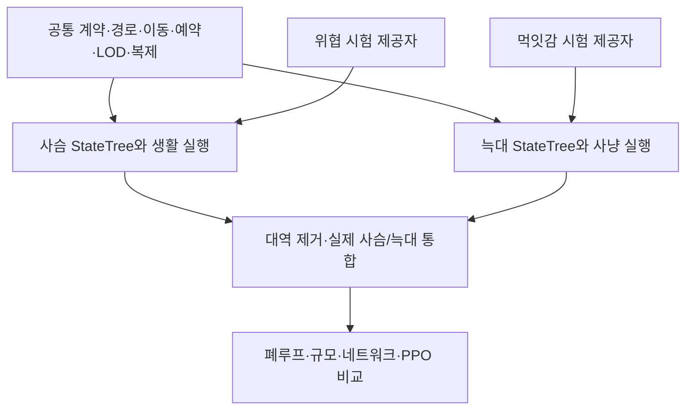

# 사슴·늑대 독립 개발 및 후속 통합 마스터 계획

프로젝트 전체 목표와 종 독립성은 [공통 맥락](../../PROJECT_CONTEXT.md)을 먼저 읽는다. [세부 기획 §21](../../Architecture/DYNAMIC_ECOSYSTEM_DETAILED_DESIGN_20261023.md#21-종에-독립적인-능력과-실행-계약)은 아래 기존 경로를 재사용/확장하는 후속 제안이며, Native v3 기본 경로의 자동 교체나 모든 신규 종의 지원 완료를 뜻하지 않는다.

작성일: 2026-10-14 / UE 5.8 / Source 기준: `M4` HEAD `3062180f895c7dc7e738f8f9efdc720788f40ef1` + 미커밋 작업 폴더.

상태: **기본 M1~M5 코드·설정 에셋 구현 / Editor 빌드·에셋 재로드 확인 / PIE·네트워크·성능 gate 대기**. 아래 상세 계획은 목표 설계이며, 실제 구현 범위와 차이는 [구현 마일스톤](IMPLEMENTATION_MILESTONES.md), [파일별 책임·현재 계약](SOURCE_RESPONSIBILITIES.md)을 사실 기준으로 읽는다. 사용 순서는 [Editor 빠른 시작](EDITOR_QUICK_START.md)이다.

## 1. 이번 개발의 구성

사슴과 늑대를 상대 종의 구현 완료에 의존하지 않고 개발한다. 공통 계약·이동·예약·생명주기·LOD·복제 기반은 하나로 만들고, 종별 입력과 StateTree만 분리한다. 처음부터 두 개의 생태계나 두 개의 movement framework를 만들었다가 합치는 방식은 사용하지 않는다.

문서 구성:

| 문서 | 구현할 내용 |
| --- | --- |
| [공통 런타임 상세 설계](COMMON_RUNTIME_IMPLEMENTATION_PLAN.md) | 실제 UE Trait·Fragment 구성, StateTree/Utility 실행, 예산형 NavMesh, Mass Force/Avoidance·단일 이동, Smart Object 예약, 생태 거래, Simulation/Replication LOD |
| [사슴 독립 개발 계획](DEER_INDEPENDENT_DEVELOPMENT_PLAN.md) | 먹이 탐색·접근·섭식·휴식·무리 복귀·위협/도주·Shelter·회복, 위협 대역과 단계별 검증 |
| [늑대 독립 개발 계획](WOLF_INDEPENDENT_DEVELOPMENT_PLAN.md) | 순찰·수색·감각 기억·추적·공격 요청·섭식·회복·사냥 포기, 먹잇감 대역·표적/공격/사체 계약 |
| [기존 PPO 비교 계획](../MASS_STATETREE_PPO_COMPARISON_DEVELOPMENT_PLAN_2026-10-14.md) | 정책만 비교하는 A와 전체 이동 스택을 비교하는 B, seed/manifest·성능/생태 평가 |

이번 문서가 종별 구현과 공통 엔진 연결의 상세 기준이다. 기존 비교 계획의 E0~E8은 비교 목적의 순서이며, 실제 개발은 아래 **공통 기반 → 종별 독립 개발 → 통합 → 비교** 순서로 구체화한다. 기존 PPO 경로·기본 설정·가중치·V1 수치는 유지한다.

## 2. 독립 개발 월드와 실험 대역

| 월드 구성 | 실제 권위 Entity | 실험 입력 | 완료 판단 |
| --- | --- | --- | --- |
| DeerOnly | 사슴 | scripted 위협 위치/소음·Shelter 소멸·자원 사건 | 늑대 구현 없이 생활·도주·예약·섭식·사망·이주·복제 확인 |
| WolfOnly | 늑대 | scripted prey cue/경로·가상 공격 결과·명시적 영양 공급 | 사슴 Brain 없이 감각·추적·포기·요청/결과·생존·복제 확인 |
| DeerWolf | 실제 사슴·늑대 | 정상 World/Ecology 입력 | 실제 탐지→도주/추격→포식→자원/개체군 피드백 |

대역은 후보를 생성하는 test provider다. 정책에 정답 위치·다음 이동·가상 체력 정보를 직접 전달하지 않는다. 감각 판정을 통과한 snapshot만 Brain에 전달한다. Fixture ID는 실제 StableAgentId와 다른 domain이며 실제 Population·PredationHistory·Death에 섞지 않는다.

독립 결과는 단독 기능의 증거다. 늑대의 가상 포획 성공을 실제 사슴 포식 검증으로, 사슴의 scripted 도주 성공을 실제 협동 사냥 대응으로 확대하지 않는다.

계획 당시 `RegisterTemplates`는 두 종 Config를 항상 검사했다. 현재 구현은 `EnabledSpecies=DeerOnly/WolfOnly/Both`로 활성 역할만 설정·등록·스폰·wave 검사를 수행한다. 실험 Actor가 두 번째 clock/coordinator를 만들지 않고 기존 Creature coordinator의 fixture 옵션을 사용한다. Box 혼용 가드는 유지한다.

## 3. 기술별 최종 구현 결정

| 기술 | 사용할 방식 | 보충 구현 |
| --- | --- | --- |
| StateTree Utility | Mass schema + 종별 StateTree asset + common Consideration/response curve | 값 snapshot Evaluator, action/intent 발행 Task, signal/wakeup scheduler·dependency 선언 |
| Mass NavMesh Navigation | 엔진 CachedPath/ShortPath·PathFollow/Boundary Processor 재사용 | 경로 예산·revision·cancel을 관리하는 공통 path service. 기본 Task의 동기 탐색을 각 Brain에서 무제한 호출하지 않음 |
| Mass Movement/Avoidance | 엔진 Movement/Steering/Avoidance Trait와 ApplyForce 계산 | 실제 충돌·지면·지역 제약을 처리하는 공통 최종 Movement Processor 하나 |
| Smart Objects | authored slot 검색/Claim/Use/Release + Mass user 데이터 | Shelter는 기존 Social, Graze/Rest/Carcass는 Activity reservation owner로 분리하고 하나의 facade로 연결 |
| Simulation LOD | 엔진 거리 수집/Simulation LOD + 프로젝트 중요도 보정 | 초기 stock variable ticking은 끄고 결정·검색·경로 예산부터 조절. 상세 이동/생태 정지 금지 |
| Replication LOD | 기존 Mass Bubble·Replicator·연결별 LOD 재사용 | 최소 활동 DTO, 기존 revision·Client 보간·Actor pooling 유지 |

**기존 비교 계획의 L1을 상세화한다.** 최종 production 후보는 엔진 기본 `UMassApplyMovementProcessor`에 지면 처리를 덧붙이는 두 번 이동이 아니다. 엔진 Force/DesiredMovement 계산을 소비하는 custom final writer를 사용해 물리 제약과 위치 적분을 한 번에 처리한다. 평면 smoke test에서만 엔진 기본 적분을 쓸 수 있고 production Entity에는 두 writer를 함께 쓰지 않는다.

## 4. 공통 개발 단계

| 단계 | 산출물 | gate |
| --- | --- | --- |
| C0 기준선·활성 역할 | RoleMask, manifest, 현재 Source/Config 검사, 실험 provider 경계 | 상대 종 Config 없이 단독 월드 시작, 기본 기존 PPO 경로 보존 |
| C1 계약·Traits·StateTree | 공통 requests/results/profiles, 종별 Trait, Mass Task/Evaluator, Signal 연결 | 필요한 external data·dependency 확인, backend/Brain 단일화 |
| C2 이동·경로 | Nav service·corridor·short path·Steering/Avoidance·final movement·feedback | 평면/경사/금지영역/막힘/취소, 위치 writer 하나 |
| C3 예약·거래 | Interaction facade, slot owner, 이용 시간 회계, 기존 Ecology/Lifecycle 연결 | Claim rollback·해제·실제 배분과 Energy 일치 |
| C4 LOD·복제·계측 | engine LOD 보정, budget/scheduler, 활동 DTO, diagnostics | no-player 서버·원거리 생태·Client 읽기 전용·성능 기준선 |

C1은 작은 수의 평면 smoke test로 먼저 검증한다. C2/C3가 끝나기 전 종별 Brain은 값 의도·대역 feedback으로 개발할 수 있으나 production 이동/섭식 완료로 기록하지 않는다. C4의 계측은 C0부터 준비하고 최적화는 기능별 기준선 뒤 수행한다.

## 5. 종별 개발과 합치는 순서

사슴 D0~D8, 늑대 W0~W9의 세부 작업과 완료 조건은 각 문서를 따른다. 양쪽은 동일한 공통 인터페이스 version에 의존한다. 공통 계약 변경 시 두 종 컴파일·구성 검증을 한 번에 확인한다.

| 통합 단계 | 수행 | 완료 조건 |
| --- | --- | --- |
| I0 호환성 | fixture를 끄고 두 Config·SpeciesId·target domain·예약 kind 점검 | 필수 데이터/버전·권위 검사 통과, fixture 데이터 0건 |
| I1 탐지·이동 | 소수 사슴/늑대 분리 스폰, 공격 비활성 | 서로 감각 범위/FOV/LOS를 거쳐 발견, 정상 도주·추적, 중복 이동 없음 |
| I2 실제 포식 | 공통 AttackResolver를 실제 target domain에 연결 | 한 prey 한 death receipt, cooldown/reward/Population·PredationHistory 일치 |
| I3 자원·생활 | 사슴 실제 Graze + 늑대 실제 capture nutrition | 자원 원장·섭식 구간·에너지·기아가 닫힌 루프로 진행 |
| I4 Shelter·이주 | 슬롯 경쟁·파괴·지역 이동 중 조우/사망 | 정리·도착·지역·인구 보존, path cancel의 영향 추적 가능 |
| I5 규모·네트워크 | 여러 Client·원거리/no-player·soak | 동일 AI 의미를 유지하면서 비용/지연·네트워크 예산 충족 |
| I6 PPO 비교 | 기존 A/B 프로토콜 실행 | 동일 조건 manifest·오류/fallback 공개, 정책/이동/늑대 변화 효과 분리 |

PPO V1 정책만 비교하는 A는 사슴의 추가 생활·stamina·fixture/정보 확장을 공통 조건으로 묶거나 모두 끈다. 새 사슴 전체 기능과 기존 PPO 기본 실행을 비교한 결과는 전체 시스템 비교다. 늑대의 W1 변경을 동시에 켜서 사슴 정책 우열로 해석하지 않는다.

## 6. 확장 순서

1. 현재 Region Food + authored 이용 위치로 시작한다. 지역 합계와 분리되는 patch ledger는 Ecology 확장으로 추가한다.
2. 포획 후 일회 보상과 사체 섭식 방식은 서로 다른 nutrition mode로 둔다. 사체는 ResourceId와 양을 갖는 독립 자원 계약이 준비되면 추가한다.
3. Stamina/수분/체온/부상/종별 locomotion은 capability Fragment·프로필과 공통 생존 adapter로 확장한다. 모든 종에 사용하지 않는 큰 struct를 붙이지 않는다.
4. Herd는 기존 Social 소유다. Wolf Pack·협동 사냥은 새 Social contract로 추가하고 steering 무리 이동과 구분한다.
5. 번식·새 종·집계 원거리 simulation·영속 저장은 WorldEpoch/StableId·자원/인구 보존 계약을 갖춘 뒤 추가한다. 화면 밖 entity 제거를 영속성으로 간주하지 않는다.

## 7. 협업·완료 산출물

공통 runtime/계약·종별 Brain·Social 예약·Movement·World/에셋·평가의 변경 파일을 분리한다. 담당자 배정은 제안이며 실제 배정을 수행한 문서가 아니다. Build.cs/uproject/Coordinator/공통 DTO·시계·실행순서는 통합 변경으로 조정한다. 사슴/늑대 asset은 다른 파일로 작업하고 동일 Blueprint를 동시 수정하지 않는다.

각 단계 PR에는 읽기/쓰기, phase/prerequisite, thread 문맥, 취소/유효시간, Config/프로필 version, 실제 UBT·수동 PIE/서버/Client·cook 검증 기록을 붙인다. 기존 자동화 테스트 생략 방침에 맞춘 수동 scenario와 반복 capture를 기본으로 하며 실행하지 않은 검증은 미수행으로 표시한다.

최종 인계물은 4개 상세 문서, 공통 contract/profile, 2개 종별 StateTree, authority/client EntityConfig, DeerOnly/WolfOnly/DeerWolf 레벨, fixture provider, 단계별 검증 기록, 비교 manifest/CSV·capture·known limitations다. 최종 처리 규모와 예산은 C0에서 목표 hardware·tick을 기준으로 수치화하며 실측 전 보장하지 않는다.

## 8. 불변 계약

[루트 AGENTS.md](../../../../AGENTS.md), [현재 M4 실행 계약](../M4_RUNTIME_INTEGRATION_CONTRACT.md), [V1 정책 계약](../../RL_Policy/POLICY_CONTRACT_V1.md), [Social 이동/예약 계약](../../조연우/SOCIAL_MOVEMENT_HANDOFF_AND_SHELTER_LIFECYCLE.md), [Mass 순서](../../Mass/MASS_PROCESSOR_ORDER.md)를 따른다. 신규 구현은 opt-in 실험 범위이며 기존 기본 경로를 조용히 교체하지 않는다.
