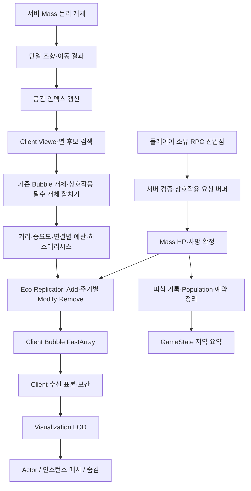

# M4 상세 구현 계획 — 대규모 Mass 복제 LOD, 공간 검색, 표현과 상호작용

> 작성일: 2026-10-05 / 기준 엔진: Unreal Engine 5.8\
> 상태: **구현 계획**. 아래 마일스톤의 완료·성능 달성을 선언하는 문서가 아니다.\
> 기준: 현재 저장소 소스, 설치된 UE 5.8 MassReplication 소스, Epic 공식 API 문서.

## 1. 목표와 이번 단계의 범위

M4는 서버에 존재하는 대규모 논리 개체 중 각 Client에 필요한 개체만 선택하여 복제하고, 수신한 개체를 제한된 비용으로 표현한다. 플레이어 상호작용은 서버 Mass 개체에 적용한 뒤 사망·Population·PredationHistory·표현 상태로 전달한다.

먼저 기존 Box 개체와 임시 표현 에셋으로 Network/Representation을 구현한다. 다른 작업자의 행동·특성 계약에 맞춘 최종 Spawn은 별도 통합 작업으로 보류한다. M4에서 말하는 Actor spawn은 **기존 논리 개체의 표현 생성**이며, M3의 개체군 생성·특성 배정과 구분한다.

대규모 구현은 다음 세 비용을 따로 줄여야 한다.

- **서버 검색 비용:** 전체 N개체를 각 Client마다 순회하는 비용을 공간 후보 검색으로 줄인다.
- **네트워크 비용:** 후보 K개체 중 필요한 개체만 선택하고 거리·중요도에 따라 전송 빈도를 제한한다.
- **Client 표현 비용:** 수신 프록시 중 제한된 수만 Actor로 표현하고 나머지는 인스턴스 메시 또는 숨김으로 처리한다.

쿼드트리·옥트리 도입만으로 갱신 빈도나 Actor 수가 제한되지는 않는다. 최종 규모는 검색·직렬화·대역폭·Client CPU/GPU·서버 생태 계산을 함께 측정하여 결정한다.

### 관련 계약

- [M4 범위와 완료 기준](M4_REPRESENTATION_INTERACTION.md)
- [Network Authority 계약](../../Network/MASS_NETWORK_AUTHORITY_CONTRACT.md)
- [Active Runtime 경계](../../Architecture/ACTIVE_RUNTIME_BOUNDARIES.md)
- [Mass 실행 순서](../../Mass/MASS_PROCESSOR_ORDER.md)
- [M3 구현 계획](../M3/M3_IMPLEMENTATION_PLAN.md), [M3 검증 기록](../M3/M3_VALIDATION_REPORT.md)
- [협업 코드 통합 계획](../../Architecture/COLLABORATOR_ECOSYSTEM_INTEGRATION_PLAN.md)
- [Policy V1](../../RL_Policy/POLICY_CONTRACT_V1.md), [M5 폐루프](../M5/M5_PPO_CLOSED_LOOP.md)
- [공식 문서·공개 프로젝트 비교 조사](M4_REFERENCE_RESEARCH.md): 단계별 참고 범위, 확인한 소스, 우리 구현과의 유사점/차이점.

## 2. 현재 상태와 확인된 공백

| 영역 | 현재 소스에서 확인한 상태 | M4에서 해야 할 일 |
| --- | --- | --- |
| 서버/Client 템플릿 | `UEcoMassNetworkTrait`가 엔진 Replication Trait를 확장하고 Authority/ClientProxy를 분리 | 새 표현·보간 Fragment를 역할에 맞게 추가. Client에 행동 계산 Trait를 넣지 않음 |
| 개체 전송 | `UEcoMassReplicator` + `AEcoMassClientBubbleInfo` + FastArray | LOD별 주기 제한, 시각 상태, 중요한 변경 전달 |
| 전송 payload | Position/Yaw, StableAgentId, SpeciesId, RegionId | 표본 시각/순서·불연속 이동·시각 상태의 최소 계약 확정 |
| 수신 | Bubble handler가 엔진 Transform handler로 수신 위치를 적용 | 엔진 보간 지원 조사 후 수신 목표와 렌더 Transform의 작성자를 정리 |
| 템플릿 지연 | 수신 TemplateID가 없으면 ReplicationID를 추적해 재시도 | 보간·사망·표현 전환 후에도 지연 Add/Remove 정합성을 유지 |
| 갱신 간격 | 현재 Modify callback은 LOD/Time을 무시. 엔진 공통 `CalculateClientReplication`에도 UpdateInterval gate가 없음 | 설정값만 바꾸지 않고 Replicator에서 시간 비교와 LastUpdateTime 갱신 구현 |
| 공간 검색 | 엔진이 `FReplicationHashGrid2D`를 질의하고 기존 HandledEntities도 처리 | baseline 측정. 트리 교체 시 기존 개체의 Off/Remove 경로 보존 |
| 표현 Actor | `ACreatureCharacter`가 Legacy `EcoDataContracts`와 Evolution Profile을 사용 | Active Runtime Snapshot 기반 표현 Actor/adapter 마련 |
| HP/사망 | Vitals Fragment와 Alive Tag, 지역 피식 이벤트 계약은 존재 | 통합 경로의 Damage/Death 처리·중복 방지·정리 구현. 이미 완성된 것으로 가정하지 않음 |
| 생태 요약 | GameState가 완료 자원 단계의 지역 집계를 전달 | 실시간 개체 스트림과 별도 시간 경계를 유지 |

M3 문서에는 이주 코드·빌드 성공과 일부 Standalone 관찰이 기록되어 있다. Host/Client, Late Join, 동시 Spawn Waves, 장시간 실행은 재확인이 필요하다. 이 기록을 M3 전체 완료로 바꾸지 않는다. M4.0에서 복제 기반을 확인한 뒤 LOD 개발에 진입한다. Energy 대사·기아 사망·PPO/Social 단일 이동 통합은 별도 M3/M5 연결 항목으로 추적하되, 플레이어 공격에 의한 권위 사망은 M4.8에서 실제로 구현한다.

### 설치된 UE 5.8 소스에서 확인한 사실

엔진 경로는 `Engine/Plugins/Runtime/MassGameplay/Source/MassReplication/`이다.

- `Private/MassReplicationGridProcessor.cpp`: PostPhysics에서 Transform을 읽어 2D 인덱스를 추가·이동·제거한다. `FMassOffLODTag`가 붙은 개체는 검색 그리드에서 제외한다.
- `Private/MassReplicationProcessor.cpp`: Client의 Viewer별 영역 질의 결과에 `ClientReplicationInfo.HandledEntities`를 합치고 중복을 제거한다. Client별 LOD를 계산하고 Replicator를 호출한다.
- `Public/MassReplicationProcessor.h`: common helper는 Add/Modify/Off Remove와 pending destruction을 처리한다. Add에서 LastUpdateTime을 설정하지만 Modify에 대한 UpdateInterval 제한은 하지 않는다.
- `Public/MassReplicationFragments.h`: 거리·개수·갱신 간격 설정과 Client를 처리하는 동안의 LOD Fragment를 제공한다.

이 사실 때문에 **선행 Processor가 모든 개체의 단일 Replication LOD 값을 한 번 덮어쓰는 방식**으로 Client별 중요도를 구현하지 않는다. 엔진은 Client마다 상태를 동기화·재계산하므로, Client별 LOD 계산/선정 경계 안에 확장이 필요하다.

## 3. 목표 데이터 흐름과 불변 조건



| 상태/서비스 | 소유자 | 주의 사항 |
| --- | --- | --- |
| HP, Alive, 이동, Region, StableAgentId | 서버/Standalone Mass Entity | 표현 전환으로 Entity를 재생성하지 않음 |
| Food, PredationHistory, 지역 Population | 서버 Ecology | Client의 프록시 수로 집계하지 않음 |
| 공간 인덱스 | 서버의 로컬 서비스 | Bounds와 로컬 EntityHandle/보조 슬롯만 참조. 두 번째 생태 장부를 만들지 않음 |
| Client별 복제 상태/시간/예산 | 연결별 복제 데이터 | ClientHandle 수명과 연결 해제를 반영. shared fragment 설정과 연결별 가변 상태를 혼합하지 않음 |
| 표본/보간/Representation | Client, Listen Host의 로컬 표현 | 권위 상태로 역반영하지 않음 |
| 전송 | Bubble Actor/FastArray, GameState, 플레이어 소유 Actor RPC | Subsystem 자체에 RPC/Replicated 프로퍼티를 만들지 않음 |

`StableAgentId`는 논리 ID, `FMassNetworkID`는 전송 ID, `FMassEntityHandle`은 World 로컬 핸들이다. Handle은 네트워크·저장 식별자로 사용하지 않는다. Client relevance 이탈은 서버 사망이 아니며, Client 재진입은 서버 재출생이 아니다.

Simulation LOD, Replication LOD, Visualization LOD를 분리한다. M4에서는 원거리 개체의 서버 생태 계산을 끄지 않는다. 특히 Client별 Off 상태를 서버 `FMassOffLODTag`로 표현하면 다른 Client의 검색 대상까지 제거될 수 있으므로 금지한다. 현재 Box bootstrap의 Simulation LOD 혼용 금지와 `mass.UseProcessingQueue=0` 호환성 설정을 유지하며, 변경이 필요하면 별도 엔진 호환성 검증을 수행한다.

## 4. 마일스톤 전체 순서

| 단계 | 결과 | 선행 조건 | 완료 게이트 |
| --- | --- | --- | --- |
| M4.0 | 네트워크 baseline·측정 환경 | 현재 M3 Box 경로 | Host/Client·재진입·ID 검증, 성능 기록 형식 확정 |
| M4.1 | 설정·표현·전송 계약 확정 | M4.0 | 역할별 Fragment, 시간/상태/ID 규칙, 예산 정의 |
| M4.2 | 실제 Replication LOD 갱신 주기 | M4.1 | LOD별 간격 실측, 중요 변경·Remove 정상 전달 |
| M4.3 | 공간 검색 baseline와 트리 비교 | M4.0~2 | 정확성·검색/갱신 총비용 비교, backend 결정 |
| M4.4 | Client 보간과 불연속 이동 처리 | M4.1~2 | 단일 Transform writer, 지연·손실·재진입 안정성 |
| M4.5 | 거리 기반 Actor/인스턴스 메시 표현 | M4.4 | Stable ID 유지, 중복 표현 0, Actor 수 제한 |
| M4.6 | Client별 중요도·예산·전환 안정성 | M4.3·5 | 상호작용 필수 개체 보장, 전체 연결 예산 제한 |
| M4.7 | 서버 검증 상호작용 진입점 | M4.6 | 요청 검증·중복 방지·동시 요청 안전성 |
| M4.8 | 사망·피식·집계·표현 제거 연결 | M4.7 | 한 번의 Death commit, 지역 피드백·Client 상태 일치 |
| M4.9 | 대규모 통합 검증과 M5 인계 | M4.0~8 | 하드웨어별 성능표·회귀 시나리오·완료 보고 |
| M4.X | 선택적 쿼드트리/옥트리 운영 통합 | M4.3의 도입 판단 | M4.6·9 동일 게이트 통과, 기본 그리드 fallback |

M4.X는 트리 비교가 운영상 이점을 입증했을 때 진행한다. 트리 도입을 선택하면 운영 통합 완료까지 M4.9 승인 대상에 포함한다. baseline backend를 선택해도 M4.3의 비교 결과와 도입/보류 근거를 남긴다.

## 5. M4.0 — baseline 재현과 계측

**목적:** 지금 동작하는 복제 경로와 성능을 고정하여 후속 변경의 효과를 판단한다.

**공식 참고:** [PIE Multiplayer Options](https://dev.epicgames.com/documentation/unreal-engine/play-in-editor-multiplayer-options-in-unreal-engine), [Mass Debugger](https://dev.epicgames.com/documentation/en-us/unreal-engine/mass-debugger-overview), [Networking Insights](https://dev.epicgames.com/documentation/unreal-engine/networking-insights-in-unreal-engine). World/NetMode별 Fragment를 확인하고 연결별 packet/bytes를 측정한다. 측정 프리셋·ID 대응 검사는 프로젝트가 추가한다.

1. 기존 A/B Region, 동일 EntityConfig, Box 표현을 사용하는 M4 전용 테스트 레벨/프리셋을 준비한다. 기존 작업 레벨을 덮어쓰지 않는다.
2. Standalone, Listen Host + 1 Client, Host + 2 Clients를 확인한다. Client를 서로 다른 지역과 겹치는 관심 영역에 배치한다.
3. 양쪽 TemplateID와 역할별 Fragment를 확인한다. 첫 Bubble 수신보다 템플릿 등록이 늦은 경우 Add 대기·Change·Remove·재시도가 정상인지 확인한다.
4. 관심 범위 진입/이탈/재진입, Late Join, 이주 중 Region commit, PIE 재시작을 기록한다.
5. Authority 개체 수, 전체 Alive 수, 연결별 Bubble 수, Client 프록시 수, Actor/인스턴스 수를 각각 표시한다.
6. Unreal Insights CPU trace와 네트워크 측정을 준비한다. 공간 갱신·질의·LOD 계산·직렬화·Client 보간·Actor 전환 비용을 분리한다.

**결과물:** `M4_EDITOR_TEST.md`, `M4_VALIDATION_REPORT.md`, 성능 캡처 위치/프리셋. 파일은 해당 단계 구현 때 생성하며, 미실행 항목은 명시한다.

**측정 필드:** 엔진/커밋, 장비/해상도, NetMode, 논리 개체 N, Client 수 C, 이동 비율, 분포, 관심 반경, 후보 K, LOD별 수, 표본 간격, 연결별 bytes/s, Client CPU/GPU 프레임 시간, p50/p95/p99, Add/Remove와 전환 수, 메모리.

**완료 기준:** 동일 ID가 서버와 수신 Client에서 대응하고, Client 범위 이탈이 Population을 바꾸지 않는다. 범위 밖 개체도 서버 이주를 계속한다. baseline trace와 재현 설정이 저장된다.

## 6. M4.1 — LOD 설정과 데이터 계약

**목적:** 이후 구현자가 같은 의미·단위·역할을 사용하게 한다.

**공식 참고:** [ReplicationParameters](https://dev.epicgames.com/documentation/unreal-engine/API/Plugins/MassReplication/FMassReplicationParameters), [ReplicationSubsystem](https://dev.epicgames.com/documentation/en-us/unreal-engine/API/Plugins/MassReplication/UMassReplicationSubsystem), [FastArraySerializer](https://dev.epicgames.com/documentation/unreal-engine/API/Runtime/NetCore/FFastArraySerializer). 설정·연결·dirty 처리 API를 확인한다. StableAgentId, 표본 시간, visual revision과 연결 전체 예산은 프로젝트 계약이다.

### 설정

- 기존 Replication Trait의 `FMassReplicationParameters`를 거리/개수/UpdateInterval/히스테리시스 설정의 기본 출처로 사용한다. 별도 설정 UI는 이를 검증·적용하는 프리셋 역할로 제한한다.
- 거리 단위는 Unreal cm, 갱신 간격은 초다. 거리 경계는 증가 순서, 간격은 양수·유한값, 수 제한은 유효 범위인지 검증한다.
- 연결 전체 예산과 종/Template별 엔진 LODMaxCount의 범위를 구분한다. 여러 종의 별도 shared 설정에 각각 500개를 허용하면 연결 전체 500개가 보장되지 않는다.
- 데이터 프리셋 수정은 다음 PIE/템플릿 생성부터 적용하는 것으로 시작한다. 런타임 변경이 필요하면 const shared fragment를 안전하게 재구성하는 별도 절차를 둔다.

### 전송·표현

| 값 | 제안 계약 | 구현 시 결정할 내용 |
| --- | --- | --- |
| ID/종/지역 | 현재 payload 유지 | FName 전송 비용은 실측 후 압축 검토 |
| 이동 표본 | 위치/방향 + 서버 표본 시각 또는 순서 | Network real time 기준과 Client 시각 동기화 방식 |
| 불연속 이동 | teleport/reset 판별 정보 | 보간 버퍼 초기화 조건과 허용 이동 오차 |
| 시각 상태 | NormalizedHealth, 이동/사망 등 필요한 최소 상태 | bit/quantization·revision·상태 변경 빈도 |
| 보간 상태 | Client 전용 per-entity fragment | 이전/현재 표본, 최신 순서, 버퍼 길이, stale 상태 |
| 표현 초기화 | `FEcoRepresentationSnapshot` 기반 읽기 전용 입력 | species→mesh/anim/actor class 매핑 |
| 사망 결과 | 살아있는 상태와 구별되는 지속 상태 또는 terminal 전달 계약 | M4.8의 잔류 기간·ACK 필요 여부·Late Join 규칙 |

Network 표본 시간과 생태 WorldClock은 구분한다. 현재 엔진 helper는 `GetRealTimeSeconds()`를 사용하므로 전송 제한도 같은 시간원을 사용한다. GameState의 생태 Epoch/Step은 별도 완료 snapshot이다. 서로 다른 스트림이 같은 프레임에 도착한다고 가정하지 않는다.

**구현 대상:** `Core/EcoRepresentationTypes.h`, `Network/Mass/EcoMassReplicationTypes.h`, `Mass/EcoMassNetworkTrait.*`. 보간·표현 전용 신규 파일의 이름은 M4.4/5에서 확정한다. Observation/PolicyOutput/Runtime Index/EntityHandle은 기본 payload에 추가하지 않는다.

**완료 기준:** payload 표, role별 Fragment 표, 프리셋, 중요 변경 우선 전달 규칙이 확정된다. 서버/Client의 동일 Config GUID와 TemplateID 호환성이 유지된다.

## 7. M4.2 — 실제 Replication LOD와 전송 빈도 제한

**현재 구현:** [연결별 간격·우선 전달·계측](M4_2_REPLICATION_INTERVAL.md)을 구현했다. [빌드/수동 검증 현황](M4_VALIDATION_REPORT.md)을 별도로 기록하며, 아래 실측 완료 게이트는 PIE 확인 후 판정한다.

**목적:** LOD 설정이 실제 표본 갱신 간격으로 작동하게 한다.

**공식 참고:** [MassGameplay LOD 구분](https://dev.epicgames.com/documentation/unreal-engine/overview-of-mass-gameplay-in-unreal-engine), [ReplicationParameters](https://dev.epicgames.com/documentation/unreal-engine/API/Plugins/MassReplication/FMassReplicationParameters), [ReplicationProcessor](https://dev.epicgames.com/documentation/unreal-engine/API/Plugins/MassReplication/UMassReplicationProcessor). 실제 호출 경계는 설치 엔진의 `MassReplicationProcessor.h`와 `MassReplicationTransformHandlers.h`를 함께 읽는다. API에 UpdateInterval이 존재한다는 사실만으로 현재 Eco Replicator의 시간 gate를 보장하지 않는다.

1. `UEcoMassReplicator::ModifyEntity`에서 LOD/Time을 읽고 현재 Client의 AgentData.LastUpdateTime과 비교한다.
2. `FMassReplicationParameters::UpdateInterval[LOD]`가 지나기 전에는 일반 Transform 표본을 건너뛴다. 생태계 프레임 수와 무관하게 초 단위로 판정한다.
3. 표본 처리를 수행한 시점에 LastUpdateTime을 갱신한다. 위치 dirty tolerance 검사와 표본 처리 시각 갱신 정책을 명시하여 정지 개체에서 매 프레임 같은 검사로 돌아가지 않게 한다.
4. 신규 Add는 완전한 현재 snapshot으로 즉시 처리한다. Region commit, 시각 상태 revision, 사망, teleport는 일반 위치 간격보다 우선하여 필요한 항목을 dirty 처리한다.
5. High 승격 직후 최신 표본을 보낼지 정의하고, 동시 승격에 의한 폭주를 계측한다. 신규 Add 분산은 별도 큐 수명·취소 계약이 필요하므로 M4.6에서 구현한다.
6. Off/파괴 Remove는 interval gate 바깥에서 처리한다. 주기 제한으로 Bubble 제거가 지연되지 않게 한다.
7. Client별 시간 상태를 엔진의 동기화 경계와 함께 갱신한다. Client A의 gate가 B의 갱신을 제한하지 않는지 확인한다.

### 실험용 시작 프리셋

아래는 **설계 실험용 제안값**이며 현재 적용값이나 성능 보장값이 아니다. 실제 엔진 배열의 거리 경계 의미를 확인한 후 Trait에 매핑한다.

| 관심 거리 | Replication 등급 | 표본 간격 | Client 표현 방향 |
| --- | --- | --- | --- |
| 약 0~20m | High | 0.05~0.10초 | 예산 안에서 Actor |
| 약 20~80m | Medium | 0.20초 | 인스턴스 메시 중심 |
| 약 80~200m | Low | 0.50~1.00초 | 저비용 표현/숨김 |
| 범위 밖 | Off | 일반 개체 표본 없음 | 프록시 제거, 지역 요약 사용 |

게임 속도·시야·공격 거리·애니메이션 품질에 맞춰 조정한다. Network 표본 빈도는 실제 packet 전송 빈도와 같지 않다. Bubble Actor의 NetUpdateFrequency, bandwidth, FastArray dirty 여부도 함께 확인한다.

**완료 기준:** 같은 속도로 움직이는 개체의 서버 표본 갱신 간격이 LOD별 설정과 일치한다. 두 Client의 다른 거리에서 다른 빈도로 전달된다. Off 제거·Region commit·상태 변경은 일반 간격 때문에 유실되지 않는다.

## 8. M4.3 — 공간 검색 측정과 쿼드트리/옥트리 비교

**목적:** 수직 분포와 동적 이동량을 포함해 인덱스를 선택한다.

**공식 참고:** [ReplicationGridProcessor](https://dev.epicgames.com/documentation/unreal-engine/API/Plugins/MassReplication/UMassReplicationGridProcessor), [HierarchicalHashGrid2D](https://dev.epicgames.com/documentation/unreal-engine/API/Runtime/AIModule/THierarchicalHashGrid2D), [TOctree2](https://dev.epicgames.com/documentation/en-us/unreal-engine/API/Runtime/Core/TOctree2). 추가·이동·제거·질의와 Bounds 판정의 의미를 확인한다. backend 비교 방법과 선택 기준은 프로젝트 실측으로 결정한다. 공개 쿼드트리/군집 코드의 비교는 [참고 조사](M4_REFERENCE_RESEARCH.md)를 따른다.

### 기본 경로

엔진 `FReplicationHashGrid2D = THierarchicalHashGrid2D<2, 4, FMassEntityHandle>`를 baseline으로 사용한다. Hierarchical Hash Grid의 레벨은 개체 Bounds 크기에 따라 선택되며, 쿼드트리처럼 밀도에 따라 노드를 재귀 분할하는 구조가 아니다.

1. `ReplicationGridCellSize`를 관심 반경/개체 밀도에 맞춰 여러 값으로 비교한다.
2. 질의는 broad phase 후보를 반환한다. 최종 거리·필요한 높이 검사 후 LOD를 계산한다. false positive 수와 최종 수의 비율을 기록한다.
3. 균일 분포, 특정 지역에 집중된 군집, 희소 장거리 분포, 빠른 이주, 수직으로 겹친 층을 비교한다.
4. 질의만 측정하지 않고 이동에 따른 갱신·할당·메모리·정리 비용을 함께 측정한다.

### 트리 실험 경로

| backend | 적합한 분포 | 구현 고려 사항 |
| --- | --- | --- |
| 엔진 2D hash grid | 지상 중심, 많은 동적 개체 | 셀 크기와 과밀 후보 증가, 높이 false positive |
| loose quadtree | 2D이며 밀도 차이가 큰 지역 | loose bounds·최대 깊이·노드 용량·분할/병합·바깥 root 처리 |
| UE `TOctree2` 기반 octree | 비행/수중/동굴처럼 3D 후보 감소가 큰 분포 | Element semantics, bounds, element ID, 이동 재삽입, root/world 범위 |

비교용 인덱스는 같은 서버 Transform snapshot을 사용하고 Network payload나 생태 상태를 바꾸지 않는다. 소규모 full scan을 정답으로 삼아 후보 누락과 범위 경계 오차를 검사한다. 2D backend도 최종 3D 거리 검사 규칙을 동일하게 적용한다. 트리 결과를 실사용 Bubble과 동시에 보내지 않는다.

### 운영 도입 판단

- 목표 장면에서 후보 검색 또는 수직 false positive가 실제 병목이면 트리 도입을 검토한다.
- `갱신 + 질의 + 후보 검증 + 추가 관리`의 p95 비용과 메모리·프레임 spike를 baseline과 비교한다.
- 예시 도입 기준은 목표 장면에서 총비용 20% 이상 감소하면서 정확성·메모리 예산을 만족하는 것으로 둔다. 20%는 프로젝트의 초기 판단 기준이며 실측 후 M4.0 성능 예산에 맞춰 조정한다.
- 렌더링·네트워크 전송·생태 계산이 주 병목이면 해당 비용을 먼저 개선하고, 트리는 비교 결과와 함께 보류한다.

**완료 기준:** 동일 입력으로 backend별 정확성/총비용 비교표를 만들고 기본 backend를 결정한다. 트리의 점근 복잡도만으로 대규모 수용량을 선언하지 않는다.

## 9. M4.X — 선택적 공간 트리의 운영 통합

**목적:** M4.3에서 선택한 트리를 실제 Client 후보 검색에 연결한다.

**공식 참고:** [ReplicationSubsystem](https://dev.epicgames.com/documentation/en-us/unreal-engine/API/Plugins/MassReplication/UMassReplicationSubsystem), [ReplicationProcessor](https://dev.epicgames.com/documentation/unreal-engine/API/Plugins/MassReplication/UMassReplicationProcessor), [TOctree2](https://dev.epicgames.com/documentation/en-us/unreal-engine/API/Runtime/Core/TOctree2), [MassObserverProcessor](https://dev.epicgames.com/documentation/unreal-engine/API/Runtime/MassEntity/UMassObserverProcessor). 설치 엔진 `MassReplicationProcessor.cpp`의 Grid 질의/HandledEntities 합치기와 `GenericOctree.h`의 membership API를 확인한다. 공간 backend를 Trait 설정만으로 교체하는 공식 플러그인 슬롯이 있다고 가정하지 않는다.

### 인덱스 서비스

제안 위치는 `Mass/Spatial/`이다. 다음은 신규 설계 이름이며 현재 존재하는 API로 가정하지 않는다.

- `FEcoSpatialEntry`: EntityHandle, Bounds, compact slot/generation. StableAgentId는 진단/매핑에 필요한 경우만 유지.
- `FEcoSpatialMembershipFragment`: backend의 셀/element ID 또는 슬롯. per-entity 가변 membership을 shared fragment에 저장하지 않음.
- `FEcoSpatialIndex`: Add/Update/Remove/QueryCandidates와 통계. 2D/3D backend는 동일 입력·정확성 계약을 사용.
- `UEcoSpatialIndexSubsystem`: World 로컬 수명·설정·snapshot 관리. Replication Transport 기능을 갖지 않음.
- 공간 갱신 Processor/Observer: 이동 완료 후 membership 갱신, 개체 파괴 시 제거, World 종료 시 reset.

초기 구현은 Mass loop에서 값 요청을 수집하고 단일 소유 단계에서 인덱스를 변경한 뒤 읽기 snapshot을 공개한다. 쓰기와 질의를 동시에 수행하지 않는다. 필요할 때 double buffering을 도입하며, 지연된 snapshot의 이동 오차를 검색 반경에 보수적으로 반영한다. N개체 전체 갱신 자체가 비용이므로 실제 membership 변경·dirty 이동·일괄 rebuild의 손익을 측정한다.

TOctree2 이동은 구현 버전의 API를 확인하여 기존 ID 제거와 새 Bounds 재삽입 등으로 처리한다. 저장된 Bounds만 바꾸고 노드 배치를 유지하지 않는다. element ID가 교체/재배치될 때 membership mapping도 갱신한다. root 범위 이탈, 대형 Bounds, 음수 좌표, World origin 이동, 파괴된 Handle/generation을 검사한다.

### MassReplication 연결

설치된 UE 5.8에서는 `UMassReplicationProcessor`가 `ReplicationSubsystem->GetGrid().Query(...)`를 직접 호출한다. Trait의 ReplicatorClass만 바꾸면 이 후보 검색은 교체되지 않는다.

1. 현재 엔진의 export/virtual/protected 경계를 조사하여 후보 제공 훅을 좁게 추가할 수 있는지 확인한다.
2. 게임 모듈에서 Processor를 대체하는 방식을 선택하면 실제로 link 가능한 API를 확인하고, 기본 Processor와 대체 Processor가 동시에 실행되지 않게 구성한다.
3. 엔진 수정이 필요한 경우 패치 범위·버전·배포 비용을 별도 결정 기록으로 남긴다. 기존 엔진 파일을 무작정 복사하여 업그레이드와 라이선스 관리를 어렵게 만들지 않는다.
4. Client의 모든 Viewer 후보, 기존 HandledEntities, 서버가 인정한 상호작용 필수 개체를 합친다. 중복을 제거하고 현재 유효한 Entity만 archetype collection으로 구성한다.
5. Client 상태 복원 → LOD 계산/예산 → Replicator → Client 상태 저장의 기존 수명 경계를 보존한다.
6. 범위에서 사라진 기존 개체도 Off/Remove 판정을 받게 한다. 파괴 Observer와 pending destruction, TemplateID, NetID, Bubble handle 관리를 보존한다.
7. 트리 backend 사용 시 불필요한 기본 Grid 갱신을 끌 수 있는지 확인한다. 다른 Mass 개체가 사용하는 엔진 Grid까지 전역 비활성화하지 않는다.

**완료 기준:** 기본 그리드와 동일한 Add/Modify/Remove·Late Join·재진입 결과, 후보 누락 0, 오래된 membership 0. M4.3 이점이 실제 replication trace에도 유지된다. backend fallback과 엔진 버전별 회귀 절차가 문서화된다.

## 10. M4.4 — Client Transform 보간

**목적:** 낮은 전송 빈도에서도 부드러운 표현을 제공하고 위치 작성 충돌을 막는다.

**공식 참고:** [ClientBubbleTransformHandler](https://dev.epicgames.com/documentation/unreal-engine/API/Plugins/MassReplication/TMassClientBubbleTransformHandle-), [RepresentationLODFragment](https://dev.epicgames.com/documentation/unreal-engine/API/Plugins/MassRepresentation/FMassRepresentationLODFragment), [Network Emulation](https://dev.epicgames.com/documentation/en-us/unreal-engine/using-network-emulation-in-unreal-engine). Transform 수신 API와 시각 LOD를 구분하고 손실/지연에서 검사한다. timestamp buffer·stale 판정·teleport 처리·보간 품질은 이 자료가 자동으로 제공한다고 가정하지 않고 프로젝트에서 구현/검증한다.

1. 엔진 Transform handler의 Client Fragment/Processor 지원을 확인한다. 기존 기능으로 해결되면 확장하고, 별도 보간을 만들면 engine direct write와 새 write를 동시에 수행하지 않게 한다.
2. Add 수신은 최신 표본 위치로 초기화한다. Modify는 수신 목표/표본 버퍼를 갱신하고, Client 전용 Processor가 렌더 Transform을 작성하도록 역할을 확정한다.
3. 서버 표본 시각을 Client의 동기화된 시간축으로 변환한다. 표본 sequence/revision으로 stale 입력을 판별하고, 제한된 버퍼에서 지연된 표시 시각을 보간한다.
4. yaw는 최단 회전으로 보간한다. 외삽을 허용하면 최대 시간과 거리 상한을 두고 표본이 끊기면 freeze/fade 정책을 적용한다.
5. teleport/reset/큰 위치 불연속은 보간 버퍼를 초기화한다. Region ID 변경 자체를 teleport로 취급하지 않는다. 일반 이주는 연속 이동이다.
6. relevance Remove, 템플릿 Add 대기 취소, 사망, PIE 종료는 버퍼·Actor binding을 정리한다.
7. Listen Host는 서버 Transform으로 직접 표현한다. 같은 권위 Transform에 Client 보간 Processor를 실행하지 않는다.

**예정 위치:** `Mass/Representation/` 또는 별도 `Representation/` 내 보간 Fragment/Processor, `EcoMassClientBubble.*`, `EcoMassNetworkTrait.*`.

**검증:** Medium/Low 전송, RTT 100/200ms, packet loss 1/5%의 제안 조건, 30/60FPS, hitch, 방향 반전, teleport, 재진입, 늦은 Template 등록. 에뮬레이션 값과 도구 설정을 함께 기록한다.

**완료 기준:** Transform writer가 역할마다 하나이며, 오래된 표본이 새 표본을 덮지 않는다. 버퍼/외삽은 상한 안에 있고, 삭제된 ID의 이동/표현이 복원되지 않는다.

## 11. M4.5 — Actor/인스턴스 메시 Representation

**목적:** 기존 논리 개체를 거리와 가시성에 맞춰 제한된 비용으로 보여 준다.

**공식 참고:** [MassRepresentationSubsystem](https://dev.epicgames.com/documentation/en-us/unreal-engine/API/Plugins/MassRepresentation/UMassRepresentationSubsystem), [VisualizationTrait의 대체 안내](https://dev.epicgames.com/documentation/unreal-engine/API/Plugins/MassRepresentation/UMassVisualizationTrait), [MassActorSpawnerSubsystem](https://dev.epicgames.com/documentation/en-us/unreal-engine/API/Plugins/MassActors/UMassActorSpawnerSubsystem). Actor 요청·취소·pool·시간 예산 API를 확인한다. Stable ID binding·pool reset·비복제 표현 계약은 프로젝트가 추가한다. 실제 근거리/원거리 표현 예시는 [City Sample](https://dev.epicgames.com/documentation/unreal-engine/city-sample-project-unreal-engine-demonstration)을 참고한다.

1. UE 5.8의 움직이는 개체용 `UMassMovableVisualizationTrait`와 Representation subsystem을 기본으로 사용한다. soft-deprecated 기본 `UMassVisualizationTrait`를 새 설정의 직접 출발점으로 삼지 않는다.
2. 임시 mesh로 High Actor / Medium·Low 인스턴스 / Off 숨김을 연결한다. 정확한 LOD 매핑은 시각 프리셋으로 정의한다.
3. Active Runtime 전용 표현 Actor를 추가하거나 기존 Actor에 Legacy를 include하지 않는 adapter를 마련한다. `FEcoRepresentationSnapshot`과 species별 visual asset mapping으로 초기화한다.
4. Actor 전환은 같은 Entity의 Representation Fragment/binding을 바꾸는 것이다. HP/Energy/Region/ID를 Actor로 이전하거나 새 서버 Entity를 만들지 않는다.
5. 엔진 Actor 생성·해제·pool 지원을 확인해 활용하고, 실패/취소 중에도 ISM→Actor/Actor→ISM 중복 표시가 남지 않게 한다.
6. Actor 재사용 시 StableAgentId, collision, animation, death 상태, delegate, async load 결과를 초기화한다. 늦게 끝난 load/spawn은 binding generation을 확인한다.
7. 시각 Actor의 이동 RPC/자체 AI/권위 HP를 활성화하지 않는다. Client Actor는 기본 비복제 표현으로 사용하고 상태 전송은 Bubble로 유지한다.
8. Dedicated Server에는 시각 Representation을 만들지 않는다. Listen Host의 로컬 시야 예산은 원격 Client와 별도로 적용한다.

High Actor는 가능하면 가벼운 표현 class로 시작한다. ACharacter를 사용해야 하는 에셋은 movement/tick/collision 비용을 측정한다. 수천 개의 Character를 기본 표현으로 만들지 않는다. 고급 애니메이션/VAT/인스턴스 스켈레탈 메시의 선택은 에셋 담당자와 별도 합의하고 지원 경로를 실측한다.

**완료 기준:** 같은 ID의 Actor/ISM 동시 활성 수가 1 이하이며, 전환 전후 ID·논리 상태가 유지된다. 프록시 제거/사망/종료 시 표현이 해제된다. Actor 상한·생성 spike가 계측된다.

## 12. M4.6 — 중요도, 연결 전체 예산, 히스테리시스

**목적:** 개체 밀도가 높아도 상호작용에 필요한 대상과 성능 예산을 함께 지킨다.

**공식 참고:** [ReplicationParameters](https://dev.epicgames.com/documentation/unreal-engine/API/Plugins/MassReplication/FMassReplicationParameters), [Significance Manager](https://dev.epicgames.com/documentation/unreal-engine/significance-manager-in-unreal-engine), [Replication Graph](https://dev.epicgames.com/documentation/unreal-engine/replication-graph-in-unreal-engine). 후자의 두 자료는 우선순위/Client별 목록·예산의 설계 참고다. UObject/Actor용 시스템을 Mass Entity마다 생성하지 않으며, MassReplication의 Client별 선정과 전체 연결 예산은 별도로 구현한다.

### 선정 규칙

1. 서버가 확인한 공격/상호작용 대상 및 근접 안전 반경 개체를 우선한다. Client가 임의로 모든 ID를 필수 대상으로 등록하지 못하게 한다.
2. 일반 개체는 거리·종별 시각 중요도·시야·최근 상호작용으로 정렬한다. 동점은 StableAgentId로 결정해 재현 가능하게 한다.
3. 근접 충돌·공격 후보는 시야 밖에도 필요한 복제 수준을 유지한다. Network 후보를 카메라 frustum만으로 제거하지 않는다.
4. High/Medium/Low 개수, 연결 전체 프록시 수, bytes/s를 관리한다. 필수 대상의 별도 예약 예산과 상한도 둔다.
5. 초과 시 일반 대상의 등급/빈도를 낮춘다. 서로 다른 종/Template의 예산이 합산되어 연결 상한을 넘지 않게 한다.
6. Split screen 등 한 연결의 복수 Viewer는 후보 union과 중복 제거로 처리하고, 프록시 예산은 연결 전체에 적용한다. 각 Viewer의 High 요구는 별도로 계산한다.

클라이언트별 중요도는 M4.X와 같은 후보/LOD 계산 경계의 확장이 필요할 수 있다. 초기에 engine 거리/개수 제약을 검증하고, **중요 대상 보장 구현은 generic count 조정이 끝난 뒤에도 유지되는 선정 경계**에 배치한다. Modify callback 안의 단순 승격은 후보 밖 개체를 가져오지 못하고 이미 실행된 count 조정도 우회하므로 완전한 중요도 구현으로 간주하지 않는다.

### 전환과 폭주 제한

- 거리 승격/강등에 히스테리시스를 적용하고, 일반 대상에는 최소 유지 시간을 둔다. 사망/강제 제거는 유지 시간에 막히지 않는다.
- Actor 생성/전환 수를 프레임별로 제한한다. 실제 상호작용 대상은 별도 예산 안에서 우선 처리한다.
- 신규 Bubble Add가 hitch를 만들면 선정 단계의 가입 대기열을 구현한다. 대기 중 대상 이탈/사망 시 취소하고, Add 시점의 최신 snapshot으로 생성한다. 엔진 common Add callback이 즉시 유효 handle을 기대하는 점을 보존한다.
- 오래 기다린 일반 후보가 계속 누락되지 않게 대기시간 가산점을 둔다. 가입 대기열/우선 대상 수에도 상한을 둔다.
- 연결 해제·Viewer 교체·World 종료 시 모든 우선순위/대기/예산 상태를 정리한다.

**완료 기준:** 필수 대상이 정해진 예산 안에서 보장되고, 연결별 합계가 프리셋 상한을 만족한다. 경계 왕복·군집 진입·teleport에서 Add/Remove와 Actor 전환 spike가 제한되며, A의 관심도가 B의 선정 결과를 오염시키지 않는다.

## 13. M4.7 — 플레이어 상호작용의 서버 검증

**목적:** Client가 가리킨 표현을 서버 논리 개체의 검증된 요청으로 연결한다.

**공식 참고:** [RPC](https://dev.epicgames.com/documentation/unreal-engine/remote-procedure-calls-in-unreal-engine), [Actor Owner and Owning Connection](https://dev.epicgames.com/documentation/en-us/unreal-engine/actor-owner-and-owning-connection-in-unreal-engine), [MassCommandBuffer](https://dev.epicgames.com/documentation/unreal-engine/API/Runtime/MassEntity/FMassCommandBuffer). 소유된 Actor/Component의 RPC 실행 조건과 지연 구조 변경 API를 확인한다. 명중·쿨다운·sequence·Stable ID 검증은 프로젝트 게임 규칙이다.

1. RPC 진입점은 플레이어가 소유한 PlayerController/Pawn/상호작용 Component에 둔다. Client가 소유하지 않는 생태 표현 Actor에서 Server RPC를 보내는 방식에 의존하지 않는다.
2. 요청은 TargetStableAgentId, action 종류, 요청 sequence 등 최소 정보를 포함한다. Client의 HP·피해량·Region·EntityHandle을 권위 입력으로 받지 않는다.
3. 서버는 연결의 플레이어, 월드 세션/epoch 문맥, action 권한/쿨다운, 중복 sequence, rate limit을 검사한다.
4. StableAgentId→현재 유효 EntityHandle lookup을 사용한다. 매 공격마다 전체 Mass 순회를 하지 않으며 생성·파괴·세션 reset 때 mapping을 갱신한다.
5. 서버의 실제 위치/Alive/거리/시선/공격 상태로 대상과 명중을 확인한다. 사용한 공격 origin·방향·시간의 허용 범위를 정의한다. MVP는 서버 현재 위치 판정으로 시작하고 rewind 판정은 후속 범위로 둔다.
6. server collision/trace가 필요하면 제한된 gameplay proxy 또는 공간 후보+수학적 hit test를 사용한다. Client의 visual Actor collision이 서버에 존재한다고 가정하지 않는다.
7. Mass 처리 중 HP/태그를 즉시 수정하지 않는다. 검증된 요청을 버퍼링하고 안전한 reconciliation 경계에서 적용한다.
8. 결과/거절 이유를 요청자에게 최소 응답으로 전달한다. Client 타격 효과는 예상 표시와 서버 확정 상태를 구분한다.

**예정 위치:** 플레이어 소유 interaction component, `Core/EcoInteractionTypes.h`의 요청/결과 값 계약, `Mass/` 내 interaction reconciliation. 이름은 구현 시 확정한다.

**완료 기준:** 존재하지 않는 ID, 죽은 대상, 먼 거리, 잘못된 소유자, 연속/재전송 요청은 HP/집계를 바꾸지 않는다. 동시 두 Client 공격도 유효한 서버 규칙에 따라 처리된다.

## 14. M4.8 — 사망, 피식 기록, 집계와 표현 정리

**목적:** Player Kill을 생태 피드백과 네트워크 수명에 한 번만 반영한다.

**공식 참고:** [ReplicationEntityDestructionObserver](https://dev.epicgames.com/documentation/unreal-engine/API/Plugins/MassReplication/UMassReplicationEntityDestructio-), [MassCommandBuffer](https://dev.epicgames.com/documentation/unreal-engine/API/Runtime/MassEntity/FMassCommandBuffer), [FastArraySerializer](https://dev.epicgames.com/documentation/unreal-engine/API/Runtime/NetCore/FFastArraySerializer). Destroy와 Bubble 삭제는 엔진 수명 API를 이용한다. death를 한 번 확정하는 규칙·PredationHistory·예약 해제·terminal 전달 보장은 별도 생태 계약이다. [공개 피해/지연 파괴 코드 비교](M4_REFERENCE_RESEARCH.md)를 함께 읽는다.

### 권위 commit 순서

1. 안전한 서버 경계에서 검증된 Damage를 HP에 적용한다. Dead 전이를 최초 한 번만 commit한다. 요청 재전송·동시 공격·HP=0 재관찰로 피식 이벤트가 중복되지 않게 한다.
2. Alive 참여를 종료하고 이동·섭식·이주·정책의 후속 처리를 막는다. 생존 쿼리의 Alive 조건을 확인한다. M3 자원 단계보다 앞에서 death queue를 반영하거나 해당 단계의 제외 규칙을 정해 사망 뒤 Food 소비를 차단한다.
3. Tag 제거/Entity destruction은 Deferred 명령 또는 EntityManager가 processing 중이 아닌 승인된 경계에서 수행한다. commit과 최종 destroy는 별도 상태로 추적한다.
4. 현재 commit Region에 `FEcoPredationEvent`를 한 번 전달하고 기존 Ecology `ApplyPredationEvent`를 사용한다. Player는 Mass 개체가 아닐 수 있으므로 PredatorStableAgentId=0과 서버 플레이어 문맥을 구분한다.
5. 집계는 Alive Mass 개체에서 재계산하여 기존 완료 Summary로 게시한다. traveling 개체는 기존 마지막 commit Region 규칙을 따른다.
6. Food 예약·이주 목표·Stable ID lookup·Social/Herd/Alarm·Shelter slot 등 개체 수명에 묶인 자원을 해제한다. 미통합 협업 기능은 명시적 hook와 구현 책임을 남긴다.
7. 사망 상태/최종 표본을 필요한 Client에 전달한 뒤 논리 Entity 최종 파괴와 Bubble 제거를 진행한다. destroy observer/pending destruction 경로도 확인한다.

### terminal 상태 전달

같은 프레임에 FastArray item을 Dead로 갱신한 뒤 제거하면 Client가 중간 사망 상태를 반드시 보는 것은 아니다. 따라서 구현 전에 다음 MVP 계약을 확정한다.

- 기본 제안은 Dead terminal 상태를 정해진 grace 기간 유지하고, 일반 위치 gate보다 우선 dirty 처리하는 방식이다. grace 기간은 네트워크 조건을 측정해 설정한다.
- terminal 개체는 살아있는 replication/query 경로에서 제외되더라도 전용 전달 경로로 기존 수신 Client에 도달해야 한다. AddRequirements에 Alive 조건만 추가하여 terminal 경로를 끊지 않는다.
- grace는 정확한 사망 애니메이션 수신을 보장하는 ACK가 아니다. 연출 전달 보장이 필요하면 별도 ACK/결과 이벤트 계약을 추가한다. 프록시 최종 제거와 지역 Population 정합성은 연출 수신과 무관하게 보장한다.
- 일반 relevance Remove와 death Remove를 구분한다. 범위 이탈을 Client Kill 효과로 처리하지 않는다.
- Late Join/재진입에는 최신 terminal/Alive 상태만 제공한다. 제거된 ID를 재출생시키지 않는다. 프록시가 없으면 사망 연출을 생략해도 지역 요약은 일치해야 한다.
- 시각 사체는 필요하면 Client 전용 시간 제한 표현으로 남긴다. 살아있는 Mass 개체나 Population으로 되돌리지 않는다.

**M5 인계:** 실제 Ecology PredationHistory를 다음 관측 Provider가 읽게 한다. PPO/Social 반응의 본 통합과 수치 검증은 M5 게이트로 남기되, M4에서 Player Kill→지역 위험도·Population 변화는 확인한다. 별도 정책 데모의 피식 EMA를 두 번째 권위 피식 기록으로 만들지 않는다.

**완료 기준:** Player Kill 한 번에 HP/Alive/Population/PredationHistory가 한 번 반영된다. 중복 이벤트 0, death 이후 소비/이동 0, 남은 lookup/예약/Actor binding 0. 지연·동시 공격·이주 중 사망·범위 밖 사망·Late Join에서도 서버와 Client의 최종 상태가 일치한다.

## 15. M4.9 — 대규모 검증과 완료 보고

**목적:** 수용 가능한 규모와 남은 병목을 숫자로 확정하고 M5에 인계한다.

**공식 참고:** [Networking Insights](https://dev.epicgames.com/documentation/unreal-engine/networking-insights-in-unreal-engine), [Unreal Insights Reference](https://dev.epicgames.com/documentation/unreal-engine/unreal-insights-reference-in-unreal-engine-5), [Network Emulation](https://dev.epicgames.com/documentation/en-us/unreal-engine/using-network-emulation-in-unreal-engine), [Network Testing Guide](https://dev.epicgames.com/documentation/en-us/unreal-engine/testing-and-debugging-networked-games-in-unreal-engine). trace·네트워크 조건·자동 세션 실행 도구를 확인한다. 생태 정합성 지표와 하드웨어별 규모 판정은 프로젝트 테스트로 추가한다.

### 단계적 부하

| 단계 | 제안 개체 수 | 연결/분포 | 판단 |
| --- | --- | --- | --- |
| 기능 회귀 | 128~1,000 | Host + 1~2 Clients, A/B 이주 | 모든 ID·수명·상태 정합성 우선 |
| 초기 성능 | 5,000~10,000 | 균일/군집, 1/2/4 Clients | 공간·복제·표현 비용 분리 |
| 스트레스 | 50,000 이상 | 장비가 허용하는 범위, 군집/수직/고속 이동 | 실제 한계와 열화 동작 기록 |

위 개체 수는 실험 목표이며 지원 보장값이 아니다. 기존 RegionPopulationLimit·Spawn cap·Bounds 검증을 고려해 전용 테스트 Config를 사용한다. 임의로 운영 Spawn 규칙을 우회하지 않는다. 매우 큰 N 테스트는 제한된 임시 시각 개체와 실제 생태 Processor 전체 활성 테스트를 구분하여 기록한다.

### 필수 시나리오

| 시나리오 | 완료 판정 |
| --- | --- |
| 서로 다른 두 Client 관심 영역 | 각 연결에 관련 부분집합만 존재, 공통 대상 ID 일치 |
| 영역 경계 왕복 | 히스테리시스 동작, 프록시/Actor 중복·잔류 없음 |
| 군집 영역 진입/teleport | 전환 예산 준수, 가입 대기 취소/최신 snapshot 정상 |
| Migration Region commit | 연속 이동, ID 유지, 최신 Region과 요약 일치 |
| Client 관심 범위 밖 서버 개체 | 이동/생태 계산 계속 진행 |
| Actor↔인스턴스 메시 전환 | 논리 상태 보존, 한 ID의 활성 표현 1 이하 |
| 첫 Add 전에 Template 미등록 | Change/Remove/사망/Reset에서도 stale 프록시 생성 없음 |
| 지연·손실·hitch·30/60FPS | 버퍼 상한, 표본 간격, stale 처리 정상 |
| 동시 공격·중복 요청·이주 중 사망 | death/피식 commit 한 번, 소비/예약 정리 정상 |
| Late Join/재진입/연결 해제/PIE 반복 | lookup/bubble/membership/보간/pool 잔류 없음 |
| 30분 제안 soak test | 메모리 지속 증가·Population drift·미해소 대기 없음 |
| 선택적 tree backend | full scan 대비 후보 누락 0, 기본 backend 대비 비용 근거 |

### 성능 예산 확정

M4.0에서 기준 장비와 목표 FPS를 기입한다. 아래 빈칸은 구현 전 결정해야 할 측정 예산이며 임의의 달성 수치로 채우지 않는다.

| 항목 | 확정할 목표 | 실측 기록 |
| --- | --- | --- |
| 기준 장비/CPU/GPU/해상도 | 장비 명세, 목표 FPS | 실행 환경 |
| 목표 N / C / 이동 비율 / 관심 반경 | 운영 대표 장면 | 프리셋 |
| 서버 공간 갱신+질의 p95 | ms/frame 또는 ms/update | baseline / 최종 |
| 서버 복제 LOD+직렬화 p95 | ms/frame | baseline / 최종 |
| 연결별 bytes/s | 정상/군집/중요 이벤트 예산 | 평균·peak |
| Client CPU/GPU p95 | ms/frame | 보간/표현 비용 포함 |
| 연결 전체 프록시 / Actor 상한 | 일반+필수 예산 | 관측 최대 |
| 전환/Add 처리 상한·대기 시간 | 프레임 상한·허용 대기 | 관측 최대 |
| 이동 표본 나이/화면 위치 오차 | LOD별 허용값 | 지연 조건별 |
| 공간/연결/보간/표현 메모리 | bytes/agent·총량 | 30분 변화 |

검색 개선은 서버 생태계 전체 비용의 개선과 구분한다. 전체 공간 갱신은 N에 비례할 수 있고, 전송/LOD 비용은 Client별 후보와 유지 개체에 비례한다. 모든 Client가 동일 대규모 군집에 모이는 최악 조건도 측정한다. 자료구조만으로 무제한 N/C를 지원한다고 보고하지 않는다.

**완료 결과물:** 구현/검증 표, 확정 프리셋, trace·네트워크 캡처 경로, 알려진 한계, 남은 M3/M5 연결 목록. 계획 문서에 완료 체크를 추가하는 것과 실제 실행 증거를 구분한다.

## 16. 구현 파일과 협업 인계

아래 신규 경로는 제안이다. 구현 전에 기존 기능과 중복되는지 확인한다.

| 경로 | 변경 책임 | 단계 |
| --- | --- | --- |
| `Mass/EcoMassNetworkTrait.*` | 역할별 Fragment, 기본 복제 파라미터/검증 | M4.1~5 |
| `Network/Mass/EcoMassReplicator.*` | 주기 gate·중요 상태·terminal 전송 | M4.2·8 |
| `Network/Mass/EcoMassReplicationTypes.h` | 표본/시각 상태 값 계약 | M4.1·4·8 |
| `Network/Mass/EcoMassClientBubble.*` | 수신/보간 초기화/제거/지연 Add | M4.4·8 |
| `Core/EcoRepresentationTypes.h` | Active Runtime 읽기 snapshot | M4.1·5 |
| `Representation/` 또는 `Mass/Representation/` | 보간·visual mapping·Actor adapter | M4.4~6 |
| `Mass/Spatial/` | 선택적 인덱스·membership·snapshot | M4.3·X |
| 플레이어 소유 interaction component | 요청 RPC/결과 전달 | M4.7 |
| `Core/EcoInteractionTypes.h`, `Mass/` 상호작용 구현 | 검증된 요청·Damage/Death reconciliation | M4.7~8 |
| `Mass/EcoMassLifecycleSubsystem.*` | 사망 반영 경계·집계·lookup 연계 | M4.8 |
| `Ecology/EcologySimulationSubsystem.*` | 기존 피식·집계 API 사용, 필요한 중복 방지 | M4.8 |
| `Config/DefaultMass.ini` 등 설정/전용 테스트 에셋 | 수치 프리셋·측정 환경 | 전 단계 |
| `Docs/Network/`, `Docs/Mass/`, `Docs/Roadmap/M4/` | 계약/실행 순서/검증 기록 | 전 단계 |

### 다른 작업자와 합의할 입력

- **행동/PPO 담당:** 서버 이동 결과의 단일 작성자, teleport와 최대 속도, Alive 처리, 실제 PredationHistory Provider. PPO 7→64→64→4와 7/4 계약은 M4에서 변경하지 않는다.
- **Social/Shelter 담당:** death/이주/취소 시 예약 해제 hook, Actor 전환과 독립적인 논리 ID 수명, 실제 위협 이벤트 수신.
- **에셋/특성 담당:** SpeciesId별 visual asset/class, animation 입력, collision 범위, 비동기 load 규칙. 특성 생성이 완료되기 전 임시 visual mapping을 사용한다.
- **Spawn 통합:** 최종 Trait 조합/종별 Config는 별도 작업으로 남긴다. 현재 Box bootstrap이 PPO/Spring/Simulation LOD 혼용을 거부하므로 최종 Spawn 때 단일 이동 경로를 검증하고 해당 validation을 갱신해야 한다.

## 17. 변경·빌드·검증 절차

각 구현 단위는 하나의 동작을 검증할 수 있는 크기로 나누고, 완료 게이트를 통과한 뒤 다음 단계로 진행한다.

1. 소스 변경 전 Core/Policy/Mass 계약, 현재 미커밋 작업과 사용 중인 EntityConfig를 확인한다.
2. 의도한 파일만 수정하고 기존 레벨/특성/협업 작업을 덮어쓰지 않는다.
3. `AdaptiveEcosystemEditor Win64 Development` UBT 빌드를 수행한다. USTRUCT/Fragment 변경 뒤 에디터를 재시작하고 Template 등록을 다시 확인한다.
4. 해당 단계의 PIE/네트워크/성능 검증을 수행한다. 빌드 성공을 런타임 검증 완료로 표시하지 않는다.
5. 공간 후보·ID 수명·요청 중복·death commit처럼 오류 영향이 큰 순수 데이터 경계는 필요한 자동 검증을 추가한다. 수동 PIE를 대체했다고 간주하지 않는다.
6. 실행 기록에 환경·수치·실제 결과·미실행 항목을 남기고 Network/Processor 문서를 실제 구현에 맞춘다.

표준 빌드 형식:

```text
Build.bat AdaptiveEcosystemEditor Win64 Development
  -Project=<repository>/AdaptiveEcosystem/AdaptiveEcosystem.uproject
  -WaitMutex -NoHotReloadFromIDE -NoXGE
```

### 권장 작업 묶음

| 작업 묶음 | 범위 | review/실행 증거 |
| --- | --- | --- |
| 1 | M4.0~1 | 기존 네트워크 재현, 계측, 계약 |
| 2 | M4.2 | LOD 간격 실측, 중요한 변경 |
| 3 | M4.3 | backend 비교, 운영 도입 판단 |
| 4 | M4.4 | 보간/수신 수명 |
| 5 | M4.5 | Actor/인스턴스 전환 |
| 6 | M4.6, 필요하면 M4.X | 중요도·연결 예산·후보 경계 |
| 7 | M4.7 | 검증된 상호작용 요청 |
| 8 | M4.8 | 사망·피식·집계·terminal 상태 |
| 9 | M4.9 | 통합 성능표·회귀 결과·M5 인계 |

M4.2와 M4.4를 먼저 완성하면 특성 Spawn/최종 메시를 기다리지 않고 Box로 거리별 전송과 부드러운 이동을 검증할 수 있다. M4.3의 인덱스 실험은 같은 Box 이동 snapshot으로 수행한다. 고급 애니메이션이나 실제 AI 행동 전체 연결은 M4의 Network gate와 별도 진행 상태로 보고한다.

## 18. 공식 자료와 적용 근거

공식 API는 기능/타입의 근거로 사용하고, 후보 검색·시간 gate·Processor 교체 가능성은 설치된 엔진 소스를 함께 확인한다. Unreal Engine은 Epic 라이선스의 소스 제공 엔진이므로 일반적인 오픈소스 라이브러리와 라이선스를 동일시하지 않는다. 외부 tree 구현을 도입하면 별도 라이선스·유지관리 검토와 `THIRD_PARTY_NOTICES.md` 갱신이 필요하다.

| 자료 | 이 계획에 적용한 내용 |
| --- | --- |
| [MassGameplay Overview](https://dev.epicgames.com/documentation/unreal-engine/overview-of-mass-gameplay-in-unreal-engine) | Replication/Visualization/Simulation LOD 책임 구분 |
| [MassReplication API](https://dev.epicgames.com/documentation/unreal-engine/API/Plugins/MassReplication) | Bubble, Grid, Replicator, 전송 ID 구조 |
| [ReplicationGridProcessor](https://dev.epicgames.com/documentation/unreal-engine/API/Plugins/MassReplication/UMassReplicationGridProcessor) | 가까운 개체 검색용 인덱스 갱신 |
| [ReplicationParameters](https://dev.epicgames.com/documentation/unreal-engine/API/Plugins/MassReplication/FMassReplicationParameters) | 거리/개수/간격/히스테리시스 설정 |
| [ReplicationSubsystem](https://dev.epicgames.com/documentation/en-us/unreal-engine/API/Plugins/MassReplication/UMassReplicationSubsystem) | Grid와 Client 연결/Bubble 수명 |
| [THierarchicalHashGrid2D](https://dev.epicgames.com/documentation/unreal-engine/API/Runtime/AIModule/THierarchicalHashGrid2D) | Add/Move/Remove와 broad phase 질의 |
| [TOctree2](https://dev.epicgames.com/documentation/en-us/unreal-engine/API/Runtime/Core/TOctree2) | 엔진 제공 3D Bounds 인덱스와 element 수명 |
| [MassRepresentation](https://dev.epicgames.com/documentation/en-us/unreal-engine/API/Plugins/MassRepresentation) | Actor/인스턴스 표현과 LOD Fragment |
| [VisualizationTrait](https://dev.epicgames.com/documentation/unreal-engine/API/Plugins/MassRepresentation/UMassVisualizationTrait) | soft-deprecation과 Movable/Stationary Trait 방향 |
