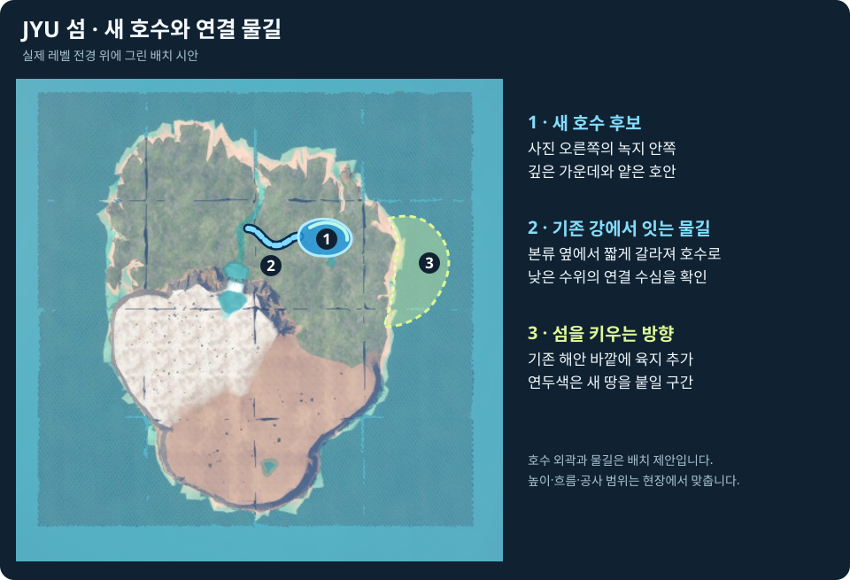
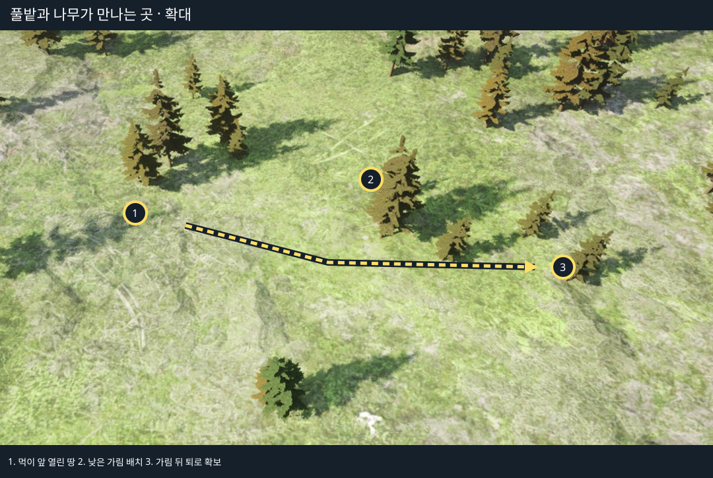
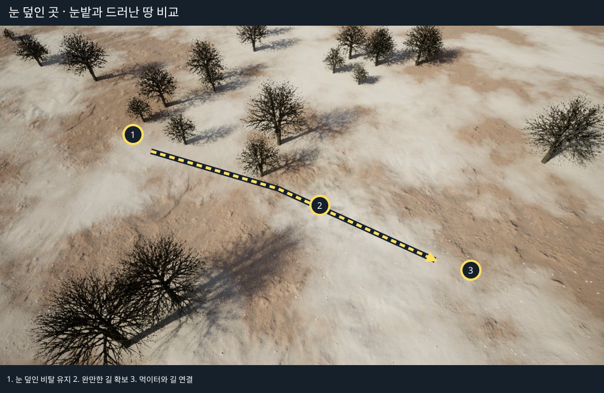
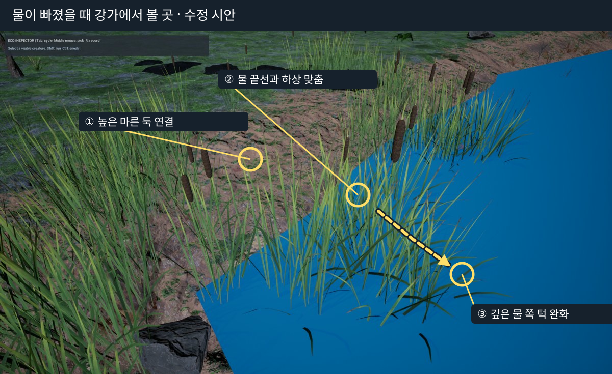
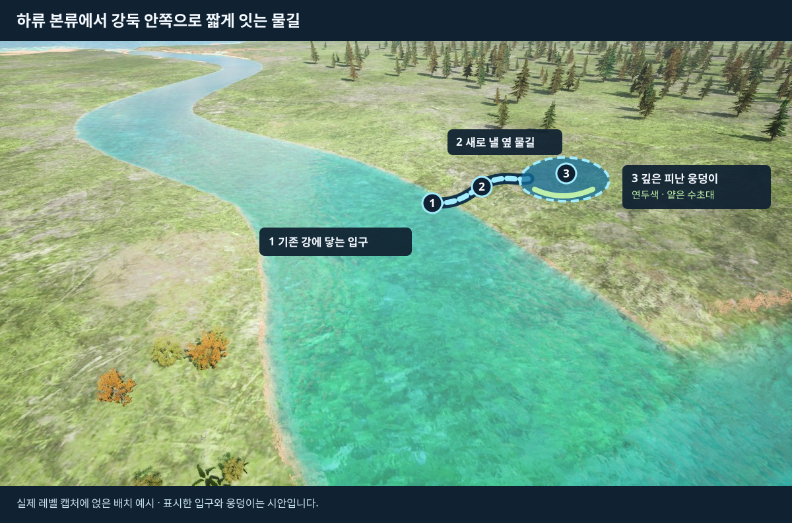

# JYU 섬 레벨 수정 요청서

**해찬 님, 섬의 육지 면적을 늘리는 시안을 작업용 복사본에 만들어 주세요.** 기존 풀밭 쪽 생활권에서 외곽으로 이어지는 해안을 바다 쪽으로 밀어 새 육지를 붙이는 안입니다. 호수와 물길은 아래 위에서 본 배치안을 기준으로 잡아 주세요.

기준 맵은 `/Game/JYU/Maps/LV_JYU_IslandEcosystemRefreshed`, 구현 기준은 `2b0110d6`입니다. 첫 시안은 기존 먹이의 총량·재생과 시작 개체 배치를 유지합니다. 좌표는 Unreal 월드 좌표(cm)입니다.

**그림대로 배치할 첫 시안.** 사진 오른쪽 녹지 안쪽에 호수를 놓고, 사진 가운데 보이는 강에서 짧은 가지 물길을 내서 연결해 주세요. 호수의 가운데는 깊게 두고, 한쪽 가장자리에는 얕은 수초대를 만듭니다. 연두색으로 표시한 쪽은 현재 해안 바깥에 새 땅을 붙이는 구간입니다. 그림의 호수 위치·모양과 물길은 제안입니다. 시안에서는 호수 바닥과 기존 강바닥의 높이를 맞추고, 낮은 수위에서도 연결부에 물이 남는지 확인합니다.

## 후속 · 숲 가장자리와 눈밭

### 숲 가장자리에 숨었다 빠져나올 자리를 만들어 주세요

기존 풀밭과 나무 경계에서 열린 먹이터 옆에 낮은 수풀이나 바위를 띄엄띄엄 놓고, 가림 뒤로 빠지는 틈을 양쪽에 남겨 주세요. 먹이에서 가림까지 가는 길과 큰 동물이 통과하는 길이 겹치는 곳은 나무를 옆으로 빼 주세요. 같은 시작 조건에서 작은 동물이 먹이에서 가림으로 실제 이동하는지, 큰 동물의 이동은 유지되는지 확인합니다. 고원에서는 이 원칙을 검독수리의 접근·착지 공간과 피식자의 퇴로에 적용합니다. [고원과 시야 차폐 대조](../Architecture/FAUNA_HABITAT_CAPACITY_20261113.md#고원-바위의-시야와-퇴로)

### 눈밭에서 먹이터까지 이어지는 완만한 길을 남겨 주세요

이미 넓힌 설원 구역 안에서, 기존 먹이터까지 이어지는 눈이 덜 덮인 완만한 길 한 줄을 확보해 주세요. 길을 끊는 장식이나 급한 턱만 정리하고 눈 덮인 비탈은 선택지로 남깁니다. 사슴이 기존 출발 위치에서 먹이터까지 가서 실제로 먹고 돌아오는지 확인합니다. 눈 외형과 실제 이동 비용은 별도 시스템 항목이며, 이번 시안은 지면과 배치를 손봅니다. 설원의 기존 구역 확장으로 먹이 접근이 늘어난 기록을 근거로, 섬 전체 확대는 같은 병목이 계속 남을 때 비교합니다. [설원 확장과 먹이 접근 기록](../Architecture/FAUNA_HABITAT_CAPACITY_20261113.md#섬의-물리-구조와-후속-레벨-작업)

## 별도 시안 · 물이 빠져도 피할 수 있는 강가

임시 퇴수 시험에서 사용한 **하류 Drift의 강변**을 시작점으로 잡아 주세요. 얕은 곳과 깊은 쪽 사이를 막는 하상 턱을 완만하게 이어 주고, 밍크가 낮은 출구를 쓰기 어려울 때 올라갈 수 있는 더 높은 마른 둑 쪽 출구를 연결해 주세요. 기존 WaterBody와 화면상 물 끝선은 그 하상에 맞춰 생태 담당과 조정합니다. 이전 임시 시험은 여섯 지점에서 화면과 생태 수역의 전환을 맞췄습니다. 이번 완료 기준은 치어가 실제로 깊은 쪽으로 이동하고 밍크가 대체 출구로 올라와 마른 지면에 도달하는 것입니다. [하류 검증 기록](JYU_ISLAND_ECOSYSTEM_HANDOFF_20261105.md#2026-11-14-로컬-섬-마무리)

## 확장 시안 · 땅이 좁거나 물길이 모자랄 때

### 1. 섬 해안선을 바깥으로 밀어 새 육지를 붙여 주세요

현재 섬 복사본에서 **풀밭 생활권이 있는 쪽의 외곽 해안**을 바다 쪽으로 밀고, 현재 해안선 바깥에 새 육지를 붙여 주세요. 기존 풀밭과 새 육지 사이에는 완만한 연결부를 두고, 새 땅에는 넓은 풀밭과 숲 가장자리를 함께 조성합니다. 제출 화면에는 **현재 해안선과 변경 해안선**을 겹쳐 그리고 새로 생긴 육지 면적(㎡)과 기존 땅에서 이어지는 입구를 표시합니다. 이 안은 섬 자체의 가로·세로 또는 육지 면적을 늘리는 작업입니다.

정확한 확장 면적과 외곽선은 시안에서 결정합니다. 에디터에서 읽은 약 3.0 × 3.0km는 바다와 여백을 포함한 지형 액터 범위입니다. 면적 비교에는 해안선 안쪽의 실제 육지만 집계합니다.

**완료 기준**은 넓힌 지형이 기존 길에 연결되고, 같은 먹이 예산에서 성체와 어린 개체가 실제로 먹이터에 도착해 돌아오는 것입니다. 현재 기록에서 섬 전체의 면적 부족이 확정된 것은 아니므로, 통로만 고친 복사본과 땅까지 넓힌 복사본을 비교합니다. [육지 규모와 통로 기록](../Architecture/FAUNA_HABITAT_CAPACITY_20261113.md#섬의-물리-구조와-후속-레벨-작업)

### 2. 물길이 부족하면 하류 본류에서 짧은 옆 물길을 내 주세요

실제 하류 캡처의 오른쪽 강둑에 새 물길의 모양을 그렸습니다. 기존 강에서 짧게 갈라져 강둑 안쪽의 깊은 웅덩이로 들어가는 안입니다. 사진의 표시 위치는 배치 예시입니다. 아래 먹이터 간 연결 상태는 기존 실측 기록에서 가져왔습니다.

- **Drift–QuietMargin 약 72m**는 조사한 몸 크기에서 물이 이어졌습니다. 이 구간은 기존 물길을 사용합니다.
- **Drift–SlowShelf 약 86m**의 직선에는 수주가 없는 구간이 있었고, 격자에서는 돌아가는 물길이 잡혔습니다. 우회가 실제 유영에 충분한지 생태 담당이 확인합니다. 저수위에서 기존 우회로를 쓸 수 없을 때 이 구간에 짧은 연결 수로를 만드는 안을 적용합니다.
- **Drift 옆 물길 추가 시안**은 흐름이 느린 피난처를 만드는 안입니다. 본류의 깊게 남는 물에서 짧게 빠져 깊은 웅덩이로 이어 주세요. 얕은 수초 선반과 마른 둑으로 오르는 비탈을 양쪽에 둡니다. 그림의 점선은 제안이며 기존 물길의 단절 실측선은 아닙니다. [하류 수중 경로 실측](../Architecture/FAUNA_HABITAT_CAPACITY_20261113.md#하류-먹이터-사이의-수중-연결)

**완료 기준**은 평수와 저수위에서 치어가 본류와 웅덩이 사이를 실제로 이동하고, 밍크가 물에서 나와 마른 땅으로 돌아오는 것입니다. 같은 위치에서 화면의 물 끝선, 충돌 바닥과 동물이 수영하는 범위를 맞춥니다. [하류 수면·수역 시험](JYU_ISLAND_ECOSYSTEM_HANDOFF_20261105.md#2026-11-14-로컬-섬-마무리)

### 3. 새 호수와 기존 호수 활용안

**기존 호수를 활용하는 비교안은 풀밭과 하류 사이의 `WaterBodyLake` 주변**입니다. 기존 호안 캡처 기준점은 `(74202, 45189, -4265)`입니다. 이 좌표는 호수 중심이나 새 제방의 위치가 아니라 에디터에서 해당 물가를 찾는 기준입니다. 새 호수 시안의 비교안으로 이 호수에서 하류로 이어지는 짧은 연결과 완만한 호안을 사용할 수 있습니다.

호수는 **가운데 깊은 물, 가장자리 일부의 얕은 수초대, 마른 땅까지 천천히 올라가는 호안**을 함께 둡니다. 하류와 연결하는 쪽은 낮은 수위에서도 남는 물길을 두고, 반대편은 말·물소가 호수 때문에 길게 돌아가지 않도록 기존 땅길을 이어 주세요. 고원 기존 호수와 Oasis는 각각 현재 자리를 유지하는 안을 기준으로 삼습니다. 높은 곳에 있는 호수를 낮은 하류와 곧장 잇는 안은 이번 시안에 넣지 않습니다.

**완료 기준**은 낮은 수위에도 깊은 물과 얕은 가장자리가 함께 남고, 물고기가 호수와 하류 사이를 실제로 오가는 것입니다. 지상 동물이 호수 가장자리에 막혀 되돌아가지 않고 기존 먹이터까지 갈 수 있는지도 확인합니다. 새 호수 좌표와 크기는 기존 호안 활용 시안과 비교해 정합니다.

## 첫 시안 공유 방법

수정한 복사 맵과 전후 화면을 공유해 주세요. 화면에는 **이어 붙인 구간, 옮긴 장식, 새로 연결한 입구·출구**를 표시합니다. 수정한 액터와 경계 좌표를 남겨 생태 담당이 같은 위치에서 실제 이동·섭취·복귀를 재현할 수 있게 합니다. 그림의 원과 점선은 변경 시안이며 확정된 이동 경로는 플레이 결과로 확인합니다.

## 생태 담당과 함께 볼 후속 작업

레벨 담당은 경로·수면·하상·가림과 자원 위치를 작성합니다. 생태 담당은 아래 실행 규칙과 실제 지급을 확인합니다. 두 쪽의 변경이 겹치면 배치와 규칙을 따로 바꾼 비교를 먼저 남깁니다.

### 코드에 고정된 규칙과 바꿀 방향

| 지금 어떤 일이 생기나요? | 다음에 어떻게 바꾸나요? | 비교할 장면 |
| --- | --- | --- |
| 기본 먹이 탐색과 섭취의 일부가 에너지 **90%**를 공통 기준으로 봅니다. 종별 식사 시작·종료·휴식 설정은 이미 있고, 별도 옵션에서 시험했습니다. | **P0.** 기존 종별 설정을 사용해 탐색, 실제 섭취, 식후 행동이 같은 기준을 보도록 검증합니다. 기본값을 바꾸기 전에 말·물소·산토끼·잉어를 비교합니다. | 먹이량을 고정하고 짧은 풀·키 큰 풀, 안전한 곳·노출된 곳의 실제 섭취량과 간격을 비교합니다. 말의 풀 높이 실험과 유럽산토끼의 현장 자료는 비교 변수의 근거로 씁니다. [말 방목 실험](https://www.sciencedirect.com/science/article/pii/S0168159104001741) · [산토끼 현장 추적](https://onlinelibrary.wiley.com/doi/full/10.1002/ece3.4613) |
| 포식 후보는 종별 목록에서 고릅니다. 일부 기본 규칙의 체급·성숙도 값도 코드에 들어 있습니다. 허용된 조합에서는 몸집과 상황이 결과를 바꿀 수 있습니다. | **P1.** 몸체가 감당할 수 있는 접촉 조건은 검사하고, 실제로 시도할지는 허기·부상·동족·새끼 보호·가림·퇴로에 따라 평가합니다. 종별 목록에서 드문 조합을 다룰 때는 기존 결과를 기준으로 한 조합씩 대조합니다. | 같은 상대를 두고 체급·가림·퇴로를 하나씩 바꿉니다. 늑대–표범은 기존 R9 사례를 비교에 남깁니다. 표범 현장 먹이 자료에서 확인된 몸집과 방어 조건을 참고하되 종별 확률이나 체급 상한으로 그대로 옮기지 않습니다. [표범 먹이 선택 조사](https://ibs.bialowieza.pl/publications/1596.pdf) |
| 수역이 겹치면 우선순위를 보고, 같을 때는 액터 이름순으로 선택합니다. 얕은 곳에 걸린 물고기의 회피는 약 18cm 근거리 검사입니다. | **P0.** 겹치는 수역의 소속과 경계를 레벨에서 명시합니다. 피난 방향은 종·성장 단계별 통과 수심과 실제 연결을 기준으로 비교합니다. | 액터 이름을 바꿔도 의도한 수역이 선택되는지 확인합니다. 같은 최저 수위에서 빠른 퇴수와 느린 퇴수를 비교하고, 어떤 개체가 피난에 성공하거나 남는지 기록합니다. [하천 퇴수 현장 실험](https://webapps.usgs.gov/mrgescp/documents/fishes-move-to-transient-local-refuges-not-persistent-landscape-refuges-during-river-drying-experiment) |

[섭식 지급 코드](../../Source/AdaptiveEcosystem/Creature/Runtime/EcoFauna.cpp) · [종별 프로필](../../Source/AdaptiveEcosystem/Creature/Runtime/EcoFauna.h) · [육상 판단](../../Source/AdaptiveEcosystem/Creature/Runtime/EcoFaunaMovement.cpp) · [수역 선택](../../Source/AdaptiveEcosystem/Creature/Runtime/EcoCreatureMovement.cpp) · [퇴수 회피](../../Source/AdaptiveEcosystem/Creature/Runtime/EcoFaunaWaterMovement.cpp)

### 육지에서 비교할 환경 차이

- **큰뿔양·검독수리.** 고원의 먹이 주변에 실제로 도망쳐 오를 수 있는 바위 지형을 두고 평탄한 우회로와 비교합니다. 검독수리는 월드 높이와 지표에서 떨어진 높이를 따로 기록해 능선에서 선회·착지할 공간을 봅니다. 바람에 따라 상승이 달라지는 기능은 후속 후보입니다. [큰뿔양 현장 추적](https://doi.org/10.1093/jmammal/gyab035) · [검독수리 비행 고도 연구](https://pubs.usgs.gov/publication/70204641)
- **사슴·늑대와 눈 덮인 길.** 눈이 덮인 경사와 덜 덮인 우회로에서 이동 시간·에너지·도주 성공·먹이 접근을 비교합니다. 후속 적설 기능에서는 내리는 눈과 땅에 쌓인 눈, 발이 빠지는 정도와 먹이가 묻히는 정도를 구분합니다. 현장 연구에서 눈의 깊이·밀도·단단함은 종별 발 빠짐에 다르게 작용했습니다. [적설과 포식자·피식자 현장 측정](https://doi.org/10.1111/oik.09925)
- **사슴·산토끼와 숲 가장자리.** 먹이까지의 거리와 먹이 품질을 고정하고, 가림과 도망갈 방향을 바꿉니다. 수풀은 피식자를 숨길 수도 있고 포식자의 접근을 가릴 수도 있어, 위협 감지와 섭식을 같은 장면에서 봅니다. [노새사슴의 숲 경계 섭식 조사](https://www.esf.edu/biology/faculty/documents/Altendorfetal2001deerpumasIdaho.pdf)

- **P0 · 종별 식사 주기.** 포만 직전 격자 식생 과다 차감은 수정됐습니다. 끼니 옵션은 산토끼의 관측 간격을 늘렸고 잉어는 줄였습니다. 말·물소도 결과가 달라 공통 기본 적용은 보류했습니다. 네 종부터 실제 지급량·식사 사이 간격·저에너지 체류·남은 재고를 대조합니다. 방목·식후 휴식, 사체 선점·복귀, 수륙 왕복과 섭식 애니메이션을 실제 지급과 구분합니다. [끼니 대조](../Architecture/FAUNA_HABITAT_CAPACITY_20261113.md#팀-피드백의-과섭식-점검)
- **P0 · 퇴수와 산란 이후.** 현재 걸렸을 때 가까운 방향으로 후퇴합니다. 깊은 곳까지의 피난·고립 지속시간·재침수 회복이 후속입니다. 같은 최고·최저 수위에서 물이 빠지는 속도만 바꿔 확인합니다. 산란 기질과 침수 이력을 추가로 검토하고, 부화 뒤 첫 먹이와 성장까지 추적합니다.
- **P1 · 식생·날씨·수질.** 먹을 수 있는 잎·새순, 실제 가림, 그늘을 따로 확인합니다. 열매·씨앗·뿌리·저서 및 유입 곤충은 기존 예산 내 유한 자원으로 대조합니다. 같은 누적 강우에서 간격과 그친 뒤 회복을 비교합니다. 현재 수온은 수역 설정값이며 용존산소·탁도는 입력이 확인되지 않았습니다. 시간에 따라 변하는 수온, 저산소 노출과 피난, 탁도에 따른 시야를 각각 검증합니다.
- **P1 · 경쟁·성장·이주·플레이어.** 늑대–표범 같은 드문 충돌을 비교 장면에 두고 허기·부상·동족·새끼 보호·퇴로를 각각 평가합니다. 어린 개체의 첫 섭식과 성장, 이주 뒤 섭취·정착·복귀, 정상 플레이어 입력에서의 발소리와 사체 전달을 확인합니다. 후보를 합친 뒤에는 같은 조건의 30·60게임분, 저장·복원, 전용 서버에서 종별 사망 원인·자원 고갈과 회복을 함께 검증합니다.
- **P2 · 질병·기생충·수분 대사.** 최신 섬에서 종별 완성 기능으로 확인되지 않았습니다. 먹이·피난·번식의 회귀를 확보한 뒤 어떤 종의 어떤 문제를 해결할지 정합니다.

[수변 설계 근거](../Architecture/FAUNA_HABITAT_CAPACITY_20261113.md#수변-구현-우선순위와-대조-시험) · [검증 원본과 복원](LOCAL_TEST_EVIDENCE.md)
