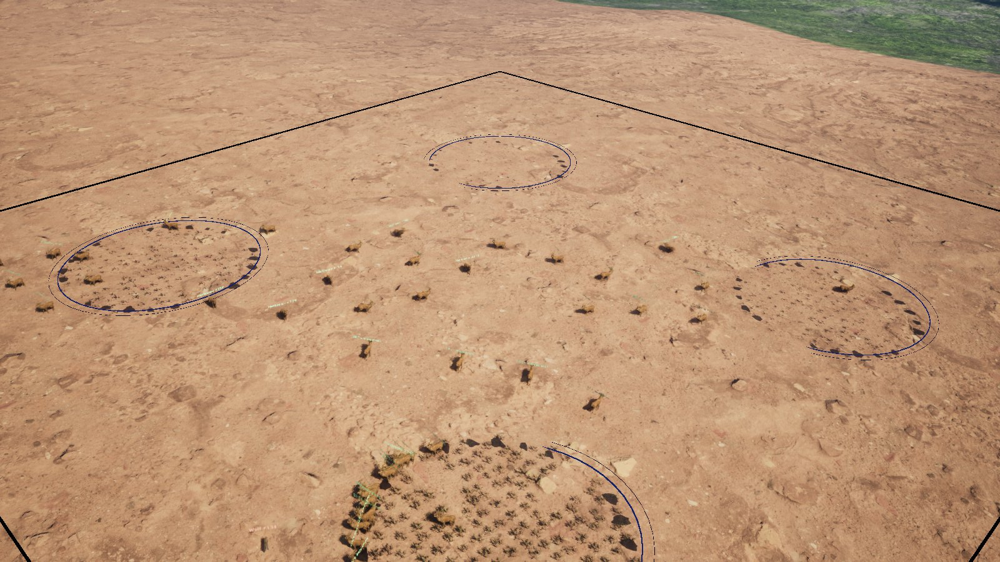
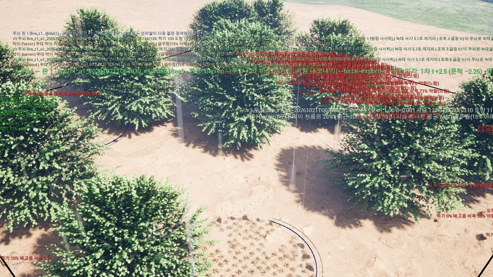
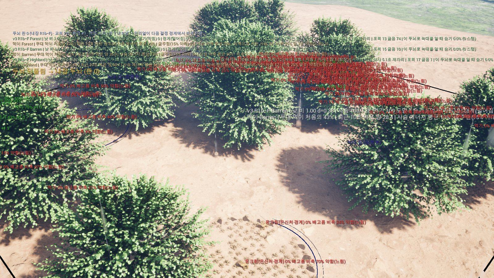

# 실시간 두뇌 교체 — 레벨이 환경을 바꾸면 Play 를 멈추지 않고 새 두뇌를 들이는 자동 고리 (2026-10-21)

사용자 말(10-20·10-21): '게임 중 실시간 두뇌 교체를 이어서 하자. … 환경이 변하는 규칙은 레벨(팀) 작업이라 우리가 만들지 않는다. 우리는 레벨에서 바뀐 환경에
맞춰 게임 중에 두뇌가 바뀌게만 한다.' 사람 결정 10-21: 관문 '포만 없는 세계 1차', 한 바퀴 '빠른 판 10~15분', 두뇌 '관측 21로 올려 배움'
(`AdaptiveEcosystem/Docs/RL_Policy/RL_V2_PLAN.md` 10-20 (17)·10-21 (18)).

파일: 도구 `live.py`, 관문 `LIVE_GATE.md`, 예비 측정 `pilot/`, 시연 `demo/`, 주고받기 약속 `AdaptiveEcosystem/Docs/RL_Policy/LIVE_ADAPT_SPEC.md`.

> **10-24 (7) 지금 기준 — 쫓김 '사건' 하나를 한 번만 센다** (사람 결정 "'쫓김 사건' 단위로 셈"): 사슴이 은신처에 들어갔다가 몇 초 만에 다시 뛰고 또
> 숨으면, 옛 셈(도망 하나하나)은 그걸 '숨음 두 번'으로 세어 숨음 비율이 부풀 수 있었다(R7 결과를 본 뒤 알게 된 것 — `results/v3/r7/gr_split.md`).
> 이제는 같은 사슴의 이어진 도망(은신처로 끝났으면 10 초 안, 그 밖이면 5 초 안에 다시 뜀)을 **한 사건**으로 묶어 그 사건이 마지막에 숨었나·잡혔나로 센다.
> 1차 = 쫓긴 사건 가운데 숨은 사건 몫(사건 숨음 비율)이 유의하게 큼, GH = 쫓긴 사건 가운데 잡힌 사건 몫이 늘지 않음, 새 지킴 GE = 사건 수가 늘지 않음
> ('5 초 안 다시 뛰기' GR 자리). 옛 도망 단위 숨음·잡힘 비율과 쫓긴 시간은 보고만 한다. 정의는 `LIVE_GATE.md` 5-1 '쫓김 사건'·변경 기록 (7),
> 코드는 `env_v2/world.py` '쫓김 사건'(`flight_stats` 의 `episode`). 판정 실행기는 C++ 평가기(`ceval`)다 — 같은 날 사건 셈을 C++ 도망 기록에 옮겨
> 파이썬과 `flight.episode` 까지 세계 기록이 정확히 같다(아래 7절, 옮기기 전 잠깐 파이썬이었다). 게임 화면도 '쫓긴 사건 중 숨음 a% · 잡힘 b%' 로 센다.
> 예: 지금 두뇌 route0 은 같은 세계 60 개에서 숨음 비율이 도망 단위 13.0 % · 사건 단위 11.9 % 였다(은신처 뒤 10 초 안 다시 뛴 203 번이 묶임). 이 기준으로 돌린 판은 아직 없다.

> **10-21 (3) 교체 기준을 바꿨다** (사용자 '잘 안 잡히는 두뇌가 아니라 … 도망가는 시간이 더 짧은 사슴이 똑똑한 걸로'): 관문 1차는 이제 포만 없는 세계에서
> **스스로 벗어난 도망(은신처에 숨거나·나무 줄기·바위가 늑대 눈길을 가리거나·늑대 시야 밖으로 빠져 쫓기를 끝낸 도망)의 '쫓긴 시간'이 유의하게 짧은가**이다
> (쫓긴 시간 = 도망을 시작해서 늑대가 이 사슴을 마지막으로 표적으로 둔 순간까지 — 늑대가 놓친 뒤에도 40 m 까지 이어지는 세계 규칙의 달리기는 넣지 않는다).
> 잡힘·도망 횟수·달린 시간·잡혀 끝난 도망·게임 세계 쫓긴 시간은 '나빠지지 않음' 지킴이다(`LIVE_GATE.md` 5절·변경 기록 (3)). 아래 1·3절의 '진짜 관문 판'은 바꾸기 전
> 기준(잡힘)의 판정이다. 이 기준의 크기는 예비 측정 뒤 정하고, 그 전에는 코드가 실제 폴더에서 판·감시를 막는다(`LIVE.flight_sizes_confirmed` 거짓). 그 기준으로는 아직 판을 돌리지 않았다.

> **10-21 (4) 판을 빠르게** (사용자 '중간에 미리 판정'·'지금 두뇌 시험 재사용'): 후보 판정은 N 판정 시드 앞 절반부터 돌리고 한 번 본다. 후보가 나아지는 쪽도
> 아니면(짝 t ≥ 0) 곧바로 기각하고 뒤 절반·게임 세계를 돌리지 않는다. 통과는 늘 끝까지(N 전체·게임 세계·끼임) 본 뒤에만 한다 — 앞 절반만 보고 통과시키면
> 뒤 절반에서 더 잡히거나 은신처 안에서 잡혀도 놓쳐 관문이 느슨해지므로(같은 날 검토), '분명히 나았으면 곧바로 통과'는 끄고 통과 문턱은 옛것(1.990)
> 그대로다(`LIVE_GATE.md` 5-3·변경 기록 (4)). 같은 환경에서 같은 지금
> 두뇌를 이미 쟀으면 그 판정을 다시 쓴다(`<root>/live/cache/`, 상태 줄 '지금 두뇌 시험: 저장된 결과 다시 씀'). 판정 일은 모두 `live.eval_runner` 를
> 지난다(`LIVE.evaluator` — 네이티브 판정기를 끼울 자리). 시점·기각 경계는 예비 측정 뒤 확정한다.

> **10-23 (6) 교체 기준을 다시 바꿨다** (사람 결정 '전체 사냥률보다 사슴 하나가 늑대에게 쫓겼을 때 잡히는지 아니면 살아서 은신처에 잘 숨는지 … 비율로 판정'):
> 관문 1차는 이제 포만 없는 세계에서 **늑대에게 쫓긴 도망 가운데 은신처에 들어 끝나고 그 뒤 10 초(75 스텝) 안에 잡히지 않은 몫(숨음 비율)이 유의하게 큰가**이다
> (시드마다 지역 셋 합, 짝 t ≥ +1.990 — 쫓긴 시간 때의 문턱에서 부호만 뒤집음, 중간 판정은 앞 절반 짝 t ≤ 0 이면 기각). 새 지킴 GH = 쫓긴 도망 가운데 잡힌 몫이
> 유의하게 늘지 않음. 쫓긴 시간은 판정에서 빼고 보고만 한다. 판정 실행기는 C++ 평가기(`ceval`)다 — 10 초 지켜보기를 같은 날 C++ 도망 기록에 옮겨
> 파이썬과 `flight.hide` 까지 세계 기록이 정확히 같다(아래 7절, 옮기기 전 잠깐 파이썬이었다). 예비 근거(도망길 m1): 쫓긴 도망 가운데 잡힘 늘 RUN 9.5 %·늘 SHELTER 9.5 % 로 같고,
> 은신처 끝 12.7 % → 21.2 % 로 크게 바뀐다. 지금 두뇌는 은신처 끝 도망 뒤 10 초 안에 잡힌 것이 0 이다(숨음 비율 = 은신처 끝 몫, 약 13 %). 정의·까닭·
> 크기는 `LIVE_GATE.md` 5절·5-1·변경 기록 (6) — 크기는 예비 측정 뒤 확정(실제 폴더 잠금 그대로), 이 기준으로 돌린 판은 아직 없다.

## 1. 결론 먼저

- **고리는 끝까지 자동으로 돈다.** 레벨이 나무를 놓고 비를 내리면 → 언리얼이 다음 결정 스텝(0.13 초 안)에 지역 세계에 넣고 → 3 초 뒤 스냅숏을 쓰고 →
  파이썬 감시가 3 초 안에 집어 늑대 포만 없는 세계에서 지금 두뇌를 이어 배우고 → 관문을 넘으면 두뇌 파일을 쓰고 → 언리얼이 Play 를 멈추지 않고 다음 결정 스텝에서
  바꿔 끼우며 화면에 판 번호를 알린다. `eco.V3Brain.Rollback` 으로 되돌린다.
- **진짜 관문 판은 기각됐다 — 새 두뇌가 더 낫지 않았기 때문이다.** 메마른 땅(Barren)에 나무 0 → 20 그루 + 비를 넣은 환경에서 2M 이어 배운 두뇌는
  포만 없는 세계 4 분 잡힘이 13.96% 대 지금 13.68%(t +1.15, 문턱 −1.99)였다. 같은 두뇌(가중치까지 같다)가 예비 측정 시드에서는 −0.63 %p 였으니 둘을 합치면 거의 0 이다.
  짧게 더 배워도 이 환경에서 나아지지 않았고, 관문이 그 두뇌를 막았다. 게임 두뇌는 R1b-F 그대로다.
- **바꿔 끼우는 장면은 시험 폴더에서 보였다.** 관문을 무시하는 시험 내보내기(`--force-export`, 작은 크기, 실제 폴더가 아닌 `Saved/EcoAdapt_test`)로 같은 바꿈을 돌리자
  149.5 초에 새 두뇌(판 1)가 들어오고 480 초에 되돌아갔다. 화면 알림에 '시험 내보내기 — 관문 기각' 이 그대로 찍힌다(아래 4절 그림).
- **한 바퀴 약 16 분**(진짜 관문 크기, 게임과 함께 돌 때 — 언리얼을 끈 PC 어림 13 분). 사용자가 정한 '10~15 분' 보다 조금 길다.

## 2. 쓰는 법

`herbivore_rl/` 에서 파이썬 감시를 먼저 켠다(`PYTHONUTF8=1`):

```
python results/v3/live/live.py watch
```

언리얼(편집기 PIE, 넷 모드 오프라인 — 또는 독립 실행):
1. Play 전에 콘솔 `eco.IntegratedPolicyVersion 3`, `eco.IntegratedV3.AutoAdapt 1` (독립 실행은 `-EcoIntegratedV3 -EcoV3AutoAdapt`). AutoAdapt 는 Play 시작 때 읽는다.
2. Play. 왼쪽 위에 상태 줄 `두뇌 판 0 (내장 R1b-F) · 교체 0번 · 환경 #0 · 적응 고리 | …` 이 보인다.
3. 레벨을 바꾼다 — 레벨 팀 몫이다. 시험할 때는:
   - 나무: 콘솔 `eco.IntegratedV3.Test.AddTrees Barren 20` (명령 `-run=EcoV3PlaceTreesCommandlet` 과 같은 나무 + 줄기 막이 짝을 놓는 시험용 대역, 단독 실행만).
     레벨에 꼬리표 `EcoV3Trunk` 줄기 막이가 있는 나무를 놓으면 무엇이든 알아챈다.
   - 날씨: `eco.IntegratedV3.WeatherBarren rain:1` (우리 지역 날씨) 또는 팀 `eco.Environment.Rain Barren 1`(팀 지역 환경 — 눈은 팀에 없다).
4. 화면: `환경 바뀜 #1 — Barren: 나무 0→20 · Barren: 맑음→비` → 3 초 뒤 `스냅숏 #1 내보냄 → 파이썬 학습 대기` → 상태 줄이 파이썬 진행(`학습 중 1.2M/2M …`, `후보 판정 …`)을 보인다 →
   통과면 `새 두뇌 — 판 1 · … · 환경 · 관문 …`, 기각이면 상태 줄 `기각 — 게임 두뇌 그대로 (…)`.
5. 되돌리기 `eco.V3Brain.Rollback`, 쌓개 보기 `eco.V3Brain.History`, 환경 보기 `eco.IntegratedV3.EnvInfo`. 바꿈 순간 화면 찍기 `eco.V3Brain.NoticeShot 1`(`Saved/EcoAdapt/shots`).

- 적응 고리 Play 는 늘 내장 두뇌(판 0)에서 시작하고 Play 마다 번호(`play_id`)가 새로 붙는다. 앞 Play 에서 시작한 판이 늦게 끝나 낸 두뇌는 받지 않는다.
- 판 크기·규칙은 `LIVE_GATE.md`. 시험 크기(`--steps` 등)·`--force-export` 는 실제 폴더(`Saved/EcoAdapt`)에서 받지 않는다 — `--root` 로 다른 폴더를 줄 때만.
- 시연에 쓴 독립 실행 명령(창 1600×900, 세션 20004, 60 초에 나무·비, 480 초 되돌리기, 600 초 끝, 위에서 Barren 을 내려다보는 촬영):

```
UnrealEditor.exe <uproject> /Game/Map/LV_Ecosystem_IntegrationTest -game -windowed -ResX=1600 -ResY=900 -EcoIntegratedV3 -EcoV3DeerPerRegion=128 -EcoV3Seed=20004
  -EcoV3AutoAdapt -EcoV3TestAt=60 "-EcoV3TestCmd=eco.IntegratedV3.Test.AddTrees Barren 20 1; eco.IntegratedV3.WeatherBarren rain:1"
  -EcoV3TestAt=480 "-EcoV3TestCmd=eco.V3Brain.Rollback" -EcoV3TestAt=600 "-EcoV3TestCmd=quit" "-ExecCmds=eco.V3Brain.NoticeShot 1, t.MaxFPS 30"
  -EcoV3Film=live_demo "-EcoV3FilmShots=Barren,wide,0,5,100000,,,,1" -EcoV3FilmUI -EcoV3FilmNoQuit -EcoV3FilmEvery=300
```
  (시험 폴더로 돌릴 때는 `-EcoV3AutoSnapshotOut=<폴더>/snapshots -EcoV3BrainWatch=<폴더>/brains` 와 `eco.V3Brain.StatusFile <폴더>/status.json`.)

## 3. 진짜 관문 판 — 시도 1 (`demo/real_a1/`)

- 게임: 위 명령(실제 폴더), 06:19 감시 시작. 60.0 초 `환경 바뀜 #1`(Barren 나무 0→20, 새 줄기 안 사슴 2 마리 밀어냄, 맑음→비 1.00) → 63.1 초 자동 스냅숏
  `eco_v3_snapshot_s20004_t473_e1.json` → 3 초 뒤 파이썬 시도 1 시작.
- 판(관문 크기 그대로): 변환 3 초 → 학습 2M(순수 253 초) ‖ 지금 두뇌 판정 563 초 → 후보 판정 389 초 → 관문 → 합 956 초(16 분). 앞 9 분은 게임과 함께 돌았다.
- 시작 두뇌 = R1b-F + 0 열(`ckpt/v3/v3_r1_g995_s3_obs21zero.zip`), 후보 가중치 sha `0594ac24…` — 예비 측정의 s0 2M 후보와 같다(학습이 결정적).

| 기준 | 후보 | 지금 두뇌 | 차이 (t) | 통과 |
|---|---|---|---|---|
| R 재현 확인 | 건너뜀 (중간 변화 — 환경 #1) | | | — |
| **P1 포만 없는 세계 4 분 잡힘** (시드 80) | 13.96% | 13.68% | +0.28 %p (t +1.15, 문턱 −1.990) | **아니오** |
| GN 포만 없는 세계 굶음 · 산 | 0.02% · 86.02% | 0.02% · 86.30% | +0.00 (+0.26) · −0.28 (−1.16) | 예 · 예 |
| GG 게임 세계 8 분 잡힘 · 굶음 · 산 (시드 40) | 11.56% · 26.60% · 61.85% | 11.65% · 25.74% · 62.60% | −0.10 (−0.96) · +0.85 (+1.20) · −0.76 (−1.08) | 예 · 예 · 예 |
| G4 은신처 안 잡힘 | 0 · 0 | | | 예 |
| G5 끼임 (15 세계) | 사슴 0 · 늑대 0 | 사슴 0 · 늑대 0 | | 예 |
| G6 악용 | 은신처 안 7.07% (지금 6.56%), 먹기 90.3 · 도망 7.4 · 숨기 2.3% | | | 예 |

- **기각.** 두뇌 파일을 쓰지 않았고 게임 두뇌는 그대로다. 상태 줄: `기각 — 게임 두뇌 그대로 (1차 t +1.1 (문턱 −1.99))`.
- 같은 후보가 예비 시드(34900~34939, 시드 40)에서 −0.63 %p(t −1.85), 판정 시드(35000~35079, 시드 80)에서 +0.28 %p(t +1.15)였다. 120 시드를 합치면 약 −0.02 %p 다.
  예비 측정의 '후보 넷 모두 덜 잡힘'은 대부분 우연이었다고 본다. 늑대 포만을 꺼서 두뇌가 결과를 바꿀 여지를 늘려도, 2M 이어 배우기는 이 바꿈에서 잡힘을 줄이지 못했다
  (R4·R5·적응 고리 첫 바퀴와 같은 결론).

## 4. 바꿔 끼우는 장면 — 시험 내보내기 (`demo/swap_test/`, 판정 아님)

같은 바꿈을 시험 폴더(`Saved/EcoAdapt_test`)에서 작은 크기(학습 0.3M, N 시드 10·G 시드 5 × 900 스텝, 끼임 2)와 `--force-export --skip-check` 로 돌렸다.
관문은 그대로 셈하고(이번에도 기각 — 1차 t +2.51), 결과와 상관없이 두뇌 파일을 낸다. 두뇌 파일의 관문 칸에 '시험 내보내기(--force-export) — 관문 기각 …' 이 적혀 화면에 그대로 뜬다.

| 게임 시각 | 일어난 일 (`demo/swap_test/game_ecov3i.log`) |
|---|---|
| 0.0 초 | `두뇌 시작 | v3_r1_g995_s3_20m@eca97f2e` (내장, 판 0), Play 번호 p20261020T213824_602da0d7 |
| 60.0 초 | `환경 바뀜 #1 | Barren: 나무 0→20 (+20 −0) (밀어냄 사슴 2) | Barren: 날씨 맑음→비 1.00` |
| 63.1 초 | `환경 스냅숏 | …_t473_e1.json | 계기 env_change · 환경 판 #1` → 파이썬 시도 1 (86 초) |
| 149.5 초 | `두뇌 바꿈 | v3_r1_g995_s3_20m@eca97f2e → live_r1_a1_20261021T063930_e1@da618ee9 (관측 21 장애물, 판 1)` + 화면 알림 |
| 480.0 초 | 예약 `eco.V3Brain.Rollback` → `두뇌 바꿈 | … → v3_r1_g995_s3_20m@eca97f2e` + `두뇌 되돌림 → 내장 두뇌 (판 0)` |
| 600 초 | 예약 `quit` |

| 바뀌기 전 (45 초) | 새 두뇌가 들어온 순간 (149.5 초) | 되돌린 순간 (480 초) |
|---|---|---|
|  |  |  |

- 가운데 그림: 나무 20 그루와 빗줄기, 큰 초록 글자 `새 두뇌 — 판 1 · live_r1_a1_… · 환경: Barren 나무 0→20, 비 1.0 · 관문: 시험 내보내기(--force-export) — 관문 기각: 1차 t +2.5 …`,
  맨 위 상태 줄 `두뇌 판 1 (live_r1…@da61) · 교체 1번 · 환경 #1 · 적응 고리 | 판 1 내보냄 — 언리얼이 다음 결정 경계에서 바꿔 끼움`.
- 오른쪽: 주황 글자 `두뇌 되돌림 → 내장 두뇌 (판 0)`, 상태 줄 `두뇌 판 0 (내장 R1b-F) · 교체 2번`.
- 사슴 글자(eco.V3Debug)가 많고, 팀 나무 메시의 잎(지름 약 28 m)이 사슴을 가린다 — 시험 대역이 팀 메시 그대로를 놓기 때문이다(줄기 원판은 0.4 단위로 작다).

## 5. 시연하면서 고친 것

- **촬영이 9 분 만에 게임을 닫았다.** 촬영 감독은 장면 시간을 '프레임 × 1/30 초'로 센다(-benchmark -fps=30 가정). 창 실행이 초당 약 90 프레임이라 1700 초 장면이 9 분에 끝나
  게임을 닫았다(시도 1 은 그 뒤에도 끝까지 돌아 기각). 다시 돌릴 때는 `-EcoV3FilmNoQuit`·`t.MaxFPS 30` 을 주고 끝내기는 예약 `quit` 으로 했다. (촬영 감독 코드는 그대로.)
- **새 Play 가 같은 환경을 만들면 두뇌가 오지 않을 수 있었다.** 언리얼은 다른 Play 번호가 적힌 두뇌를 받지 않는데, 파이썬은 '환경 지문 + 두뇌' 가 같으면 건너뛰었다.
  건너뛰기 열쇠에 Play 번호를 넣었다(`live.pair_key`) — 새 Play 의 스냅숏은 새 판이 되고, 앞 Play 의 판은 그만둔다.

## 6. 한계와 다음

- **이 바꿈에서는 다시 배워도 나아지지 않는다.** 늑대 포만을 끈 세계(사람 결정 10-20)에서도 짧은 이어 배우기의 효과가 0 근처다. 관문이 계속 막으면 게임에서 두뇌가 바뀌는
  일은 드물다(고리가 계획대로 일하는 것이다). 사슴 결정이 결과를 더 바꾸게 하려면 예전 권고(늑대가 짧게 쫓다 포기·쉼, 도망칠 곳을 두뇌가 고름 — `results/v3/adapt/README.md` 5-2)
  같은 세계 규칙이 필요한데, 이것은 사람이 정할 일이다(현실 근거부터 짧게).
- 환경이 바뀐 뒤의 스냅숏은 재현 확인(R)을 건너뛴다 — Play 시작부터의 누적 수를 파이썬이 다시 만들 수 없다. 변환이 모르는 규칙·바뀐 은신처를 거부하는 것이 안전망이다.
- 나무를 더해도 먹이 격자는 그대로다(팀 자원 계약). 파이썬도 스냅숏 먹이 용량을 그대로 써서 둘은 같지만, 새 나무 밑 먹이 줄임은 양쪽 모두 없다.
- 날씨 출처는 우리 지역 날씨 콘솔 변수와 팀 `FRegionEnvironmentState`(비·맑음만)다. 팀 날씨 블루프린트(SHC)는 아직 이 값을 쓰지 않는다.
- 한 바퀴 16 분(게임과 함께). 판정 시드를 줄이면 빨라지지만 작은 차이를 놓친다(`LIVE_GATE.md` 변경 기록부터).
- 개발 빌드 전용(팀 합의 #S1 은 아직 기록 없음).

## 7. 평가기 — 파이썬 세계와 비트 단위로 같다 (10-22)

판정 실행기 `ceval`(게임의 `EcoWorldV3::Step` 을 엔진 없이 돌리는 `AdaptiveEcosystem/Tools/EcoV3Eval`, `ceval.py`)과 파이썬 거울 세계가 이제 **같은 시작 상태에서
끝 비트까지 같다.** 10-21 에는 통계로만 같았다(정확히 같은 세계 2/30) — 파이썬 `World._geometry` 가 동족 무리 중심·분리를 행렬곱으로 더하고 C++ 은 한 마리씩
차례로 더해 끝자리(1e-15)가 달랐고, 그 작은 차이가 수백 스텝 뒤 행동을 갈랐다. `env_v2/world.py` 가 그 두 칸을 C++ 과 같은 차례(`_seq_sum`)로 더하게 바꿨다
(세계 스텝 +2.5~3.6 %).
- 증거 (`ceval.py compare`, 스냅숏 `pilot/eco_v3_snapshot_s20004_t475_e1.json`, 두뇌 `EcoBrains/v3_r1_g995_s3_obs21zero.json`, 시드 34900~34904 × 지역 셋 × 1800 스텝):
  N 15/15·G 15/15 세계 기록이 정확히 같고 지표 23 개의 짝 차이가 모두 0, 1800 스텝 궤적 셋(사슴 자리·방향·에너지·관측·행동, 늑대 자리·표적)에 첫 비트 차이가 없다.
  숲 시야를 켠 세계(`--world-set features.obstacles.foliage.enabled=true` · r 3.0 · block 2.0)도 N 15/15·G 15/15, 궤적 셋 비트 동일.
- 10-23 (`LIVE_GATE.md` 변경 기록 (6)) 숨은 뒤 10 초 지켜보기(`flight.hide`)를 파이썬 도망 기록에 더한 뒤 같은 compare 를 다시 쟀다: N 15/15·G 15/15 세계 기록이
  정확히 같고(지표 짝 차이 모두 0), 궤적 셋 첫 비트 차이 없음, selftest(PCG64·저장소 두뇌 파일) 통과. 그때는 새 칸이 C++ 에 없어 compare 가 `python_only`
  (`flight.hide`)로 적었고 관문 판정 실행기를 잠깐 파이썬으로 돌렸다.
- 10-23 같은 날 (변경 기록 (6) '10-23 덧붙임') 그 칸을 C++ 도망 기록(`EcoWorldV3.h`)·평가기에 옮겼다: 같은 compare N 15/15·G 15/15 가 `flight.hide` 까지 정확히
  같고(`python_only` 없음, 궤적 셋 첫 비트 차이 없음), 숲 시야 켬 시드 34905~34934 × 지역 셋 N 90/90·G 90/90 도 같다(10 초 안 잡힘 N 12·G 1 번이 나오는 판).
  `ceval.HIDE_WATCH` 참, 관문 판정 실행기는 다시 `ceval` 이었다.
- 10-24 (`LIVE_GATE.md` 변경 기록 (7)) 쫓김 사건(`flight.episode`)을 파이썬 도망 기록에 더했다. 그때는 C++ 에 없어 `ceval.EPISODE` 가 거짓이었고 관문 판정
  실행기를 잠깐 파이썬으로 돌렸다(compare 는 `flight.episode` 를 python_only 로 적었다).
- 10-24 같은 날 (변경 기록 (7) '10-24 덧붙임') 그 셈을 C++ 도망 기록(`EcoWorldV3.h`)·평가기에 옮겼다: 같은 compare N 15/15·G 15/15 가 `flight.episode` 까지 정확히
  같고(`python_only` 없음, 궤적 셋 첫 비트 차이 없음), 숲 시야 켬 시드 34905~34934 × 지역 셋 N 90/90·G 90/90 도 같다(사건 시작 N 34,259·G 21,825, 이어진 도망
  N 3,459·G 1,753). `ceval.EPISODE` 참, 관문 판정 실행기는 다시 `ceval` 이다.
- **학습된 두뇌는 그대로다.** 가중치·관측 계약은 바뀌지 않았고, 바뀐 것은 동족 두 칸의 끝자리 셈뿐이다(세계 규칙·분포는 같다). 다만 같은 시드라도 옛 파이썬 판정
  기록과는 세계마다 같지 않을 수 있다 — 판정 저장 열쇠에 `world.py` 바이트가 들어가 옛 저장과 섞이지 않는다.
- 도망길 측정 도구(`results/v3/route/route_rules.py`·`oracle.py`)는 이 저장 열쇠를 쓰지 않고 있는 raw 부분을 건너뛰어 이어 돌리므로, 10-22 부터
  raw·meta 에 같은 셈 길 지문(`code` — 세계 = `live.eval_code_tag('python')`, 측정 = 도구 함수)을 적는다. 지문이 다른(지문 없는 옛 판 포함) 부분은
  이어 돌리거나 g 의 규칙 고르기에 쓰지 않고(`--force` 로 그 부분을 다시 잴 때만), 보고는 부분끼리 다르면 멈추며 세계 지문이 다른 오라클을 판단표에 쓰지 않는다.
  **이 고침 전에 잰 `route/runs/m1`·`m2_f15`·`m2_f30`(과 저장소 `route/m1`)은 옛 행렬곱 합으로 잰 것이다** — 보고는 다시 낼 수 있지만(머리에 적힌다)
  이어 돌리지 말고 새 폴더에서 처음부터 다시 잰다. 세계 규칙은 같지만 같은 시드라도 세계마다 값이 다르다.
- 그래서 compare 의 `--py-seq-kin` 진단(파이썬만 차례 합으로 바꿔 보던 것)은 지웠다. 비트 동일 시험: `tests/test_ceval_v3.py`(궤적·기록 칸 전체),
  `tests/test_env_v2.py::test_kin_sums_follow_cpp_order`(C++ 꼴 스칼라 합과 비트 비교). 옛 커밋 사본과 견주는 비트 동일 시험들은 사본에 같은 두 줄 바꿈을 넣어
  견준다(`tests/kin_seq.py`).
